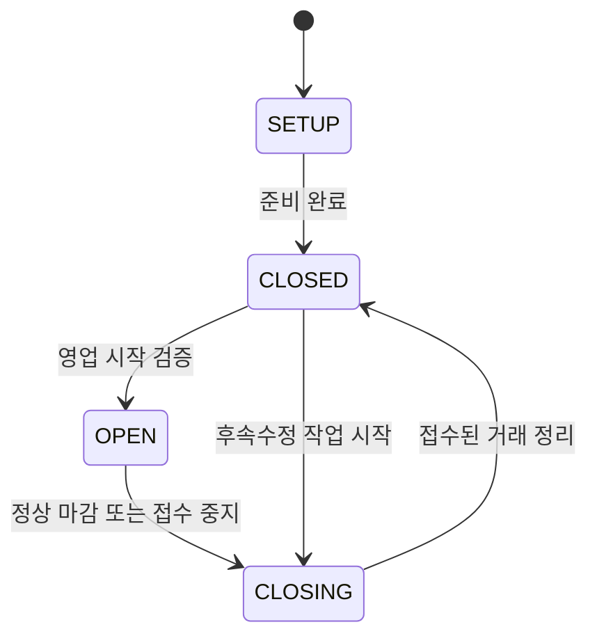

# 핵심 플레이와 경영 시간

버전 2.0 · 설계 기준안 · 2026-11-11

[문서 트리](../README.md) · [게임 시스템](README.md)

## 1. 이 문서가 정하는 것

플레이어가 어떤 순서로 경영하고, 여러 사람이 같은 상권에서 시간을 공유하며, 영업·휴업·이탈이 어떤 결과로 이어지는지 정의한다. 수치는 MVP 검증을 위한 초기 설정값이다. 달력상의 실제 하루를 게임 속 경영일로 취급하지 않는다.

핵심 경험은 **업종과 운영 전략 선택 → 고객에게 약속 → 생산·서비스 → 수익과 평가 확인 → 연구와 업그레이드 → 다음 운영 판단**이다. 가게나 회사는 저장되는 개인 자산이며, 스테이지는 그 자산을 가져와 다른 경영자와 수요를 나누는 실시간 상권이다.

## 2. 시작부터 다시 접속하기까지

| 단계 | 플레이어 행동 | 확정되는 상태 | 다음 판단 |
|---|---|---|---|
| 사업 선택 | 카페·음식점·소프트웨어·SI 중 하나 선택 | 사업 유형, 기본 제품, 기본 장비, 사업 식별자 | 누구에게 어떤 가치를 제공할까 |
| 입점 | 성장 구간에 맞는 상권의 빈 구획에 배치 | 입점권, 구획, 스테이지 입장 순번 | 주변 수요와 경쟁자는 어떤가 |
| 준비 | 가격·제품·운영 모드·영업 약속 설정 | 적용 설정 버전과 고객 대상 | 지금 열 준비가 되었는가 |
| 영업 | 주문·상담·계약을 받아 수행 | 거래와 대기열, 예약 원가, 서비스 상태 | 처리 능력보다 더 받지 않았는가 |
| 대응 | 품질 신호·불만·사건에 대응 | 선택과 비용, 후속 조건 | 수익·신뢰·시간 중 무엇을 우선할까 |
| 개선 | 연구, 검증, 설비·공간 개선 | 연구 결과, 업그레이드 소유권 | 실제 고객 문제를 해결했는가 |
| 회고 | 경영 보고서와 고객 이탈 이유 확인 | 검증된 지표와 다음 목표 | 다음 운영에서 바꿀 한 가지는 무엇인가 |
| 마감 | 새 거래 접수 종료, 남은 약속 정리 | 안전한 마감 또는 약속 불이행 결과 | 종료 후 재개할 위치는 어디인가 |

가게 운영, 꾸미기, 연구, 다른 공간 방문을 같은 세션 안에서 오갈 수 있다. 다만 거래를 시작한 뒤에는 그 약속을 취소하거나 완료하는 명시적인 절차가 필요하다. 화면을 닫거나 이동했다는 이유만으로 거래 기록을 없애지 않는다. 다른 플레이어에게 계약을 양도하는 기능은 MVP에 없다.

## 3. 세 종류의 시간

| 시간 | 진행 조건 | 사용하는 기능 | 진행하지 않는 기능 |
|---|---|---|---|
| 상권 시간 `stageTick` | 연결된 경영자가 있거나 마지막 연결 유예·정산을 처리하는 동안 | 고객 생성, 날씨·공통 사건, 경영일 보고 | 오프라인 사업의 품질 감쇠 |
| 사업 활동 시간 `businessActiveTick` | 소유자가 CONNECTED이고 서버가 정상일 때 | 연구·서비스·예정 영업 이행, 사업 사건 | RECONNECTING 중 작업·비용·약속 기한 진행 |
| 실제 경과 시간 `wallTime` | 실제 시간이 흐를 때 | 연결 복구 60초, 인증·구매 확인·보안 기한 | 맛·신뢰·제품 품질의 자동 붕괴 |

경영일은 상권 시간 **1,200초, 즉 20분**의 보고 주기다. 한 경영일을 끝까지 플레이해야 보상을 받을 수 있는 라운드가 아니다. 거래는 개별 완료 때 정산되고, 보고서에는 참여한 구간만 표시한다. 상권을 옮겼다고 사업의 최근 성과 기록이나 확정된 불이행이 초기화되지 않는다.

초기 실행 목표는 이동·상호작용 판정 10회/초, 경제·영업 상태 평가 1회/초다. 이 빈도는 구현 환경별 성능 검증 후 변경할 수 있으나, 모든 정산은 경과 시간과 고유 식별자에 기반하여 실행 빈도 변화로 보상이 달라지지 않아야 한다.

## 4. 영업 상태

연결은 별도 축 `CONNECTED → RECONNECTING → CONNECTED 또는 ABSENT`로 관리한다. 재접속하면 연결 전 영업 상태와 사건 잠금을 복원한다. 사건을 회피하기 위한 재접속으로 강제 개점되지 않는다. 신규 접수 잠금은 별도 사유 필드로 저장하고 영업 상태를 추가로 늘리지 않는다.

| 상태 | 새 고객 접수 | 이미 시작한 거래 | 연구 | 꾸미기 |
|---|---|---|---|---|
| SETUP | 불가 | 없음 | 안내용 체험만 | 가능 |
| CLOSED | 불가 | 없음 | 가능 | 가능 |
| OPEN | 수용 능력·원가·운영비 예약 이내에서 가능 | 정상 실행 | 불가 | 서비스 통로·작업 설비 외 가능 |
| CLOSING | 불가 | 완료·합의된 취소·후속수정만 | 불가 | 작업 영역 외 가능 |
| RECONNECTING일 때 모든 영업 상태 | 불가 | 작업·기한·운영비 동결 | 동결 | 불가 |

기본 작업 슬롯은 사업당 1개다. 생산·연구·사건 작업은 동일 슬롯을 사용하므로 동시에 수행하지 않는다. 연구는 기존 거래를 정리한 뒤 CLOSED에서만 시작·진행한다. 접수된 주문이 있을 때 연구를 시작하려 하면 마감 또는 대기열 정리를 먼저 안내한다. 방문·관람은 사업의 소유권을 바꾸지 않는다.

## 5. 영업 약속과 휴업

실제 접속 시간이 불규칙한 플레이어도 사업을 유지할 수 있다. 대신 **활동 중 스스로 고객에게 확정한 약속**에는 결과가 따른다.

- `자유 영업`: 문을 열 때만 신규 고객을 받는다. 준비·연구를 위해 닫는 것은 불이행이 아니다.
- `예약 영업`: 현재 경영일 안에서 특정 활동 시간 구간의 개점을 약속한다. 수락한 고객 예약이 있을 때부터 이행 의무가 생긴다.
- `계약 납기`: 수락한 계약마다 시작·완료·검수 조건을 가진다. 남은 시간을 화면에 표시한다.

예약 영업을 게시하기만 하고 아직 고객이 확정하지 않았다면 철회할 수 있다. 확정 예약은 취소 전에 예상 결과를 보여 준다. 고객이 없는 휴업에 가상의 민원을 생성하지 않는다. 확정 약속을 어기면 거래별 불이행을 한 번 기록하며, 같은 약속에 시간 경과마다 연속 벌점을 부과하지 않는다.

## 6. 연결 끊김과 종료

1. 연결이 끊기면 즉시 새 접수를 중지하고 실제 시간 60초의 유예를 시작한다.
2. 이미 시작한 작업·비용·기한·연구·선택 타이머를 동결한다. 유예 동안 새 수익이나 품질 열화를 만들지 않는다.
3. 유예 안에 돌아오면 같은 사업·거래·사건과 남은 시간을 복원한다. 끊기기 전에 이미 확정된 결과는 다시 보여 주되 재지급하지 않는다.
4. 유예가 끝나면 미착수 거래를 취소하고 원가·운영비 예약을 해제한다. 착수 거래는 확인된 완료 기록 또는 귀책 취소 규칙으로 한 번 정산한다. 중단된 작업을 가짜 완료로 만들어 매출을 지급하지 않는다.
5. 마감 정산과 확정 약속 결과는 영구 기록한다. 이후 오프라인 시간에는 새로운 고객·매출·열화·임대료·불이행을 생성하지 않는다. 마지막 이용자의 유예와 정산이 끝난 스테이지는 SLEEP으로 들어간다.

서버 장애로 발생한 중단은 플레이어의 태만으로 취급하지 않는다. 장애 복구는 검증된 시작·소모·완료 기록을 기준으로 원가와 거래를 복구하며 신뢰 벌점을 발생시키지 않는다. 소유자 연결 여부와 서버 장애 사유를 동일한 상태로 덮어쓰지 않는다.

## 7. 경영일 보고서

매출 외에 다음 정보를 함께 보여 준다.

| 표시 | 의미 | 교육적 판단 |
|---|---|---|
| 매출·소모 원가·순영업결과 | 실제 확정 거래의 합계 | 매출과 이익은 다르다 |
| 미완료 거래와 묶인 자금 | 아직 확정하지 못한 약속 | 현금과 예약 자금은 다르다 |
| 방문·문의 → 수락 → 완료 | 고객 흐름의 단계별 전환 | 광고 이후에도 운영 능력이 필요하다 |
| 품질·대기·가격·적합성 이탈 | 고객별 관찰 가능한 이탈 이유 집계 | 손님 감소의 원인을 구분해야 한다 |
| 영업 가능 시간·실제 영업 시간 | 참여 구간 안에서의 이행 | 오래 접속한 것과 잘 운영한 것은 다르다 |
| 다음 실험 1개 | 플레이어가 고른 개선 목표 | 원인을 정하고 작은 실험을 한다 |

순위는 같은 참여 시간·업종·성장 구간을 확인할 수 있게 제공한다. 참여 시간이 다른 두 사업의 총매출만으로 ‘더 좋은 경영자’를 정하지 않는다.

## 8. 수용 기준

| ID | 검증 상황 | 통과 기준 |
|---|---|---|
| SYS-TIME-01 | 경영일 중간에 입장·퇴장 | 참여한 거래만 정산하며 20분 완주 요구가 없음 |
| SYS-TIME-02 | 59초 만에 재접속 | 기존 거래·사건·영업 상태 복원, 중복 정산 없음 |
| SYS-TIME-03 | 60초 유예 종료 후 재접속 | 마감 정산 단 1회, 추가 오프라인 열화 없음 |
| SYS-TIME-04 | 예약 고객 없이 휴업 | 명성 벌점 없음, 신규 고객만 받지 않음 |
| SYS-TIME-05 | 확정 예약을 반복 취소 요청 | 해당 약속 실패·원가 결과가 단 1회만 적용 |
| SYS-TIME-06 | 품질 사건 중 이탈·다른 상권 입장 | 미해결 사건과 관련 잠금 유지 |
| SYS-TIME-07 | 실행 빈도를 10Hz에서 변경 | 같은 논리 입력과 경과 시간의 경제 결과 동일 |
| SYS-TIME-08 | 서버 장애 후 거래 재처리 | 장애로 인한 신뢰 벌점 없음, 원가·지급 중복 없음 |

## 연관 문서

- 다음: [시장 수요와 NPC 고객](02-market-and-npc.md)
- 규칙: [운영 품질과 연구](03-operations-quality-rnd.md), [재화와 아이템](06-economy-and-items.md)
- 구현: [공통 게임 구현 명세](../04-implementation/01-engine-neutral-spec.md), [실시간과 영속 저장](../04-implementation/03-realtime-and-persistence.md)
- 경험: [튜토리얼](../03-experience/02-onboarding-and-tutorial.md)
