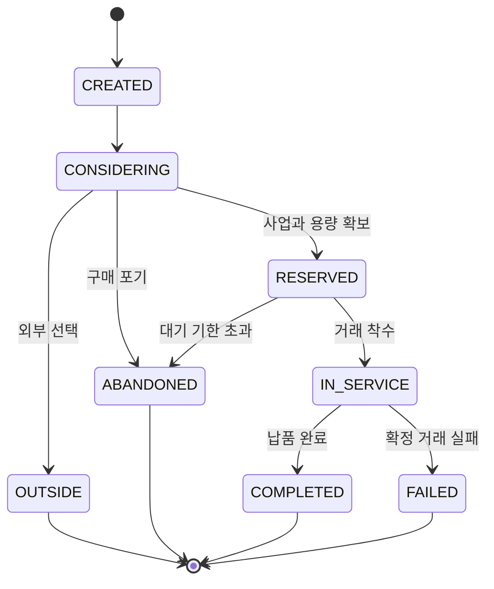

# 시장 수요와 NPC 고객

버전 2.0 · 설계 기준안 · 2026-11-11

[문서 트리](../README.md) · [게임 시스템](README.md)

## 1. 경쟁의 단위

한 스테이지에는 최대 6명의 실제 경영자가 들어온다. 같은 업종을 여러 명이 선택할 수 있다. **같은 필요를 가진 고객을, 그 필요를 처리할 수 있는 사업끼리 경쟁**한다. 음료를 사려는 손님이 소프트웨어 회사에 계약하는 식으로 업종을 섞지 않는다.

| 수요 유형 | 기본 호환 업종 | 고객이 고르는 대상 | 시각 표현 |
|---|---|---|---|
| NEED_CAFE | 카페 | 지금 마실 음료 | 보행 고객·좌석 이용 |
| NEED_MEAL | 음식점 | 식사 한 끼 | 식사·포장 고객 |
| NEED_SOFTWARE | 소프트웨어 | 정해진 범위의 예약관리 제품 | 상담 방문·데모 문의 |
| NEED_SI | SI | 고객 환경에 맞춘 예약 시스템 연동 | 요구사항 상담·검수 담당자 |

MVP에서는 수요 유형 간 대체 구매를 구현하지 않는다. 서로 다른 업종은 상권의 방문객 분위기와 공동 사건을 공유하지만 같은 고객을 직접 빼앗지 않는다. 업종 간 계약과 공급망은 후속 범위다.

## 2. 수요의 보존

모든 수요는 `demandId` 하나를 가지며, 한 번만 거래 또는 이탈로 끝난다. 고객을 화면에서 더 많이 표시하거나 이동 경로를 반복했다고 매출이 생기지 않는다.

`RESERVED` 이후에는 같은 고객을 다른 업체에도 예약하지 않는다. 거래 취소 후 다시 시장에 나타나는 경우 원래 수요를 재사용하지 않고 명시적인 후속 수요를 만든다. MVP에서는 이 후속 수요의 유료 거래를 만들지 않고 이탈로 종결하여 재배분 중복 정산을 줄인다.

다음 불변식을 매 경영일에 검사한다.

`생성 수요 = 고려 중 + 예약/서비스 중 + 완료 + 실패 + 외부 선택 + 구매 포기`

최초 튜토리얼 손님은 `origin=TRAINING`, `trainingMode=ONBOARDING` 수요이며 경쟁 수요와 지표에서 분리한다. 최초 단계의 실제 거래만 정의된 TC·XP를 정산한다. 반복 체험은 같은 TRAINING의 `trainingMode=PRACTICE`이며 영구 지갑·명성·랭킹을 바꾸지 않는다. 일반 시장 수요의 origin은 MARKET이다.

## 3. 초기 시장 규모

초기 수요 설정의 원본은 [경제 설정](06-economy-and-items.md)의 `CFG_MARKET`이다. 한 경영일의 기본 수요는 음료 60건, 식사 30건, 소프트웨어 20건, SI 15건이다. 이는 현실 시장의 통계가 아닌, 업종별 작업 시간을 반영한 첫 실험값이다.

수요는 시간대별로 나누어 생성한다. 같은 고객을 한순간에 몰아서 만들지 않고, 경영일·수요 유형·일련번호에 고정된 난수 시드로 도착 시각과 선호를 결정한다. 스테이지를 다시 시작해 유리한 손님을 뽑을 수 없게 이미 발행한 수요와 시드를 저장한다.

- OPEN 사업 수가 순간적으로 변했다고 해당 경영일의 수요 총량을 새로 늘리지 않는다.
- 한 업종으로 몰리면 사업별 수요가 줄 수 있다. 입장 전 동종 사업 수와 수요 전망을 보여 준다.
- 자동 매칭은 유사 성장 구간과 업종 과밀도를 고려한다. 초대방의 동일 업종 선택을 강제로 막지는 않는다.
- 빈 구획의 NPC 경쟁 사업은 `NPC 운영`이라고 표시한다. 실제 플레이어인 것처럼 위장하지 않는다.
- NPC 경쟁 사업도 같은 가격·용량·품질 규칙을 적용하고, 사람 사업의 통화를 훔치거나 돈을 발행하지 않는다.
- 마을 밖 구매라는 **외부 선택지**는 항상 남아 있다. 경쟁자가 한 명이라고 모든 수요가 자동으로 그 가게에 들어오지 않는다.

## 4. 후보 사업과 거래 자격

수요의 후보가 되려면 모두 만족해야 한다.

1. `BusinessState = OPEN`, `ConnectionState = CONNECTED`이며 신규 접수 잠금이 없다.
2. 수요 유형과 제품이 호환되고 고객의 필수 요구 태그를 만족한다.
3. 가격이 고객 예산 안에 있다.
4. 예상 대기 시간이 고객의 허용 대기 시간보다 짧다.
5. 사용 가능한 제작 슬롯 또는 대기열 자리가 있고, 사업자가 원가와 최대 남은 유상 시간의 운영비를 예약할 수 있다.
6. 고객에게 표시한 메뉴·제품·납기 조건 버전이 현재 접수 가능한 버전이다.

선택 직전 확인한 자리가 동시 요청으로 사라졌다면 다른 후보 또는 외부 선택으로 다시 판정한다. 이 재판정에서 수요 식별자는 유지하며, 이미 원가를 예약한 거래를 또 만들지 않는다.

## 5. 고객 효용과 선택

각 후보의 관찰 가능한 정보로 `0~1` 정규화 값을 만든다. 고객 유형별 가중치 합계는 1이다.

`U_i = wQ·Qhat_i + wF·Fit_i + wR·Trust_i + wV·Value_i + wW·Wait_i + wA·Access_i + wN·Novelty_i`

| 항목 | 정의 | 주의 |
|---|---|---|
| `Qhat` | 공개된 품질 검증과 실제 이용 후 평가의 사전 기대 | 서버 내부의 숨은 실제 품질을 고객이 미리 아는 것으로 계산하지 않음 |
| `Fit` | 고객이 원하는 태그·기능·식사 조건의 충족률 | 호환성과 필수 태그는 후보 단계에서 먼저 검사 |
| `Trust` | 검증된 납품과 약속 이력에 기반한 신뢰 | 현금 구매·친구 추천 수로 직접 증가하지 않음 |
| `Value` | 기준 가격 대비 제안 가격의 적절함 | 단순 최저가 순으로 정렬하지 않음 |
| `Wait` | 예상 완료 시간의 여유 | 순간 이동·아바타 충돌이 완료 시간을 결정하지 않음 |
| `Access` | 통로·안내·공간 기능 등 실제 접근성 | 유료 외형과 색상은 경쟁 수치에 포함하지 않음 |
| `Novelty` | 검증된 신제품 또는 개선의 새로움 | 낮은 가중치로 제한, 반복 이름 변경은 갱신 아님 |

기본 고객의 가중치는 `Q .25 / F .20 / R .15 / V .15 / W .15 / A .05 / N .05`다. 가격 민감, 품질 우선, 급한 고객은 해당 항목을 높이는 별도 프로필을 사용한다. 어느 고객 프로필에서도 DG 구매 여부는 입력으로 받지 않는다.

선택 확률은 외부 선택지까지 포함하여 계산한다.

`P(i) = exp((U_i − Umax) / τ) / Σ_j exp((U_j − Umax) / τ)`

기본 온도 `τ = 0.12`, 외부 선택의 기준 효용 `Uoutside = 0.55`다. `Umax`를 빼 수치 범위를 안정화한다. 모든 후보가 제외되면 외부 선택 또는 구매 포기로 종료한다. 고객 성향과 결정 난수는 수요에 고정되므로 같은 상태를 재평가해도 무작위 결과가 계속 바뀌지 않는다.

예를 들어 동종 업체 A의 효용이 .72, B가 .62, 외부가 .55라면 선택 확률은 대략 A 59.6%, B 25.9%, 외부 14.5%다. 이는 A가 언제나 이긴다는 뜻이 아니다. 특정 고객에 맞는 가격·품질·대기 전략으로 유리해지는 구조다.

## 6. 수용량과 동시 접수

기본 사업은 **작업 슬롯 1개와 대기 거래 1개**, 합계 최대 2개 거래를 가진다. 대기 거래도 원가와 필요한 운영비 예약을 요구한다. 업그레이드의 기본 목적은 품질과 검수 능력이며, MVP에 두 번째 병렬 작업 슬롯을 판매하지 않는다.

예상 대기 시간은 `현재 작업 남은 시간 + 앞선 대기 작업 시간 + 신규 작업 시간`이다. 사건으로 지연된 시간은 포함하고, 이미 해소된 사건 지연을 중복 합산하지 않는다. 고객이 감당하지 못할 대기라면 예약 전에 이탈한다.

여러 고객이 같은 마지막 자리를 선택하면 단일 권위 순서에 따라 하나만 확정한다. 다른 고객은 재판정하며, 원가 보류를 풀어야 한다. 가격 변경은 이미 수락한 주문의 조건을 바꾸지 않는다.

## 7. 품질 경험과 고객 기억

납품 후에는 `실제 품질`, `약속한 조건`, `관찰한 대기`, `불만 처리`를 평가한다. 고객이 떠난 이유는 가격·대기·필수 조건·품질·미영업 중 하나 이상의 근거 태그로 저장한다.

이력은 사업별로 보존한다. 새 스테이지에 입점했을 때도 명성과 미해결 서비스 문제가 이어진다. 동일 고객의 연속 구매는 같은 경험을 여러 번 평가하는 것으로 집계하지 않는다. 반복 평점은 거래 식별자로 중복 제거한다.

MVP에서 인간 플레이어의 별점은 경쟁 수치에 반영하지 않는다. 다른 가게의 허위 신고·악성 리뷰·진입로 점거로 수요를 훼손하는 기능도 제공하지 않는다. 공간 방문과 감상은 별도 소셜 경험이다.

## 8. 개발 시 관찰할 지표

| 지표 | 정의 | 문제 징후 |
|---|---|---|
| 후보 탈락률 | 생성 수요 중 후보에 들지 못한 비율 | 가격·조건·원가 부족 UI가 이해되지 않음 |
| 선택률 | 후보에 든 뒤 선택된 비율 | 품질/가격 조정이 결과에 반영되지 않음 |
| 대기 포기율 | 예약 후 기한 초과 이탈 | 처리 능력보다 과도한 접수 |
| 외부 유출률 | 외부 선택과 구매 포기의 비율 | 시장 규모·가중치가 지나치게 가혹하거나 쉬움 |
| 업종별 가동률 | 처리 시간 / 영업 가능 시간 | 업종별 경제 균형이 명목상으로만 같음 |
| 수요 보존 오차 | 생성 수요와 각 상태 합계의 차이 | 중복 고객·유실·재접속 재발행 |

유입이 적다는 사실만 보여 주지 않고 어떤 단계에서 줄었는지를 보여 주어야 한다. 교육 평가도 매출 증가뿐 아니라 원인을 설명하고 적절한 개선을 선택했는지 확인한다.

## 9. 수용 기준

| ID | 검증 상황 | 통과 기준 |
|---|---|---|
| SYS-MKT-01 | 고객 1명이 여러 후보를 동시 선택 | 최종 거래와 원가 예약은 1개 |
| SYS-MKT-02 | 카페와 SI만 입점 | 서로의 수요 유형을 잘못 수주하지 않음 |
| SYS-MKT-03 | 후보가 전부 폐점 또는 자금 부족 | 수요가 외부/포기로 끝나고 지갑 변화 없음 |
| SYS-MKT-04 | 동일 시드·상태로 선택 재실행 | 동일 고객 선택 결과, 재지급 없음 |
| SYS-MKT-05 | 유료 외형만 변경 | 효용·수요·처리량·명성 변화 없음 |
| SYS-MKT-06 | 마지막 대기열 자리 동시 경합 | 용량을 넘지 않고 실패 예약을 해제 |
| SYS-MKT-07 | 1경영일 종료 | 수요 보존 식의 오차 0 |
| SYS-MKT-08 | 튜토리얼 반복 | 훈련 수요가 경쟁 지표·영구 보상을 늘리지 않음 |

## 연관 문서

- 이전: [핵심 플레이와 경영 시간](01-core-loop-and-time.md)
- 다음: [운영 품질과 연구](03-operations-quality-rnd.md)
- 함께 읽기: [명성과 경쟁](04-reputation-and-competition.md), [경제 설정](06-economy-and-items.md)
- 구현: [공통 데이터 계약](../04-implementation/02-domain-data-contracts.md)
