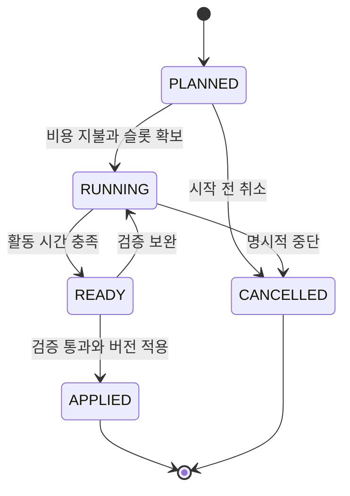

# 운영 품질과 연구 개발

버전 2.0 · 설계 기준안 · 2026-11-11

[문서 트리](../README.md) · [게임 시스템](README.md)

## 1. 품질을 세 가지로 나눈다

사업이 오래되었다는 이유만으로 커피가 맛없어지거나 프로그램이 고장 나지는 않는다. 플레이어가 관찰하고 개선할 수 있도록 **실제 품질, 시장 적합성, 신선함**을 분리한다.

| 지표 | 질문 | 변하는 원인 | 복구 방법 |
|---|---|---|---|
| 실제 품질 `actualQuality` | 약속한 제품이 얼마나 안정적으로 작동하는가 | 검수 생략, 재료 상태 문제, 공정 오차, 알려진 결함, 도구 한계 | 원인 수정, 검수, 재작업, 관련 연구·설비 |
| 시장 적합성 `marketFit` | 이 고객의 필요를 충족하는가 | 고객 선호·업무 조건·요구 기능과 제품 태그의 차이 | 고객 관찰, 연구 갈래 선택, 제품 구성 변경 |
| 신선함 `novelty` | 검증된 개선이 최근에 있었는가 | 의미 있는 제품 개정 뒤 경과한 활동 시간 | 검증된 기능·레시피 개정. 이름만 변경하면 갱신하지 않음 |

품질이 좋더라도 가격이나 대기가 맞지 않으면 손님은 떠날 수 있다. 반대로 신제품이라는 이유만으로 불량을 감추지 않는다. 고객 선택은 예상 품질을, 이용 후 평가는 실제 품질을 사용한다.

## 2. 공통 운영 작업

업종마다 표현은 다르지만, 구현은 같은 거래 흐름을 사용한다.

| 공통 구간 | 카페 | 음식점 | 소프트웨어 | SI |
|---|---|---|---|---|
| 요구 확인 | 음료 취향 | 식사·재료 조건 | 필요한 기능 | 연동 대상과 검수 기준 |
| 원가 예약 | 원두·소모품 | 식재료 | 제작·서비스 자원 | 분석·구현 자원 |
| 착수 | 추출 준비 | 조리 준비 | 구성·개발 | 분석·연동 구현 |
| 검수 | 배합·제공 상태 | 조리 기준·포장 | 기능 테스트 | 합의한 통합 검수 |
| 납품 | 음료 제공 | 식사 제공 | 제품 인도 | 최종 검수 완료 |
| 후속 | 재방문 의견 | 재료·대기 의견 | 사용 중 오류 | 수정·운영 인계 |

타이밍 반응 속도만으로 품질을 결정하지 않는다. 모바일·키보드·보조 조작 모두 동일한 체크리스트를 수행할 수 있어야 한다. 자동 처리 보조는 순서를 안내하되, 고객의 요구와 자원 배분 선택은 남긴다.

## 3. 실제 품질의 초기 공식

모든 항목은 `0~100` 범위다. 수치 원본은 [경제 설정](06-economy-and-items.md)의 `CFG_QUALITY`다.

`potential = 50 + 5 × reliabilityResearchTier + processBonus + verificationBonus`

`actualQuality = clamp(min(equipmentQualityCap, potential) − issuePenalty, 0, 100)`

| 변수 | 초기 범위 | 획득·변화 조건 |
|---|---|---|
| `reliabilityResearchTier` | 0~3 | 업종별 일관성·표준·안정성·요구검증 연구 |
| `processBonus` | 0 또는 10 | 해당 거래의 요구 확인과 공정 체크를 모두 수행 |
| `verificationBonus` | 0 또는 10 | 해당 제품 버전의 유효한 검증을 수행하고 관련 필수 테스트 통과 |
| `equipmentQualityCap` | T1 60 / T2 75 / T3 90 | 소유·배치·사용 가능한 설비 중 실제 작업 설비 |
| `issuePenalty` | 확인된 문제별 합산, 최대 40 | 재료 이슈·검수 실패·알려진 결함의 공개된 영향 |

예시: T1 설비, 신뢰성 연구 1단계, 공정 준수, 검증 완료라면 잠재 품질은 `50+5+10+10=75`지만 실제 도구 상한 때문에 품질 60이다. T2로 바꾸면 같은 조건에서 75를 실현한다. 연구만 구매하고 검수와 공정을 생략하면 품질은 그만큼 낮다.

MVP의 이 공식에서 도달 가능한 최고치는 85다. T3의 상한 90은 확장 여유이고, 문서나 UI가 당장 품질 100을 달성할 수 있다고 안내하지 않는다.

알려진 문제의 영향은 거래 착수 시점과 실제 공정 시점에 정한 평가 버전에 따라 적용한다. 거래가 끝난 뒤 새로 발생한 사건으로 과거 납품의 품질을 몰래 다시 계산하지 않는다.

## 4. 연구 갈래

각 업종은 두 갈래, 갈래당 3단계다. 연구비·시간·선행 조건은 모든 업종에 같은 기초값을 적용한다.

| 업종 | 연구 ID | 이름 | 주된 효과 |
|---|---|---|---|
| 카페 | RND_CAFE_CONSISTENCY | 추출 일관성 | 신뢰성 연구 단계에 반영 |
| 카페 | RND_CAFE_TASTE | 취향 배합 | 선호 태그 선택·검증 폭 확대 |
| 음식점 | RND_FOOD_STANDARD | 조리 표준 | 신뢰성 연구 단계에 반영 |
| 음식점 | RND_FOOD_YIELD | 식재료 활용 | 허용된 대체 재료와 고객 조건 대응 폭 확대 |
| 소프트웨어 | RND_SW_STABILITY | 안정성 | 신뢰성 연구 단계에 반영 |
| 소프트웨어 | RND_SW_USABILITY | 사용성 | 고객 업무·조작 태그 대응 폭 확대 |
| SI | RND_SI_REQUIREMENTS | 요구 검증 | 신뢰성 연구 단계에 반영 |
| SI | RND_SI_INTEGRATION | 통합 테스트 | 연동 환경·검수 태그 대응 폭 확대 |

두 번째 갈래는 원가를 영구적으로 0에 가깝게 만드는 생산 배율이 아니다. 예를 들어 식재료 활용은 재료 대체 사건에서 선택할 수 있는 조합을 늘리고, 소프트웨어 사용성은 고객이 요구하는 작업 흐름을 충족하도록 한다.

### 연구 비용과 상태

- 연구 1단계: **20 TC, 활동 시간 90초**.
- 단계 1·2·3의 사업 레벨 선행 조건: **레벨 1·2·3**.
- 같은 갈래는 이전 단계를 완료해야 다음 단계를 시작한다.
- 연구는 기존 거래를 정리한 CLOSED 상태에서만 시작·진행한다. 기본 슬롯 1개에서 거래·후속수정과 연구를 동시에 실행하지 않는다.
- 연구에는 영업 고정비가 없다. 연구 비용에 해당 연구의 활동 자원을 포함한다. 확정된 미래 영업 예약과 연구 완료 기한이 충돌하면 먼저 약속을 조정하도록 안내한다.
- 연구 완료 자체에는 TC·XP를 지급하지 않는다. 연구가 해결한 고객 문제는 이후 정상 거래로 확인한다.

시작 전 취소는 비용을 발생시키지 않는다. 시작 후 취소는 사용한 연구 비용을 자동 환급하지 않는다. 연결 유예 중에는 연구 시간이 동결된다. 검증을 보완하는 경우 같은 연구 ID에 대해 두 번째 20 TC를 자동 청구하지 않고, 남은 체크리스트를 수행한다.

연구 결과 적용은 제품 버전을 올린다. 진행 중 거래에는 수락 당시 제품·가격·원가·검수 버전을 유지하고, 새 버전은 이후 수락한 거래에만 적용한다.

## 5. 시장 적합성과 제품 선택

제품마다 최대 3개의 선호 태그와 필수 지원 태그를 가진다. 고객은 필수 조건과 가중 선호를 가진다.

`marketFit = 충족한 선호 가중치 합 / 전체 선호 가중치 합`

필수 조건을 충족하지 못하면 낮은 적합성으로 억지 판매하지 않고 후보에서 제외한다. 연구 2갈래의 각 단계는 허용된 새 태그 1개를 검증할 권리를 열지만, 동시에 장착하는 태그 수를 무한히 늘리지 않는다. 최대 3개 태그 제한 안에서 어떤 고객을 목표로 할지 선택해야 한다.

예를 들어 ‘부드러운 맛’과 ‘진한 맛’을 동시에 모든 고객에게 최대로 제공하는 만능 커피는 만들지 않는다. 소프트웨어도 모든 기능을 한 제품에 붙일수록 무조건 이기는 구조를 피한다. 선택 화면에 지원하는 조건과 포기한 조건을 함께 보여 준다.

## 6. 관리 소홀의 결과

| 관찰 가능한 원인 | 게임 상태 변화 | 손님 감소 경로 | 회복 행동 |
|---|---|---|---|
| 재료 특성 변화 안내를 무시 | 공개된 재료 문제 패널티 | 실제 품질 저하 → 이용 후 평가 하락 | 배합·대체 재료 검증 |
| 공정 체크를 반복 생략 | 해당 거래 공정 보너스 상실 | 품질 일관성 저하 | 체크리스트 재도입 |
| 알려진 오류를 남긴 채 출시 | 해당 버전 결함 유지 | 평가 하락·재문의 | 수정과 회귀 검증 |
| 고객 요구를 읽지 않고 수락 | 필수 조건 불일치 또는 검수 실패 | 취소·약속 신뢰 하락 | 요구 재합의·범위 축소 |
| 연구·고객 관찰을 오래 하지 않음 | 새 고객 선호에 대한 태그 부족 | 적합성이 높은 경쟁 제품으로 이동 | 목표 고객을 고르고 관련 연구 |
| 예고한 시간에 열지 않음 | 확정 예약의 불이행 | 신뢰와 재방문 기대 하락 | 사전 취소·재약속·실제 이행 |

사건이 발생하기 전에는 단서와 영향 예고를 제공한다. 외부 사건이 모든 사업에 자동 실패를 강제하지 않으며, 비용이 드는 대응과 시간이 드는 대응을 함께 제공한다.

## 7. 신선함과 오프라인

신선함은 의미 있는 검증 개정 후 지나간 **사업 활동 경영일** 수로 계산한다.

`novelty = max(40, 100 − 10 × completedActiveDaysSinceRevision)`

사업 활동 경영일은 누적 활동 시간 1,200초다. 오프라인 시간을 더하지 않는다. 신선함의 고객 효용 가중치는 기본 5%로 제한하여, 오래된 검증 제품도 품질·가격·적합성으로 경쟁할 수 있다. 연구 제목이나 제품 이름만 바꿔서는 새 개정으로 인정하지 않는다.

## 8. 수용 기준

| ID | 검증 상황 | 통과 기준 |
|---|---|---|
| SYS-QLT-01 | 같은 공정·설비·연구·문제 상태 | 실제 품질 결과 동일 |
| SYS-QLT-02 | T1에서 품질 잠재치 75 | 실제 품질 60, 상한 원인 표시 |
| SYS-QLT-03 | 오프라인 7일 후 재접속 | 실제 품질·연구·신선함 자동 감쇠 없음 |
| SYS-QLT-04 | 제품 이름만 변경 | 신선함 초기화·연구 단계 증가 없음 |
| SYS-QLT-05 | 진행 중 거래에서 연구 적용 | 기존 거래 버전 유지, 신규 거래에만 적용 |
| SYS-QLT-06 | 생산 중 연구 시작 | 동일 슬롯 중복 사용을 거절하고 해결 방법 표시 |
| SYS-QLT-07 | 검증 보완을 반복 요청 | 연구비 중복 청구·연구 보상 발행 없음 |
| SYS-QLT-08 | 필수 고객 태그 누락 | 수락 전에 차단하거나 명시적 재합의, 자동 성공 없음 |

## 연관 문서

- 이전: [시장 수요와 NPC 고객](02-market-and-npc.md)
- 다음: [명성과 경쟁](04-reputation-and-competition.md)
- 설정 원본: [재화와 아이템](06-economy-and-items.md)
- 업종별 설명: [카페](../02-businesses/01-cafe.md), [음식점](../02-businesses/02-restaurant.md), [소프트웨어](../02-businesses/03-software.md), [SI](../02-businesses/04-si.md)
