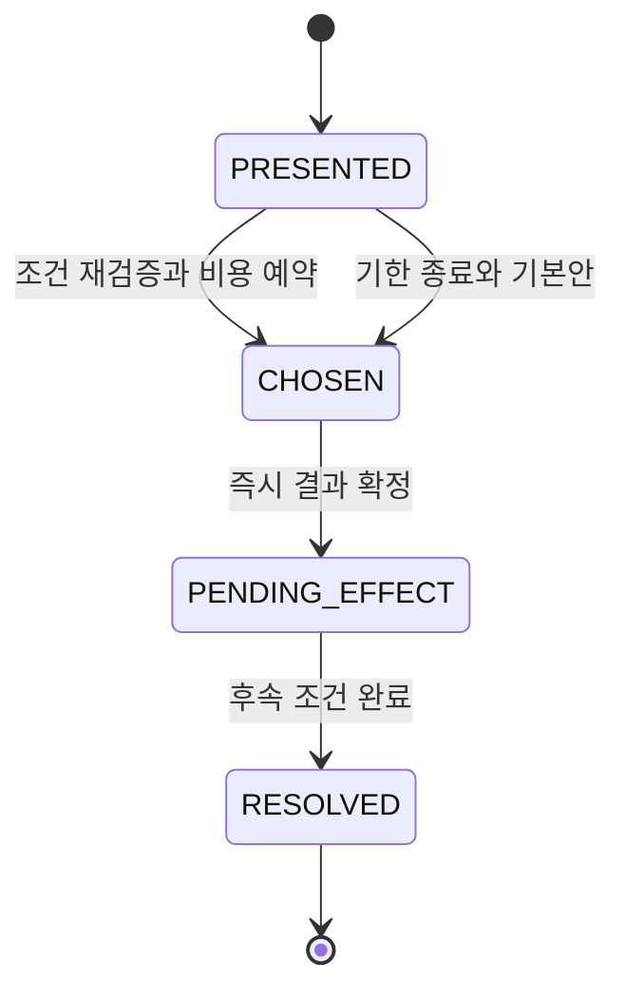

# 선택 분기와 소형 AI 사건

버전 2.0 · 설계 기준안 · 2026-11-11

[문서 트리](../README.md) · [게임 시스템](README.md)

## 1. 선택의 목표

선택은 짧은 대사 뒤에 보상을 고르는 장식이 아니다. **공개된 정보로 판단하고, 즉시 비용과 나중의 결과를 경험하며, 다음 경영 방식을 바꾸는 사건**이다.

처음에는 비용·예상 시간·현재 확인된 위험을 보여 준다. 아직 알 수 없는 결과는 확률 또는 불확실성으로 표현한다. 사건이 끝나면 실제로 선택한 경로와 그 결과를 흐름도로 보여 준다. 방문하지 않은 분기의 정확한 보상까지 미리 공개하여 답을 외우는 구조로 만들지는 않는다.

## 2. 선택의 공통 형식

| 필드 | 용도 | 필수 조건 |
|---|---|---|
| `decisionId` | 한 번만 확정할 선택 식별자 | 사업·사건 인스턴스와 결합 |
| `knownFacts` | 지금 관찰할 수 있는 사실 | 원인·제약을 확인할 방법 포함 |
| `options` | 보통 3개 대응 | 비용·시간·조건을 각각 명시 |
| `eligibility` | 선택 가능한 이유 | 자금·기능·역할·시간 조건 |
| `immediateEffects` | 선택 직후 확정 결과 | 원가·운영비 예약·상태 변화 |
| `delayedEffects` | 나중에 확인할 결과 | 발동 조건·기한·취소 조건 |
| `defaultOption` | 기한 내 선택하지 않았을 때 | 자금이 0이어도 안전하게 처리 가능한 대안 |
| `reflection` | 결과 회고 | 인격 평가가 아닌 행동과 결과 연결 |

게임의 현금 재화로만 고를 수 있는 답이나, 유료 결제하면 손실을 없애는 답은 두지 않는다. 비용이 드는 개선에는 범위 조정·대기·기존 계약 유지·정상 취소처럼 다른 자원을 사용하는 대안을 제공한다.

## 3. 선택 처리 순서

1. 서버가 사건 자격·현재 사업 상태·이전 사건을 확인하고 인스턴스를 만든다.
2. UI는 사건 버전과 선택지를 표시한다. 다른 화면에 갔다 돌아와도 같은 인스턴스를 보여 준다.
3. 플레이어가 선택하면 현재 상태에서 비용·기한·슬롯·고객 동의를 다시 검증한다.
4. 선택 기록과 필요한 직접비·운영비 예약을 같은 확정 단위로 저장한다. 실제 사건 직접비는 대응 작업 착수 때 소모한다. 예약 확정이 실패하면 선택도 지갑 변화도 확정하지 않는다.
5. 후속 결과에는 별도 효과 식별자를 붙인다. 재시도·재접속으로 같은 결과를 두 번 발생시키지 않는다.
6. 완료 시 실제 경로, 관찰된 결과, 다음에 바꿀 수 있는 판단을 보여 준다.

시간을 늘리는 선택은 추가 운영비 예약도 필요하다. 예를 들어 SI의 30초 추가 작업은 수락 당시 총액 P를 바꾸지 않고 운영비 노출 1 TC를 추가한다. 기본 가격 P=64 TC인 계약은 64 TC를 유지한다. 필요한 자금이 없으면 해당 선택을 이유와 함께 비활성화하고, 시간 연장 없는 합의 또는 취소 대안을 유지한다.

## 4. MVP 사건 8개

각 업종의 전체 A/B/C 효과표와 장면 연결은 해당 업종 문서가 설명하고, 수치 원본은 [경제 설정](06-economy-and-items.md)에 둔다.

| 사건 ID | 상황 | 핵심 판단 | 원본 업종 |
|---|---|---|---|
| EV_CAFE_01 | 공급 재료의 특성이 달라짐 | 익숙한 배합 유지·재검증·대체 조합 | [카페](../02-businesses/01-cafe.md) |
| EV_CAFE_02 | 단체 주문 요청 | 접수량·품질·기존 대기 약속 | [카페](../02-businesses/01-cafe.md) |
| EV_FOOD_01 | 필요한 재료를 대체해야 함 | 고객 조건·재료 활용·메뉴 제한 | [음식점](../02-businesses/02-restaurant.md) |
| EV_FOOD_02 | 예약 손님의 제공 시간이 밀림 | 먼저 한 약속과 새 주문의 조정 | [음식점](../02-businesses/02-restaurant.md) |
| EV_SW_01 | 출시 전에 기능 범위가 늘어남 | 핵심 문제·검증·출시 시간 | [소프트웨어](../02-businesses/03-software.md) |
| EV_SW_02 | 출시한 버전에서 오류 제보 | 원인 확인·수정·고객 안내 | [소프트웨어](../02-businesses/03-software.md) |
| EV_SI_01 | 고객의 추가 범위 요청 | 고정 총액에서 범위·시간 재합의 | [SI](../02-businesses/04-si.md) |
| EV_SI_02 | 통합 검수 결과가 합의와 다름 | 수정·대체 구성·귀책 취소 | [SI](../02-businesses/04-si.md) |

사건은 두 가지 방식으로 발생한다. 관리 상태와 직접 연결되는 사건은 해당 조건을 만족하면 발동한다. 여러 사건 중 하나를 골라 보여 주는 감독형 사건은 아래 예산과 효용 규칙을 따른다. 관리상 필수 경고를 쿨다운 때문에 숨기지 않는다.

## 5. 소형 AI의 역할

MVP의 소형 AI는 적은 상태와 제한된 행동 집합으로 작동하는 세 구성요소다.

| 구성 | 입력 | 결정 | 할 수 없는 일 |
|---|---|---|---|
| 고객 AI | 필요·예산·선호·기다릴 수 있는 시간 | 후보와 외부 선택 비교 | 지갑 직접 변경·무한 신규 수요 생성 |
| NPC 경쟁 사업 AI | 같은 공개 시장 정보와 자기 자금 | 허용 가격·연구·영업 계획 중 선택 | 숨은 인간 입력 열람·무비용 업그레이드 |
| 사건 감독 AI | 사업 상태·이미 본 사건·학습 주제·예산 | 허용 사건 후보 중 제시할 것 선정 | 거래 성공 강제·명성 직접 벌점·임의 가격 생성 |

이는 규칙과 효용을 사용하는 경량 의사결정 시스템이다. 별도 생성 모델이 없어도 동일한 핵심 플레이를 실행할 수 있다.

### 선택적 경량 모델

후속 실험에서 작은 생성 모델을 연결할 수 있지만 권한은 제한한다.

- 허용: 같은 사실을 자연스러운 문장으로 표현, 사전 승인된 사건 ID·표현 변형 제안.
- 금지: TC·DG·PB·XP 수정, 새 아이템 지급, 필수 고객 조건 변경, 구매 유도, 확정 결과 취소.
- 입력: 필요한 최소 사업 상태와 허용 선택지. 다른 플레이어의 사적 대화나 결제 정보는 제공하지 않는다.
- 출력 검증: 정의된 사건·표현 필드만 허용하고 길이·유형·범위 검사.
- 실패 처리: 2초 안에 검증된 결과가 없으면 기본 문장을 사용. 모델 응답이 늦게 도착해 확정 사건을 바꾸지 않는다.

자연어 모델이 제안한 값을 ‘권고’라는 이름으로 그대로 비용이나 확률에 넣지 않는다. 숫자와 효과는 버전이 있는 콘텐츠 정의만 사용한다.

## 6. 사건 감독 규칙

기본 감독 한도는 사업당 활성 선택 사건 1개, 새 감독 사건 간 활동 시간 180초, 활동 경영일당 감독 사건 최대 2개다. 최초 튜토리얼의 고정 사건은 별도 단계로 관리하고, 튜토리얼 중 감독 사건을 겹치지 않는다.

후보 사건 점수는 다음 항목으로 계산한다.

`priority = .40·conditionRelevance + .25·unseenLearning + .20·currentManageability + .15·variety`

각 항목은 `0~1`이며, 조건을 만족하지 않는 사건은 점수와 무관하게 제외한다. 고득점 후보 안에서 사건 인스턴스 시드로 선택한다. 직전 선택과 무관하게 무조건 더 불리한 사건을 만들어 플레이어를 붙잡지 않는다.

| 제외 조건 | 이유 |
|---|---|
| 이미 처리 중인 사건이 있음 | 읽기·선택·후속 조건이 겹치지 않게 함 |
| 기본 대안도 현재 상태에서 실행 불가 | 선택 불가능한 위기를 만들지 않음 |
| 새 사건이 현재 확정 계약의 기한을 불명확하게 바꿈 | 이미 한 약속의 조건 보존 |
| 회복 과제 중 또는 막 재접속함 | 복구 도중 새 자원 요구를 추가하지 않음 |
| 같은 원인 사건을 이미 해결했고 상태 변화가 없음 | 원인 없는 반복 처벌 방지 |
| 미니 모델이 임의 조건을 제안함 | 승인된 콘텐츠만 실행 |

공통 날씨나 시장 변화는 스테이지 단위의 공개 사건이다. 특정 플레이어에게 몰래 더 나쁜 고객을 보내 순위를 맞추지 않는다. 개별 운영 문제는 해당 사업의 관찰 가능한 상태에 연결된다.

## 7. 기한과 기본 대응

선택 기한은 콘텐츠에 고정하며 기본 상한은 활동 시간 60초다. 연결 유예 중에는 기한도 동결한다. 기한은 서버의 사업 활동 시간으로 판단하고 화면에는 남은 시간을 표시한다.

기본 대응은 새 접수를 줄이거나, 합의되지 않은 추가 범위를 보류하거나, 필수 조건을 만족하지 못한 거래를 취소하는 식으로 구성한다. 돈을 자동 지출해 가장 비싼 답을 고르지 않는다. 이미 확정한 약속을 이행하지 못한 결과는 기본 대응에도 남지만, 같은 약속의 실패를 반복 생성하지 않는다.

사건 발생 자체가 시간을 연장하는 경우에는 사전에 예약된 최대 처리 시간 안에 포함되어야 한다. 선택에 따라 추가 시간이 필요하면 추가 운영비를 확보한 뒤 수락한다. 아무 선택도 하지 않아 READY 상태나 유상 운영 상태가 무한히 유지되지 않는다.

## 8. 선택 회고와 교육 검증

회고는 `상황 → 내가 본 정보 → 선택 → 실제 결과 → 다음 실험` 순서다. 예를 들어 추가 기능을 모두 받았더니 납기가 늦어졌다면, 다음에는 ‘중요 기능 하나만 먼저 검증하기’를 목표로 고를 수 있다.

학습 효과는 같은 선택지를 반복 클릭한 횟수로 주장하지 않는다. 처음 보는 다른 업종·다른 수치 상황에서 원가와 매출을 구분하고, 고객 요구를 확인하고, 확정 약속을 고려하는지 플레이테스트로 확인한다. 모든 사건에 하나의 도덕적 정답을 부여하지 않는다.

## 9. 수용 기준

| ID | 검증 상황 | 통과 기준 |
|---|---|---|
| SYS-EVT-01 | 선택 버튼 중복·동시 요청 | 선택·비용·효과가 각각 1회 |
| SYS-EVT-02 | 선택 직후 연결 종료 | 동일 분기와 후속 효과를 재개, 결과 재추첨 없음 |
| SYS-EVT-03 | 시간 연장에 필요한 운영비 부족 | 선택 거절 이유와 실행 가능한 기본 대안 제공 |
| SYS-EVT-04 | 모델 중단·시간 초과·잘못된 응답 | 기본 문장으로 동일 게임 규칙 실행 |
| SYS-EVT-05 | 모델이 새 보상 수치를 출력 | 경제와 사건 정의에 반영하지 않음 |
| SYS-EVT-06 | 활동 사건과 새 감독 사건 동시 발생 | 활성 한도 1개 유지, 필수 경고는 별도로 표시 |
| SYS-EVT-07 | 60초 동안 선택하지 않음 | 정의된 기본안 1회 확정, 무한 유상 대기 없음 |
| SYS-EVT-08 | 후속 수정 완료를 반복 제출 | 기존 경험 수정만 수행, 매출·명성 중복 증가 없음 |

## 연관 문서

- 이전: [명성과 경쟁](04-reputation-and-competition.md)
- 다음: [재화와 아이템](06-economy-and-items.md)
- 작성 규칙: [콘텐츠 저작 명세](../04-implementation/05-content-authoring.md)
- 장면: [공통 스토리보드](../03-experience/03-storyboard-common.md)
- 검증: [플레이테스트와 지표](../06-production/02-playtest-and-metrics.md)
