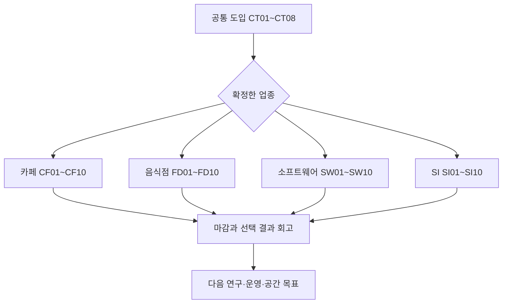

# 공통 도입 스토리보드

[전체 문서 트리](../README.md) · [상위 분야](README.md)

> 문서 ID: EXP-03 · 버전: 2.0 · 기준일: 2026-11-11 · 상태: 구현 전 제작 기준안

## 장면의 역할

공통 도입은 ‘나의 업종과 공간을 선택하는 순간’을 만든다. 8컷 이후 선택한 업종의 10컷으로 연결한다. 아래 내용은 실제 플레이 화면을 제작하기 위한 연출·상태 명세이며 완성된 게임 화면이 아니다. 컷의 예상 길이는 사용자 조작과 읽기 속도에 따라 달라진다.

## CT01 연두항에 도착

| 항목 | 내용 |
|---|---|
| 화면 | 멀리 서로 다른 상가가 보이는 보행가. 카메라가 광장에서 빈 내 필지 쪽으로 천천히 이동 |
| UI | ‘오픈타운’, 접근성·음량, ‘시작’ 또는 ‘이어 하기’ |
| 행동 | 시작 선택 |
| 대사 | 하나: “이 동네에 어떤 가게나 회사를 만들고 싶나요?” |
| 상태 | TUT00. 프로필 로드가 끝나기 전 경제 입력 비활성 |
| 저장·복구 | 로드 실패를 ‘처음 오신 분’으로 취급하지 않음 |
| 검증 | 기존 이용자는 기존 사업·튜토리얼 상태로 진입 |

## CT02 네 가지 창업 유형

| 항목 | 내용 |
|---|---|
| 화면 | 카페·음식점·소프트웨어·SI의 작은 작업 장면을 동일한 크기로 표시 |
| UI | 고객, 대표 제품, 주된 고민, 한 거래의 기본 작업 시간; ‘직접 연습’과 ‘선택’ |
| 행동 | 업종 카드를 선택하고 상세 설명 확인 |
| 선택 | 카페=맛과 대기, 음식점=준비와 품질, 소프트웨어=문제와 검증, SI=범위와 약속 |
| 상태 | TUT01 선택 초안. 영구 업종 확정 전 |
| 저장·복구 | 돌아가기를 누르면 선택 초안만 변경 |
| 검증 | 표시 순서·색·설명에서 특정 업종을 유료 또는 상위 직업처럼 표현하지 않음 |

## CT03 살아 있는 상권을 본다

| 항목 | 내용 |
|---|---|
| 화면 | 여러 가게를 둘러보는 고객, 제품 시연을 보는 회사 고객. 짧은 카메라 전환 |
| UI | 같은 수요에서 비교하는 가격·적합성·대기 예시, 현재 스테이지의 업종 구성 |
| 행동 | 관심 있는 가게의 공개 정보 한 번 확인 |
| 대사 | 하나: “손님마다 필요한 것이 달라요. 어떤 손님을 만나고 싶은지 생각해 보세요.” |
| 상태 | 사업 생성 전 정보 확인. 수요를 실제로 소비하지 않음 |
| 저장·복구 | 연출 생략 가능. 다음 화면에서 정보를 다시 볼 수 있음 |
| 검증 | 다른 사업의 내부 원가·미공개 연구·계정 정보 노출 없음 |

## CT04 예산과 조건을 비교한다

| 항목 | 내용 |
|---|---|
| 화면 | 지원실 테이블, 세 가지 시범 운영 견적 카드 |
| UI | PB120, 각 선택의 비용·남는 예산·내가 해야 할 일 |
| 행동 | 옵션 선택 후 조건 확인. 예산 초과는 그 이유를 설명 |
| 대사 | 모루: “이 견적에는 준비가 포함돼요. 다른 견적은 직접 해야 하는 일이 있네요.” |
| 상태 | TUT02. 독립 연습 예산만 변경 |
| 저장·복구 | 연습 ID로 선택을 재개. 재접속 PB 복제 없음 |
| 검증 | 남은 PB를 TC·DG로 전환하는 버튼이나 보상 없음 |

## CT05 나의 첫 사업을 확정한다

| 항목 | 내용 |
|---|---|
| 화면 | 선택 업종의 기본 공간, 빈 간판, 무료 필수 설비 미리보기 |
| UI | 사업 유형·이름·초기 TC80·기본 설비·확정 후 업종 변경 범위 |
| 행동 | 확정 버튼. 확인 응답 전 중복 입력을 막되 재요청은 같은 ID 사용 |
| 결과 | 계정과 연결된 단일 사업 생성 |
| 상태 | TUT03. 초기 자산과 사업 생성 한 작업으로 확정 |
| 저장·복구 | 연결이 끊기면 생성 결과 조회; 초기 자산을 다시 주지 않음 |
| 검증 | 두 창에서 동시에 확정해도 사업·자금 하나 |

## CT06 공간에 나의 표시를 남긴다

| 항목 | 내용 |
|---|---|
| 화면 | 간판의 기본 문양과 색을 고르고, 보유 장식을 한 곳에 배치 |
| UI | 무료 보유·미리보기·회전·확정·취소. 필수 통로를 가리면 설명 |
| 행동 | 기본 배치 유지 또는 한 번 변경 |
| 결과 | 사업의 첫 스크린샷용 구도와 소유자의 취향이 생김 |
| 상태 | TUT04. 배치 revision과 보유 수량 검증 |
| 저장·복구 | 미확정 미리보기는 저장하지 않음. 확정 배치는 재접속 후 유지 |
| 검증 | 장식 유무나 유료 외형이 최초 고객 성능을 바꾸지 않음 |

## CT07 열기 전에 약속을 확인한다

| 항목 | 내용 |
|---|---|
| 화면 | 출입구의 영업 표지와 사업 상태 패널 |
| UI | ‘지금 열기’, ‘영업 예고’, ‘연구하며 닫아 두기’; 운영비와 맡은 일 안내 |
| 행동 | 개점 준비를 확인. 실제 개점은 업종 장면에서 수행 |
| 대사 | 단: “열겠다고 알렸다면 지켜야 해요. 쉬거나 연구할 때는 미리 마감할 수 있어요.” |
| 상태 | TUT05 진입 직전. 비용은 실제 유상 운영 상태에서만 누적 |
| 저장·복구 | 설명을 읽는 시간으로 비용이나 약속 실패를 만들지 않음 |
| 검증 | CLOSED와 영업 약속 미이행을 서로 다른 상태로 보여 줌 |

## CT08 나의 첫 고객으로 연결

| 항목 | 내용 |
|---|---|
| 화면 | 카메라가 사업 작업 접점으로 내려오고 해당 업종 HUD로 전환 |
| UI | 현재 목표·지갑·예약금·고객 카드·도움말 |
| 행동 | 선택한 업종의 시작 장면으로 이동 |
| 연결 | 카페 CF01 / 음식점 FD01 / 소프트웨어 SW01 / SI SI01 |
| 상태 | 공통 도입 완료. 이후 TUT05~TUT11은 업종 흐름에서 진행 |
| 저장·복구 | 업종 전환 연출이 실패해도 사업을 다시 생성하지 않음 |
| 검증 | 업종별 사건과 가격이 해당 사업 정의 버전을 참조 |

## 분기 연결

## 연출 제작 지침

카메라가 새 정보를 보여 준 뒤 조작을 돌려준다. 선택지에는 즉시 비용과 알려진 약속을 표시하되 아직 관측되지 않은 미래 사건의 정답을 모두 노출하지 않는다. 선택 후 분기 회고에서는 관측한 경로와 아직 경험하지 않은 경로를 구별한다. 유료 선택지를 섞지 않는다.

## 연관 문서

- [튜토리얼 상태](02-onboarding-and-tutorial.md)
- [카페 장면](04-storyboard-cafe.md)
- [음식점 장면](05-storyboard-restaurant.md)
- [소프트웨어 장면](06-storyboard-software.md)
- [SI 장면](07-storyboard-si.md)
