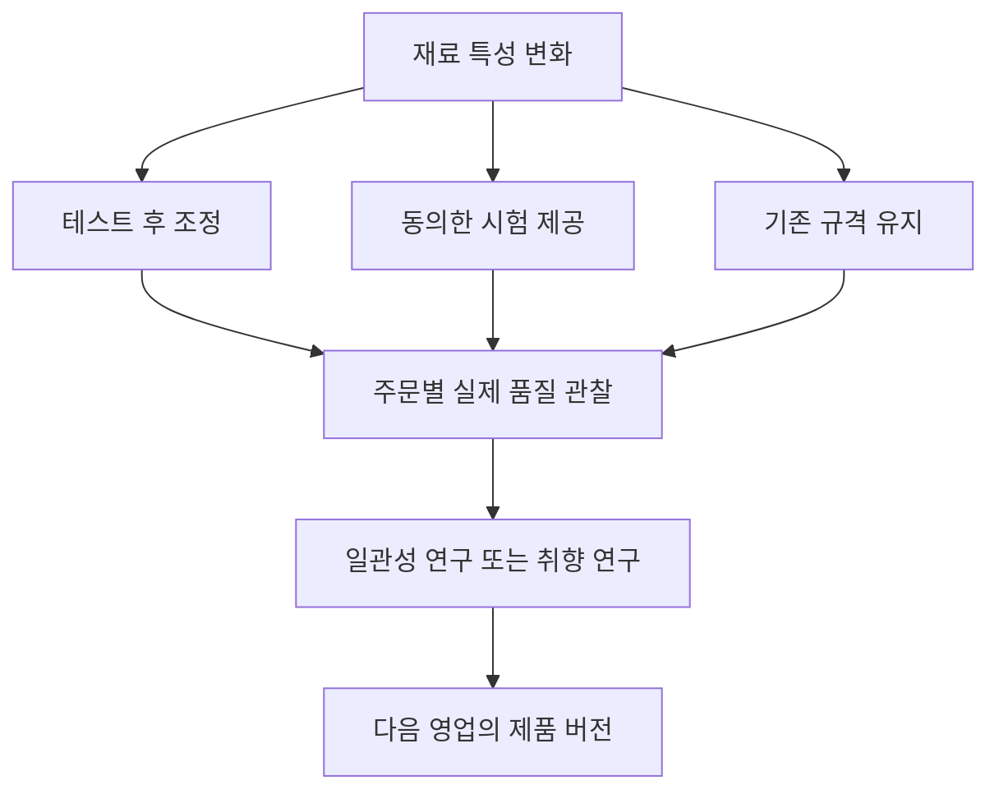

# 카페 선택 경로 스토리보드

문서 ID: SB-CAFE · 버전: 2.0 · 장면: CF01–CF10 · 상태: MVP 구현 기준

[문서 트리](../README.md) · [체험 문서](README.md) · [카페 규칙](../02-businesses/01-cafe.md) · [공통 스토리보드](03-storyboard-common.md)

## 읽는 방법

공통 장면 CT01–CT08에서 카페를 선택한 플레이어에게 보여줄 업종 행동을 확대한다. 공통 튜토리얼 TUT00–TUT11과 같은 진행을 가리키며 열 단계의 추가 튜토리얼을 붙인다는 의미가 아니다. 첫 교육 주문은 훈련 수요, 이후 장면의 경쟁 손님은 실제 상권 수요다. CF05 이후 사건은 조건과 노출 제한이 충족할 때 이어지는 플레이 예시이며 첫 세션에 모두 강제로 발생시키지 않는다.

카메라는 기본적으로 위에서 비스듬히 내려다보는 시점이다. 중요한 선택 때만 확대하고 선택을 마치면 이전 조작 시점으로 돌아간다. 카메라·대사 건너뛰기는 가능하지만 거래 완료·작업 시간·선택 결과는 건너뛰지 않는다.

## 금액 표시와 지연 결과

이 문서의 16·32·48·64 TC 등 금액은 **기본 가격으로 진행한 첫 거래의 연출 예시**다. 실제 UI는 수락 당시 거래에 저장한 가격 P, 실제 소모 원가, 실제 운영비를 조회한다. 가격을 조정한 일반 플레이에서 예시 금액을 하드코딩하지 않는다. 공헌이익 표시는 P에서 해당 거래의 실제 소모 변동원가를 뺀 값이며, 순이익은 운영비·연구·직접 사건비까지 반영한다.

TUT09는 선택을 확정하고 즉시 관측 가능한 결과를 회고하면 완료한다. 이후 일반 고객이 경험할 효과는 `pendingEffect`로 남겨 일반 플레이에서 이어간다. 새 수요가 생기기를 기다려 튜토리얼을 막지 않는다. 튜토리얼의 동의 확인용 NPC 응답은 추가 거래·TC·XP·명성을 만들지 않는다.

## 튜토리얼 매핑

| 컷 | 연결 상태 | 실행 규칙 |
|---|---|---|
| CF01 | CT08·TUT04 재확인 | 이미 만든 사업을 보여주며 자산을 다시 지급하지 않음 |
| CF02 | TUT05 | 영업 시작 |
| CF03 | TUT06 | 첫 훈련 주문 수락·착수 |
| CF04 | TUT07–08 | 전달과 실제 원장 보고 |
| CF06 | TUT09 | 최초 재료 사건 선택·필수 후속 결과 |
| CF09 | TUT10 | 연구 목표만 저장해도 완료 |
| CF10 | TUT11 | 정상 마감·회고 |
| CF05·CF07–08 | 이후 일반 플레이 | 시장 설명과 두 번째 사건의 조건부 장면; 튜토리얼 필수 아님 |

컷 번호는 제작 순서이며 튜토리얼의 강제 실행 순서가 아니다. 첫 경로는 CF04 이후 CF06으로 이어질 수 있다. 자세한 재개 기준은 [튜토리얼 상태 명세](02-onboarding-and-tutorial.md)를 따른다.

## CF01 내 카페의 약속

- **화면·카메라:** 빈 카페 전경에서 기본 판매대와 간판으로 이동. 기본 제품은 ‘기본 커피’, 지갑은 TC 80·DG 0. 확정된 업종과 운영 목표를 표시한다.
- **플레이어 행동:** 간판 템플릿과 색을 고르고, 우선 고객층의 예시를 읽는다. 무료 기본 선택만으로 진행 가능하다.
- **대사·UI:** “어떤 카페로 기억되고 싶어?” 선택은 빠른 수령 / 일정한 맛 / 편안한 공간의 소개 카드이며 수요나 능력치의 즉시 보상은 아니다.
- **결과·저장:** 사업 유형, 간판 템플릿, 팔레트, 장기 목표를 저장. 다시 고른 목표가 연구·명성을 초기화하지 않는다.
- **복구·통과:** 연결 중단 후 확정된 업종으로 복귀. 미확정 편집은 취소 가능. `AC-CF01`: 외형 선택으로 기능 수치가 증가하지 않는다.

## CF02 문을 열기 전에

- **화면·카메라:** 작업대에 준비 상태와 레시피 버전, 입구에 영업표를 표시한다. 장비를 클릭하면 경고 원인이 도구 옆에 나타난다.
- **플레이어 행동:** 준비를 확인하고 영업 시작을 선택한다. 예상 수요와 실제 주문이 다름을 첫 안내에 표시한다.
- **대사·UI:** “문을 열면 손님을 받을 수 있어. 이미 약속한 주문은 마감 전에 정리하자.” 운영 고정비가 별도라는 표시를 유지한다.
- **결과·저장:** 영업 상태가 `CLOSED`에서 검증 후 `OPEN`으로 전환. 영업표와 준비 상태를 저장한다.
- **복구·통과:** 출입구가 막히거나 필요한 장비가 없으면 원인을 보여주고 수정 후 재시도. `AC-CF02`: 영업 조건을 충족하기 전 고객 수락 없음.

## CF03 첫 주문을 받는다

- **화면·카메라:** 훈련 NPC가 판매대에 도착. 주문 카드에 매출 16 TC, 원가 예약 6 TC, 기본 작업 30초, 추가 운영비 예약을 분리해 보여준다.
- **플레이어 행동:** 요구와 대기시간을 확인하고 수락한다. 준비된 주문을 작업 슬롯에 배정한다.
- **대사·UI:** “수락할 때 재료비와 필요한 운영비 예산을 예약해. 만들기 시작하면 재료비를 사용하고 운영비는 시간에 따라 사용해.” 잔액과 사용 가능 잔액을 구별한다.
- **결과·저장:** `RESERVED`에서 원가 예약, `IN_PROGRESS`에서 소비. 주문 ID·제품 버전·고객 약속이 고정된다.
- **복구·통과:** 수락 요청 반복은 같은 주문을 반환. 착수 전 취소는 예약 해제. `AC-CF03`: 원가 예약과 소비가 두 번 차감되지 않는다.

## CF04 한 잔의 결과

- **화면·카메라:** 제조·검수·전달을 짧게 보여주고 고객 표정과 거래 요약을 함께 표시한다. 불필요한 연속 클릭은 요구하지 않는다.
- **플레이어 행동:** 제조 상태를 확인하고 `IN_PROGRESS`의 마지막 전달 행동을 한다.
- **대사·UI:** “거래 매출 16, 재료비 6, 공헌이익 10 TC. 운영비는 경영 보고서에서 따로 확인해.” 품질과 취향 적합성을 나누어 표시한다.
- **결과·저장:** 필요 조건 충족 후 짧은 `READY`를 거쳐 자동 `DELIVERED`. 매출·고객 경험·진행 보상을 각각 한 번 확정한다.
- **복구·통과:** 응답이 늦으면 ‘확인 중’을 표시하고 새 주문으로 바꾸지 않는다. `AC-CF04`: 같은 주문의 전달 버튼 연타로 중복 수익 없음.

## CF05 옆 가게로 가는 손님

- **화면·카메라:** 상권 시점으로 짧게 전환해 두 업체를 비교하는 실제 수요 NPC를 보여준다. 경쟁 업체와 구매 포기 경로도 보인다.
- **플레이어 행동:** 고객의 공개된 요구와 내 가게의 대기·품질 근거를 확인한다. 다른 플레이어의 숨겨진 재고·잔액은 보이지 않는다.
- **대사·UI:** “이 손님은 빠른 수령을 원했어. 지금 우리 예상 대기는 더 길어.” 설명은 실제 고객 선택 근거를 사용한다.
- **결과·저장:** 고객 수요 하나가 선택 업체 또는 구매 포기로 확정. 우리 매출을 보장하지 않는다.
- **복구·통과:** 업체 연결이 끊겨 고객 후보에서 빠지면 예약 전 선택만 재검증. `AC-CF05`: 같은 수요로 두 업체가 동시에 매출을 얻지 않는다.

## CF06 달라진 재료에 대한 선택

- **화면·카메라:** 새 재료 배치의 편차 경고를 확대하고 `EV_CAFE_01` 선택 카드 세 개를 펼친다. 선택 전 비용·시간·적용 대상을 표시한다.
- **플레이어 행동:** A 테스트 후 조정 / B 동의한 고객에게 소량 시험 / C 기존 규격 유지 중 선택한다.
- **대사·UI:** “이번 재료는 이전과 달라요. 확인에 시간을 쓰거나, 제한된 시험으로 반응을 볼 수 있어요.” C에는 알려진 편차 위험을 함께 표시한다.
- **결과·저장:** `PRESENTED → CHOSEN → PENDING_EFFECT`. 사건 원인과 선택을 저장하며 결과는 실제 후속 작업에서 확정한다.
- **복구·통과:** 선택 직후 재접속해도 같은 선택과 비용 예약으로 재개. `AC-CF06`: C를 골랐다고 사전에 고정한 실패를 강제하지 않는다.

## CF07 단체 손님이 왔다

- **화면·카메라:** 현재 대기열과 단체 요청을 같은 화면에 놓는다. ‘우리 처리 가능 시간’과 ‘손님 희망 시간’을 구분한다.
- **플레이어 행동:** `EV_CAFE_02`에서 A 가능한 시간으로 수락 / B 분할 수령 협의 / C 이번 주문 거절을 선택한다.
- **대사·UI:** “지금 약속을 지킬 수 있는 범위가 어디까지일까?” 협의 카드에는 고객 동의 여부와 확정된 조건을 표시한다.
- **결과·저장:** 수락·협의된 주문만 생성한다. 거절된 수요는 공통 시장 규칙으로 다른 후보나 구매 포기로 간다.
- **복구·통과:** 협의 실패는 기존 주문을 바꾸지 않는다. `AC-CF07`: 거절만으로 명성 벌점이나 원가 소비 없음.

## CF08 손님이 경험한 결과

- **화면·카메라:** 같은 장면 구도로 선택 전후의 대기열·품질·고객 반응을 비교한다. ‘좋은 선택’ 배지 대신 실제 이행 결과를 보여준다.
- **플레이어 행동:** 남은 주문을 처리하고, 문제 주문이 있으면 재작업·취소 대응을 고른다.
- **대사·UI:** “단체 주문을 나누어 약속했고, 첫 수령을 지켰어.” 미이행이라면 약속과 실제 결과의 차이를 표시한다.
- **결과·저장:** 사건에 연결된 주문 결과가 확정된 뒤 `RESOLVED`. 명성의 이유 기록과 거래 정산은 각각 중복 방지한다.
- **복구·통과:** 일부 주문만 완료하고 나가면 남은 확정 약속은 공통 마감 규칙 적용. `AC-CF08`: 사건 종료가 미완료 주문을 완료로 바꾸지 않는다.

## CF09 내 카페의 다음 투자

- **화면·카메라:** 연구 보드와 꾸미기 화면을 나란히 보여준다. 연구는 비용·작업 점유, 장식은 외형·배치 효과를 명확히 표시한다.
- **플레이어 행동:** 일관성 또는 취향 배합 연구를 목표로 정하고, 원하면 20 TC·활동 90초의 연구를 시작한다. 선택만으로 연구비를 차감하지 않는다.
- **대사·UI:** “먼저 주문을 정리하고 문을 닫아야 연구를 시작할 수 있어. 다음에 약속한 영업시간도 확인하자.”
- **결과·저장:** 연구 선택, 시작 여부, 진행과 개인 배치를 보존한다. 새 레시피는 승인 후 이후 주문부터 적용한다.
- **복구·통과:** 돈이 부족하면 목표로 저장하고 플레이를 이어간다. `AC-CF09`: 연구와 생산이 같은 슬롯에서 동시에 진행되지 않는다.

## CF10 제대로 닫고 다시 돌아온다

- **화면·카메라:** 입구의 마감 표시에서 일일 보고서로 전환. 보고서는 매출·변동원가·운영비·연구비·사건 비용을 구분한다.
- **플레이어 행동:** 신규 주문을 막고 기존 주문을 완료하거나 명시 취소한다. 다음 목표를 저장하고 나간다.
- **대사·UI:** “오늘의 약속을 정리했어. 돌아오면 이 상태에서 이어가자.” 완료되지 않은 약속이 있으면 마감 전에 다시 보여준다.
- **결과·저장:** `OPEN → CLOSING → CLOSED`. 정상 마감 후 미접속 시간에 비용·품질·명성이 계속 감소하지 않는다.
- **복구·통과:** 연결 끊김은 60초 유예와 단일 정산 규칙을 적용. `AC-CF10`: 재접속 후 장식·연구·선택 결과가 유지되고 미접속 수익·처벌이 누적되지 않는다.

## 분기의 지속 효과

재합류한 뒤에도 선택 비용, 고객 동의, 제품 버전, 실제 결과는 남는다. 새 업그레이드를 사거나 다시 접속해도 과거 선택 기록을 삭제하지 않는다.

## 제작 인계

필수 장면 자산은 기본 카페, 판매대, 커피 제조대, 주문 트레이, 간판 템플릿, 재료 검사 카드, 연구 보드, NPC 표정·대기 연출이다. 첫 구매나 DG 팝업은 이 흐름의 필수 단계로 넣지 않는다. 카메라와 대사를 건너뛰어도 동일한 상태와 인수 기준에 도달해야 한다.

[이전: 공통 스토리보드](03-storyboard-common.md) · [다음: 음식점 스토리보드](05-storyboard-restaurant.md) · [규칙: 카페](../02-businesses/01-cafe.md) · [UI와 설명서](08-ui-and-player-manual.md)
