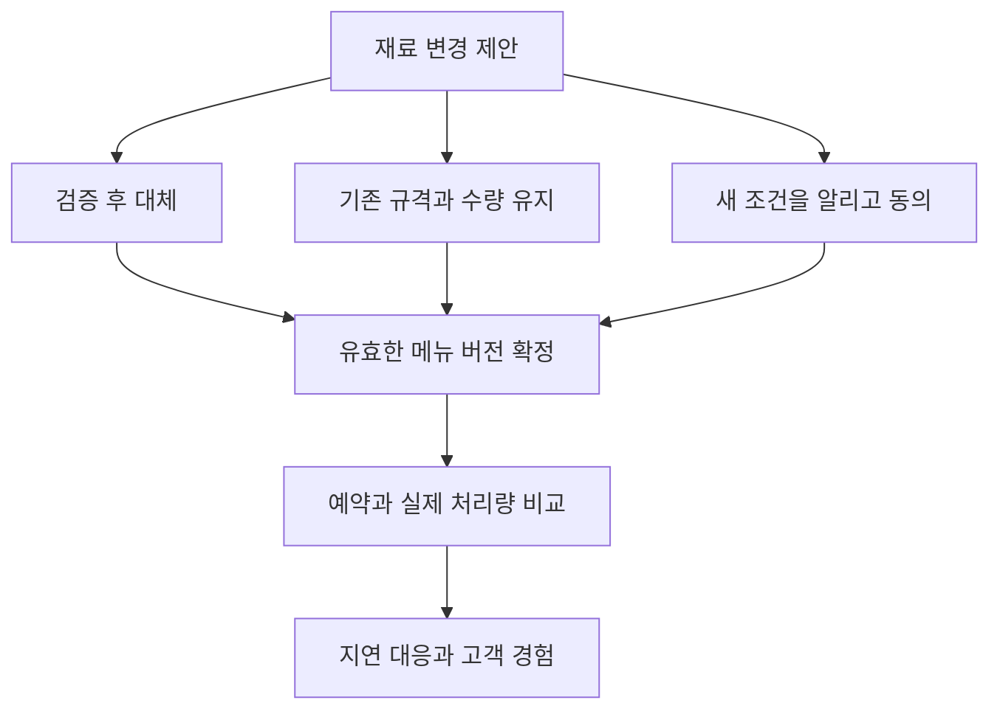

# 음식점 선택 경로 스토리보드

문서 ID: SB-FOOD · 버전: 2.0 · 장면: FD01–FD10 · 상태: MVP 구현 기준

[문서 트리](../README.md) · [체험 문서](README.md) · [음식점 규칙](../02-businesses/02-restaurant.md) · [공통 스토리보드](03-storyboard-common.md)

## 연결과 연출 원칙

공통 CT01–CT08의 음식점 선택 뒤에 해당 업종의 행동을 확대한다. 공통 튜토리얼 TUT00–TUT11과 함께 사용하며, 모든 사건을 첫 접속에 강제하지 않는다. 훈련 주문과 실제 상권 수요를 화면과 기록에서 구분한다. 조리의 성공을 빠른 연타에 의존시키지 않고 준비·요구 확인·공정 선택을 보여준다.

## 금액 표시와 지연 결과

이 문서의 16·32·48·64 TC 등 금액은 **기본 가격으로 진행한 첫 거래의 연출 예시**다. 실제 UI는 수락 당시 거래에 저장한 가격 P, 실제 소모 원가, 실제 운영비를 조회한다. 가격을 조정한 일반 플레이에서 예시 금액을 하드코딩하지 않는다. 공헌이익 표시는 P에서 해당 거래의 실제 소모 변동원가를 뺀 값이며, 순이익은 운영비·연구·직접 사건비까지 반영한다.

TUT09는 선택을 확정하고 즉시 관측 가능한 결과를 회고하면 완료한다. 이후 일반 고객이 경험할 효과는 `pendingEffect`로 남겨 일반 플레이에서 이어간다. 새 수요가 생기기를 기다려 튜토리얼을 막지 않는다. 튜토리얼의 동의 확인용 NPC 응답은 추가 거래·TC·XP·명성을 만들지 않는다.

## 튜토리얼 매핑

| 컷 | 연결 상태 | 실행 규칙 |
|---|---|---|
| FD01 | CT08·TUT04 재확인 | 기존 사업·자산 표시 |
| FD02 | TUT05 | 준비·배치·영업 |
| FD03 | TUT06 | 첫 주문 수락·착수 |
| FD04 | TUT07–08 | 최종 전달과 원장 보고 |
| FD05–06 | TUT09 | 재료 사건의 선택과 동의·검증 결과 |
| FD09 | TUT10 | 연구와 설비의 다음 목표 |
| FD10 | TUT11 | 정상 마감 |
| FD07–08 | 이후 일반 플레이 | 예약 지연 조건이 충족될 때만 진행 |

첫 튜토리얼은 FD06에서 FD09로 이동할 수 있다. 두 번째 사건을 일부러 만들려고 첫 주문을 지연시키지 않는다. [튜토리얼 명세](02-onboarding-and-tutorial.md)의 보상·재개 기준을 따른다.

## FD01 작은 식당의 첫 메뉴

- **화면·카메라:** 조리대와 작은 홀을 한 화면에 잡는다. 대표 메뉴 카드 `FOOD_RICE_01` 채소 덮밥, 기본 자산, TC 80을 표시한다.
- **행동:** 무료 간판·팔레트를 고르고 메뉴 설명을 확인한다. 영구 업종 확정 이후 다른 업종은 별도 연습에서 체험한다.
- **UI·대사:** “손님이 기대한 한 끼를 반복해서 제공하는 식당을 만들자.”
- **결과·저장:** 메뉴 초기 버전·개인화·사업 목표를 저장한다.
- **복구·통과:** 미확정 꾸미기는 취소할 수 있다. `AC-FD01`: 기본 필수 자산이 중복 지급되거나 현금 결제가 요구되지 않는다.

## FD02 준비와 영업표

- **화면·카메라:** 재료·조리·전달의 세 작업 위치를 순서대로 강조한다. 손님 이동 통로를 표시한다.
- **행동:** 준비 상태와 약속한 영업시간을 확인하고 영업 시작. 통로가 막혔으면 배치를 바꾼다.
- **UI·대사:** “예상 수요는 참고값이야. 수락한 주문은 실제 약속이 돼.”
- **결과·저장:** 검증된 배치와 영업표를 저장하고 `OPEN`으로 전환한다. 고정비 누적 조건을 안내한다.
- **복구·통과:** 조건이 모자라면 영업 시작을 막고 정확한 원인을 표시한다. `AC-FD02`: 장식의 외형 변경으로 메뉴 품질이 높아지지 않는다.

## FD03 요구를 확인하고 수락한다

- **화면·카메라:** 훈련 손님과 메뉴 태그, 희망 대기시간을 함께 보여준다. 금액은 매출 32 TC·원가 예약 12 TC·기본 작업 60초이며 추가 운영비 예약도 별도 표시한다.
- **행동:** 요구에 맞는 현재 메뉴 버전을 확인하고 수락한 뒤 작업을 시작한다.
- **UI·대사:** “무엇을 제공하기로 했는지 먼저 확인하자. 약속한 버전은 주문에 남아.”
- **결과·저장:** `RESERVED`에서 원가 12 TC와 필요한 운영비 예산 예약, `IN_PROGRESS`에서 원가 소비. 가격·메뉴 버전·약속 조건을 고정한다.
- **복구·통과:** 착수 전 취소는 예약 해제, 착수 후에는 공통 귀책 규칙 적용. `AC-FD03`: 같은 원가가 두 단계에서 중복 차감되지 않는다.

## FD04 첫 한 그릇의 검수

- **화면·카메라:** 공정 카드와 완성 그릇을 함께 표시한다. 결과 이유는 규격·공정·요구 적합성으로 나눈다.
- **행동:** 검수 결과를 확인해 `IN_PROGRESS`의 마지막 전달 행동을 하거나 알려진 결함을 재작업한다.
- **UI·대사:** “완성됐다는 것과 약속한 조건을 충족했다는 것은 함께 확인해야 해.”
- **결과·저장:** 필요 조건 충족 후 짧은 `READY`를 거쳐 자동 `DELIVERED`, 매출 32 TC 한 번 지급. 거래 공헌이익 20 TC와 별도의 운영비를 표시한다.
- **복구·통과:** 통신 지연 중에는 정산 확인을 기다린다. `AC-FD04`: 단순 전달 애니메이션 재생으로 매출이 생기지 않는다.

## FD05 다른 재료를 제안받다

- **화면·카메라:** 재료 변화 전후의 태그와 현재 메뉴의 약속을 대조한다. `EV_FOOD_01`의 세 선택을 표시한다.
- **행동:** A 규격 확인 후 대체 / B 기존 메뉴의 가능 수량만 유지 / C 변경된 조건을 신규 고객에게 제안한다.
- **UI·대사:** “다른 재료를 쓰면 설명도 함께 바꿔야 해. 이미 받은 주문의 조건은 그대로 남아.”
- **결과·저장:** 사건 선택·대상 제품 버전·시험 비용을 보존한다. 고객의 변경 동의는 별도 상태로 남긴다.
- **복구·통과:** 동의 없는 기존 주문에는 대체 버전 배정 불가. `AC-FD05`: 선택 후 재접속으로 비용이나 동의 조건을 건너뛰지 못한다.

## FD06 새 규격을 시험한다

- **화면·카메라:** 기존 규격과 후보 규격의 관측 결과를 같은 척도로 보여준다. 품질과 선호를 별도 행으로 둔다.
- **행동:** A·C 선택자는 규격을 검증하고 적용 여부를 결정한다. B 선택자는 제한된 수량으로 정상 운영을 이어간다.
- **UI·대사:** “잘 만든 메뉴라도 모든 손님의 취향과 같지는 않아.”
- **결과·저장:** 승인된 새 버전은 이후 주문부터 적용. B의 기존 규격도 정상 선택 결과로 보존한다.
- **복구·통과:** 검증 실패는 이유와 재시도 조건을 표시한다. `AC-FD06`: 새로운 버전이라는 이유만으로 품질·명성이 자동 상승하지 않는다.

## FD07 예약 시간에 늦을 것 같다

- **화면·카메라:** `EV_FOOD_02` 예약 카드와 현재 작업량을 비교한다. 기한을 단순한 빨간 경고 대신 남은 작업과 함께 표시한다.
- **행동:** A 예상 시간 변경 요청 / B 고객 동의하에 전달 순서 조정 / C 예약 취소·정리 중 선택한다.
- **UI·대사:** “요청을 보낸 것과 손님이 동의한 것은 달라. 동의 전에는 기존 약속이 유지돼.”
- **결과·저장:** 고객의 허용 조건과 동의·거절을 저장. 약속 버전은 합의 후만 바뀐다.
- **복구·통과:** 재접속으로 동의 결과를 다시 뽑지 않는다. `AC-FD07`: 동의 전 기한 자동 연장 없음.

## FD08 약속의 결과를 확인한다

- **화면·카메라:** 예약 고객·기존 대기 고객의 경험을 같은 화면에 보여준다. 한쪽의 편의를 위해 다른 약속이 밀렸는지 관찰한다.
- **행동:** 합의된 순서와 시간을 이행하고 미완료 주문을 정리한다.
- **UI·대사:** “이번에는 시간을 미리 바꾸어 약속을 지켰어.” 또는 “수락한 시간을 넘겼어. 다음에는 수락량을 조정하자.” 실제 결과에 따라 문장을 고른다.
- **결과·저장:** 주문 결과·취소 원인·사건 종결을 분리해 기록한다. 새로운 선택을 눌렀다는 이유로 과거 지연 기록을 삭제하지 않는다.
- **복구·통과:** 순서 변경으로 미수락 수요를 복제하지 않는다. `AC-FD08`: 부분 작업만으로 기본 주문 전액 매출 지급 없음.

## FD09 메뉴를 개선하는 투자

- **화면·카메라:** 최근 결과의 원인에서 연구 카드로 연결한다. 조리 표준과 식재료 활용의 목적을 비교한다.
- **행동:** 연구 목표를 선택한다. 시작한다면 기존 주문을 정리하고 `CLOSED`에서 단계당 20 TC·활동 90초와 생산 슬롯 점유를 확인한다.
- **UI·대사:** “지금 문제는 손님의 취향일까, 우리가 같은 품질을 못 내는 걸까?”
- **결과·저장:** 연구 진행과 증거를 남기고 승인 후 적용한다. 연구나 설비 구매만으로 주문 처리량이 늘지 않는다.
- **복구·통과:** 자금 부족이면 목표 저장으로 이어간다. `AC-FD09`: 원가 할인이나 즉시 매출 증가를 설정 외로 적용하지 않는다.

## FD10 영업 보고와 정상 마감

- **화면·카메라:** 오늘의 주문, 취소, 지연, 비용, 다음 계획을 보여주고 외관으로 돌아온다.
- **행동:** 새 수락을 막고 기존 주문을 완료·명시 취소한다. 다음 영업에서 바꿀 준비 항목을 선택한다.
- **UI·대사:** “잘 팔린 이유와 놓친 약속을 함께 남겼어.” 정상 마감 후 오프라인 감쇠가 없음을 짧게 안내한다.
- **결과·저장:** `OPEN → CLOSING → CLOSED`. 비용과 명성 영향은 확정된 경험만 한 번 처리한다.
- **복구·통과:** 유예 종료의 기존 약속 정산과 서버 장애 복구를 구별한다. `AC-FD10`: 다시 접속해도 메뉴·선택·장식이 유지된다.

## 분기 연결

분기가 합쳐진 후에도 제품 버전·동의·비용·약속이 다르다. 연출상 같은 그릇이 보이더라도 거래가 참조한 규격은 동일한 것으로 덮어쓰지 않는다.

## 제작 인계

필수 자산은 작은 홀, 조리대, 재료 보관대, 덮밥 모델, 요구 태그 카드, 공정 보드, 예약 카드, 결과 비교 UI다. 실제 음식 안전의 기준 온도·보존시간 등을 게임 수치로 임의 제시하지 않는다. 이 경로의 학습 내용은 경영의 요구·원가·공정·약속이다.

[이전: 카페 스토리보드](04-storyboard-cafe.md) · [다음: 소프트웨어 스토리보드](06-storyboard-software.md) · [규칙: 음식점](../02-businesses/02-restaurant.md) · [UI와 설명서](08-ui-and-player-manual.md)
