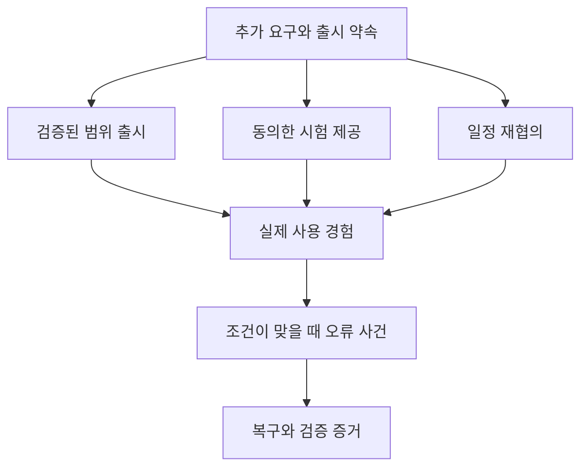

# 소프트웨어 회사 선택 경로 스토리보드

문서 ID: SB-SW · 버전: 2.0 · 장면: SW01–SW10 · 상태: MVP 구현 기준

[문서 트리](../README.md) · [체험 문서](README.md) · [소프트웨어 규칙](../02-businesses/03-software.md) · [공통 스토리보드](03-storyboard-common.md)

## 연결과 표현

공통 CT01–CT08에서 소프트웨어 업종을 선택한 뒤 제품 개발과 고객 도입의 차이를 보여준다. 공통 TUT00–TUT11의 업종 행동을 확대한 장면이며, 이후 사건은 조건이 충족될 때 이어진다. 실제 소스 코드 작성 화면을 필수로 요구하지 않는다. 제품은 예약 관리 앱 하나이며, 고객·요구·작업·검증 카드를 읽고 선택한다.

## 금액 표시와 지연 결과

이 문서의 16·32·48·64 TC 등 금액은 **기본 가격으로 진행한 첫 거래의 연출 예시**다. 실제 UI는 수락 당시 거래에 저장한 가격 P, 실제 소모 원가, 실제 운영비를 조회한다. 가격을 조정한 일반 플레이에서 예시 금액을 하드코딩하지 않는다. 공헌이익 표시는 P에서 해당 거래의 실제 소모 변동원가를 뺀 값이며, 순이익은 운영비·연구·직접 사건비까지 반영한다.

TUT09는 선택을 확정하고 즉시 관측 가능한 결과를 회고하면 완료한다. 이후 일반 고객이 경험할 효과는 `pendingEffect`로 남겨 일반 플레이에서 이어간다. 새 수요가 생기기를 기다려 튜토리얼을 막지 않는다. 튜토리얼의 동의 확인용 NPC 응답은 추가 거래·TC·XP·명성을 만들지 않는다.

## 튜토리얼 매핑

| 컷 | 연결 상태 | 실행 규칙 |
|---|---|---|
| SW01 | CT08·TUT04 재확인 | 이미 확보한 사무실과 템플릿 표시 |
| SW02–03 | TUT06의 제품 준비 안내 | 신규 고객 수락 전 요구·검증 흐름 설명, 별도 매출 없음 |
| SW04 | TUT05–06 | 영업 개시 조건 확인 후 첫 도입 수락·착수 |
| SW05 | TUT07–08 | 최초 도입 완료와 원장 보고 |
| SW06 | TUT09 | 다음 버전의 범위 사건 선택·후속 결과 |
| SW09의 연구 목표 카드 | TUT10 | 오류 사건이 없어도 목표 설명 가능 |
| SW10 | TUT11 | 정상 마감 |
| SW07–09의 오류 대응 | 이후 일반 플레이 | 실제 수요·오류 조건이 충족될 때 진행 |

TUT06 화면은 수락 전 요구 확인을 포함한다. 영업 승인 없이 계약을 수락하는 의미가 아니다. 두 번째 오류 사건을 만들기 위해 최초 안정 버전에 결함을 강제로 주입하지 않는다. [튜토리얼 상태 명세](02-onboarding-and-tutorial.md)를 따른다.

## SW01 작은 팀의 첫 제품

- **화면·카메라:** 사무실 전경에서 개발 보드와 제품 시연대로 이동한다. `SW_BOOKING_01` 예약 관리 앱, 기본 템플릿, TC 80을 표시한다.
- **행동:** 회사 간판과 제품 소개 템플릿을 고른다. 현재 제품으로 해결할 고객 문제를 읽는다.
- **UI·대사:** “여러 가게가 같은 문제를 겪고 있어. 하나의 제품으로 어떤 부분을 해결할까?”
- **결과·저장:** 사업·제품 초기 버전·회사 개인화를 저장한다. 외형 선택은 판매량 보상이 아니다.
- **복구·통과:** 기본 제품 템플릿을 재접속 때 재지급하지 않는다. `AC-SW01`: 하나의 사업이 두 개의 활성 제품을 동시에 생성하지 않는다.

## SW02 고객 문제를 확인한다

- **화면·카메라:** 훈련 NPC의 업무 흐름과 요구 카드 두세 장을 제품 옆에 보여준다. ‘이번 버전’과 ‘나중에’ 칸이 있다.
- **행동:** 예약 등록과 일정 확인이라는 필수 흐름을 확인하고 범위를 정한다.
- **UI·대사:** “고객이 원하는 기능을 모두 한 번에 넣는 것보다, 약속할 범위를 분명히 하자.”
- **결과·저장:** 목표 요구와 수용 기준을 제품 후보에 저장한다. 고객 도입 계약은 아직 생성하지 않는다.
- **복구·통과:** 범위 카드를 움직이는 것만으로 매출·명성을 지급하지 않는다. `AC-SW02`: 요구 변경이 기존 승인 버전을 덮어쓰지 않는다.

## SW03 작업과 검증의 차이

- **화면·카메라:** 구성 작업이 끝난 표시와 검증 결과를 분리한다. 테스트 통과·실패 이유가 카드에 남는다.
- **행동:** 제공된 계획에 따라 구성·테스트 증거를 확인하고 최초 안정 버전을 승인한다.
- **UI·대사:** “만들었다고 생각한 기능이 고객의 흐름에서도 동작하는지 확인해.”
- **결과·저장:** 검증 기록과 릴리스 승인을 저장한다. 초기에 제공한 교육 템플릿의 승인 과정은 반복 보상 대상이 아니다.
- **복구·통과:** 실패한 필수 검증은 해결·범위 변경 동의 전 승인할 수 없다. `AC-SW03`: 연출 건너뛰기가 검증 조건을 건너뛰지 않는다.

## SW04 첫 고객의 도입

- **화면·카메라:** 상담석에 고객이 앉고 도입 카드가 열린다. 기본 매출 48 TC·원가 18 TC·작업 90초, 추가 운영비 예약을 분리한다.
- **행동:** 요구에 맞는 안정 버전과 조건을 제안하고 수락된 도입 작업을 시작한다.
- **UI·대사:** “원가와 운영비 예산을 먼저 확보해. 착수하면 도입 원가가 사용되고 매출은 완료 뒤 들어와.”
- **결과·저장:** `RESERVED → IN_PROGRESS`. 원가 예약·운영비 예약, 제품 버전, 고객 동의를 저장한다.
- **복구·통과:** 영업 상태와 충분한 예산이 없으면 수락하지 않는다. `AC-SW04`: 원가·운영비 예약이 서로 다른 실제 차감으로 혼동되지 않는다.

## SW05 고객이 제품을 쓰기 시작한다

- **화면·카메라:** 고객의 예약 흐름이 완료되는 시연과 도입 결과를 보여준다. 시연 성공은 서버의 완료 상태를 시각화한다.
- **행동:** 최종 설정·검수 확정을 한다. 이는 `IN_PROGRESS` 마지막 행동이다.
- **UI·대사:** “도입 완료 매출 48 TC, 변동원가 18 TC, 거래 공헌이익 30 TC.” 고정비·연구비를 별도로 보여준다.
- **결과·저장:** 조건 충족 후 짧은 `READY`를 거쳐 자동 `DELIVERED`. 완료 매출·경험을 한 번 확정한다.
- **복구·통과:** 완료 응답 지연에는 기존 결과를 조회한다. `AC-SW05`: 승인 버튼 반복이나 시연 재생으로 재판매가 발생하지 않는다.

## SW06 이번 출시의 범위를 고른다

- **화면·카메라:** `EV_SW_01`에서 추가 요구, 남은 검증, 약속된 일정이 한 화면에 보인다.
- **행동:** A 검증된 범위로 안정 출시 / B 동의한 대상에게 시험 제공 / C 출시 연기와 일정 재협의 중 선택한다.
- **UI·대사:** “무엇을 지금 제공하고, 무엇이 아직 시험 중인지 고객에게 알려야 해.” 선택 전 영향 고객과 소요·비용을 확인한다.
- **결과·저장:** 선택·제공 범위·동의 상태·후속 검증을 저장한다. 연기 요청만으로 기존 계약을 연장하지 않는다.
- **복구·통과:** 고객 동의를 기다릴 때 새 확정 약속을 임의 생성하지 않는다. `AC-SW06`: 시험 버전이 모든 고객에게 배포되지 않는다.

## SW07 더 많은 문의, 다른 기대

- **화면·카메라:** 실제 상권의 패키지 제품 수요 NPC가 여러 업체의 공개 정보를 비교한다. 회사의 기능 적합성·안정성·도입 조건을 보여준다.
- **행동:** 놓친 문의의 공개 이유를 확인하고 안정성 또는 사용성 연구를 검토한다.
- **UI·대사:** “기능은 맞았지만 이 고객은 더 단순한 시작 과정을 원했어.” 근거 없는 경쟁사 비방은 제공하지 않는다.
- **결과·저장:** 고객이 선택한 하나의 거래 또는 구매 포기를 기록한다. 광고 장식만으로 매출이 확정되지 않는다.
- **복구·통과:** 수요가 적어도 무한 가짜 주문을 생성하지 않는다. `AC-SW07`: 카페 손님을 소프트웨어 구매자로 강제 전환하지 않는다.

## SW08 출시 후 오류에 대응한다

- **화면·카메라:** `EV_SW_02` 오류 카드에 버전·재현 조건·영향 범위를 표시한다. 실제 서버 장애 안내와 다른 UI를 사용한다.
- **행동:** A 검증된 이전 버전으로 복구 / B 문제 기능 제한 후 수정 / C 신규 도입을 멈추고 점검 중 선택한다.
- **UI·대사:** “영향을 줄이고, 이미 쓰는 고객에게 처리 계획을 알려야 해.” 가능한 추가 시간과 운영비 예약도 노출한다.
- **결과·저장:** 문제 버전의 신규 배정 제한, 고객 안내, 수정 계획을 저장한다. 선택 순간 품질·명성을 초기화하지 않는다.
- **복구·통과:** 추가 비용이 불가능하면 시간이 늘지 않는 중지·종료 대안을 제공한다. `AC-SW08`: 사건 대응이 지갑을 음수로 만들지 않는다.

## SW09 수정의 증거를 남긴다

- **화면·카메라:** 오류 재현→수정 계획→같은 조건 재검증을 연결해 보여준다. 선택 A·B·C별 이행 항목이 다르게 표시된다.
- **행동:** 남은 대응을 수행하고 검증된 버전을 승인한다. 별도 연구는 기존 고객 작업을 정리한 `CLOSED`에서 20 TC·활동 90초와 생산 슬롯 공유를 확인한 후 시작한다.
- **UI·대사:** “복구 버튼을 누른 것보다, 같은 조건에서 문제가 사라졌다는 결과가 필요해.”
- **결과·저장:** 결함 해결 증거·고객 지원 결과·사건 `RESOLVED`를 저장한다. 무료 수정은 새 판매로 정산하지 않는다.
- **복구·통과:** 재접속 후에도 동일 결함과 영향 대상 유지. `AC-SW09`: 같은 수정 증거를 반복 제출해 명성을 무한 회복하지 못한다.

## SW10 제품의 다음 버전을 계획한다

- **화면·카메라:** 제품 버전 이력과 회사 공간의 출시 기념판을 함께 보여준다. 오늘 매출과 고객 경험을 분리한 보고서를 연다.
- **행동:** 다음 목표를 선택하고 신규 문의를 막은 뒤 기존 도입 작업을 정리한다.
- **UI·대사:** “어떤 요구를 해결했고, 어떤 위험이 남았는지 다음 계획으로 가져가자.”
- **결과·저장:** 정상 마감 상태와 다음 연구 목표·장식을 저장한다. 이후 미접속 시간의 자동 품질 하락은 없다.
- **복구·통과:** 미해결 결함은 정상 마감해도 남지만 오프라인 고객 피해를 무한 생성하지 않는다. `AC-SW10`: 돌아온 뒤 제품 버전과 사건 상태가 같고 숨은 추가 청구가 없다.

## 선택의 흐름

오류 사건은 모든 선택의 벌로 강제 발생하지 않는다. 실제 결함·환경 조건·노출 제한이 맞을 때만 나타나며, 안정된 선택의 결과가 계속 정상일 수도 있다.

## 제작 인계

필수 자산은 작은 사무실, 요구 보드, 작업 카드, 테스트 보드, 제품 시연대, 릴리스 버전 카드, 지원 사건 카드다. 실제 개인 데이터나 외부 서비스 화면을 요구하지 않는다. 출시·수정의 효과는 게임 내 버전과 고객 기록으로 표현한다.

[이전: 음식점 스토리보드](05-storyboard-restaurant.md) · [다음: SI 스토리보드](07-storyboard-si.md) · [규칙: 소프트웨어](../02-businesses/03-software.md) · [UI와 설명서](08-ui-and-player-manual.md)
