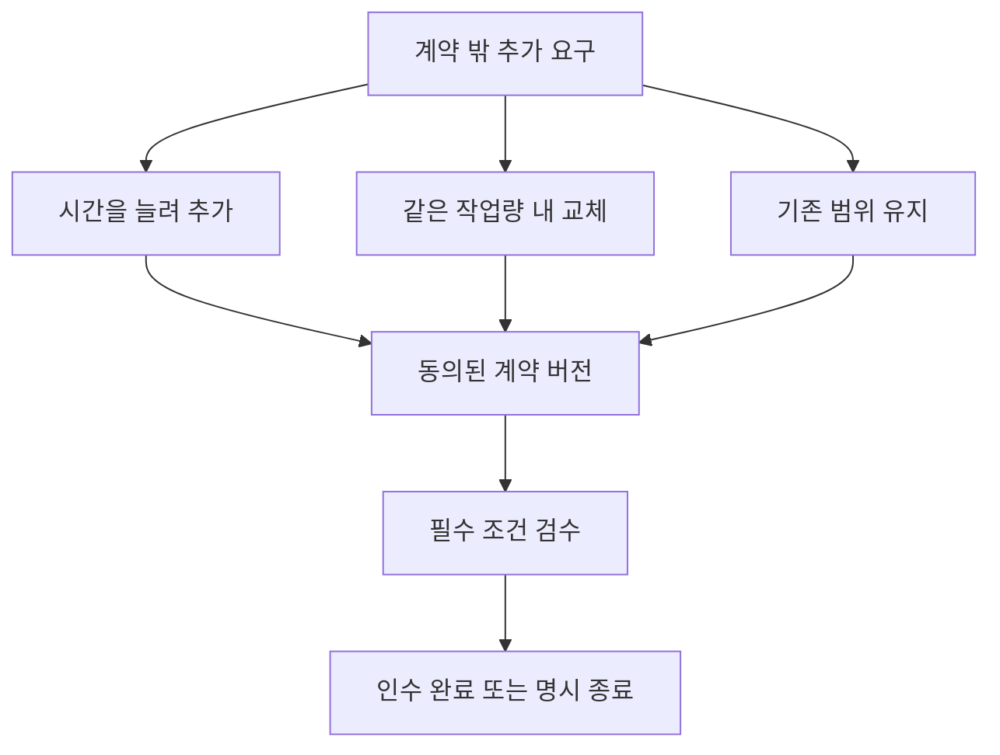

# SI 회사 선택 경로 스토리보드

문서 ID: SB-SI · 버전: 2.0 · 장면: SI01–SI10 · 상태: MVP 구현 기준

[문서 트리](../README.md) · [체험 문서](README.md) · [SI 규칙](../02-businesses/04-si.md) · [공통 스토리보드](03-storyboard-common.md)

## 연결과 핵심 경험

공통 CT01–CT08에서 SI를 선택한 뒤 상담→범위 합의→구성→검수→인수의 흐름을 보여준다. 공통 TUT00–TUT11과 연결되는 업종 확대 장면이다. 첫 고객은 훈련 수요이며 이후 문의는 실제 맞춤 구축 수요에서 경쟁한다. 두 선택 사건을 모든 신규 이용자에게 한 번에 강요하지 않는다.

## 금액 표시와 지연 결과

이 문서의 16·32·48·64 TC 등 금액은 **기본 가격으로 진행한 첫 거래의 연출 예시**다. 실제 UI는 수락 당시 거래에 저장한 가격 P, 실제 소모 원가, 실제 운영비를 조회한다. 가격을 조정한 일반 플레이에서 예시 금액을 하드코딩하지 않는다. 공헌이익 표시는 P에서 해당 거래의 실제 소모 변동원가를 뺀 값이며, 순이익은 운영비·연구·직접 사건비까지 반영한다.

TUT09는 선택을 확정하고 즉시 관측 가능한 결과를 회고하면 완료한다. 이후 일반 고객이 경험할 효과는 `pendingEffect`로 남겨 일반 플레이에서 이어간다. 새 수요가 생기기를 기다려 튜토리얼을 막지 않는다. 튜토리얼의 동의 확인용 NPC 응답은 추가 거래·TC·XP·명성을 만들지 않는다.

## 튜토리얼 매핑과 계약 순서

| 컷 | 연결 상태 | 실행 규칙 |
|---|---|---|
| SI01–02 | CT08·TUT04·TUT06 안내 | 상담·요구 확인, 계약 수락 전 |
| SI03 | TUT05–06 | 영업 개시 조건 확인 후 수락·착수 |
| SI04–06 | TUT07 내부 | 수행 중 EV_SI_01를 먼저 선택·이행하여 현재 계약에 반영 |
| SI08 | TUT07–08 | 최종 인수와 원장 보고 |
| SI05–06의 저장 결과 | TUT09 | 이미 해결한 선택을 회고; 종료된 계약을 다시 변경하지 않음 |
| SI09 | TUT10 | 다음 연구 목표 |
| SI10 | TUT11 | 정상 마감 |
| SI07 | 이후 일반 플레이 | 실제 통합 불일치 조건이 충족될 때만 발생 |

튜토리얼의 표시 상태와 실제 계약의 수행 상태는 별개다. 최초 계약에서는 SI06 다음 SI08로 이어질 수 있다. TUT09를 맞추기 위해 납품 완료된 계약에 추가 요구를 끼워 넣거나 새 매출을 만들어 내지 않는다. [튜토리얼 명세](02-onboarding-and-tutorial.md)의 저장된 선택 회고 규칙을 사용한다.

## SI01 작은 회사에 온 첫 문의

- **화면·카메라:** 상담석과 요구 보드를 보여준다. `SI_RESERVATION_01` 맞춤 예약 연동, 기본 설비, TC 80을 표시한다.
- **행동:** 회사 간판과 작업 공간을 확인하고 훈련 고객의 상담을 시작한다.
- **UI·대사:** “예약 내용이 일정판에도 보이면 좋겠어요.” 처음에는 고객의 문제만 제시한다.
- **결과·저장:** 사업 개인화와 상담 진행을 저장한다. 상담 시작은 계약 수락이나 매출이 아니다.
- **복구·통과:** 미완료 상담은 재개 가능. `AC-SI01`: 대화를 반복해서 돈이나 완료 경험을 얻지 못한다.

## SI02 무엇을 완료라고 부를까

- **화면·카메라:** 요구 카드의 모호한 부분과 검수 가능한 조건을 비교한다. ‘포함’·‘제외’·‘확인 필요’가 나뉜다.
- **행동:** NPC의 업무 흐름을 질문하고 예약 정보와 일정판의 필수 연결 조건을 확인한다.
- **UI·대사:** “예약을 저장한 뒤 같은 일정이 보이면 완료로 확인할 수 있을까요?” 합의한 조건만 체크한다.
- **결과·저장:** 요구 확인과 검수 기준 초안을 저장한다. 숨겨진 정답 대사 순서로 점수를 주지 않는다.
- **복구·통과:** 필수 조건을 확인하지 않았으면 원인을 표시한다. `AC-SI02`: 확인하지 않은 요구가 완료 처리되지 않는다.

## SI03 계약을 수락한다

- **화면·카메라:** 총액 64 TC, 변동원가 24 TC, 기본 작업 120초, 운영비 추가 예약을 계약 카드에 분리한다. 중간 검수 현금 지급은 없다고 표시한다.
- **행동:** 범위·납기·검수 기준·예산을 확인하고 수락한다. 착수는 별도 작업 시작이다.
- **UI·대사:** “계약을 받는 것과 돈이 들어오는 것은 달라. 최종 검수까지 마쳐야 매출이 확정돼.”
- **결과·저장:** `RESERVED`에서 원가·운영비 예산 예약, `IN_PROGRESS`에서 원가 소비. 계약 버전을 고정한다.
- **복구·통과:** 충분한 예산이 없으면 수락을 막는다. `AC-SI03`: 계약 카드의 재전송으로 예약이나 거래가 중복되지 않는다.

## SI04 작업을 구성한다

- **화면·카메라:** 입력 정보·예약 저장·일정판 표시의 의존 관계를 작업 보드에 표시한다. 고객의 검수 조건이 옆에 남는다.
- **행동:** 선행 작업을 완료하고 연결 조건을 확인한다. 실제 코드를 작성하지 않는다.
- **UI·대사:** “각 작업이 끝났어도 함께 동작하는지 확인해야 해.”
- **결과·저장:** 구성 버전·작업 증거·남은 작업 시간을 저장한다. 생산과 연구가 동시에 같은 슬롯을 쓰지 않는다.
- **복구·통과:** 순서가 맞지 않으면 필요한 선행 작업을 안내한다. `AC-SI04`: 완료 애니메이션만으로 검수 상태를 통과시키지 않는다.

## SI05 추가 요구가 들어온다

- **화면·카메라:** `EV_SI_01` 추가 요구가 기존 계약 옆에 나타난다. 바뀌는 범위와 남는 범위를 색과 텍스트로 구분한다.
- **행동:** A 같은 총액에서 작업 30초를 추가하고 일정 합의 / B 같은 작업량 안에서 기능 교체 합의 / C 기존 계약 범위를 유지 중 선택한다.
- **UI·대사:** “추가 요청을 무료로 받으면 작업과 운영 시간이 늘어나. 무엇을 바꿀지 함께 정하자.” A는 추가 운영비 예산 1 TC 확보가 필요하다.
- **결과·저장:** 동의한 변경만 새 계약 버전으로 저장한다. 수락 당시 총액 P(기본가 예시 64 TC)·기본 변동원가 24 TC는 유지한다. A는 후속 문의 기회가 줄 수 있다.
- **복구·통과:** A 예산 부족 시 B·C의 시간 연장 없는 대안을 유지한다. `AC-SI05`: 동의 전 계약 변경, 음수 지갑, 즉석 추가 견적 생성 없음.

## SI06 중간 검토에서 발견한다

- **화면·카메라:** 고객이 합의한 요구와 현재 결과를 같은 화면에 비교한다. ‘중간 검토’라고 크게 표시한다.
- **행동:** 현재까지의 요구 충족과 남은 작업을 확인한다. C를 선택했어도 기존 필수 조건은 모두 만족해야 한다.
- **UI·대사:** “이번 범위를 먼저 완료하기로 했죠. 빠진 필수 조건이 없는지 확인할게요.”
- **결과·저장:** 중간 검토 결과를 저장하고 다음 작업으로 진행한다. TC 매출은 지급하지 않는다.
- **복구·통과:** 고객의 동의와 검토 결과는 재접속해도 유지된다. `AC-SI06`: 중간 검토를 반복해 매출을 받지 못한다.

## SI07 연결 검수의 불일치

- **화면·카메라:** `EV_SI_02`에서 각 작업의 성공과 전체 연결의 실패를 함께 보여준다. 실패 조건과 실제 영향이 명확히 보인다.
- **행동:** A 원인을 수정하고 재검수 / B 고객이 동의한 대체 구성으로 같은 필수 기준 충족 / C 계약 중단·정리 중 선택한다.
- **UI·대사:** “해결 방법은 바꿀 수 있지만, 고객이 필요로 한 결과를 몰래 빼면 안 돼.” A·B는 추가 작업 30초와 운영비 예산 1 TC를 표시한다.
- **결과·저장:** 선택과 합의된 구성·추가 시간·운영비 예약을 저장한다. 추가 변동원가는 0 TC이며 운영비는 실제 유상 운영 시간에 따라 소비한다.
- **복구·통과:** 예산이 없으면 무리한 A·B 수락을 막고 C를 제공한다. `AC-SI07`: 실패 항목 숨김이나 일방적인 인수 기준 삭제로 성공하지 않는다.

## SI08 최종 인수를 마친다

- **화면·카메라:** 합의된 계약 버전의 필수 검수 조건이 통과하는 장면을 보여준다. 취소 경로라면 완료 축하 대신 정리 내역을 보여준다.
- **행동:** 성공 경로는 최종 검수·납품 확정을 선택한다. 이 입력은 `IN_PROGRESS` 마지막 단계다. 취소 경로는 원가 손실과 사유를 확인한다.
- **UI·대사:** 기본가 첫 거래의 예시 대사는 “최종 검수 완료, 매출 64 TC. 기본 공헌이익 40 TC에서 운영·연구·대응 비용을 확인하자.”다. 실제 대사의 금액은 수락 총액 P와 실제 소모 원가로 채운다. 취소 대사의 손실액도 이미 소비한 원가 기록을 조회한다.
- **결과·저장:** 성공은 짧은 `READY`를 거쳐 자동 `DELIVERED`, 취소는 `CANCELLED`. 매출과 결과 기록을 한 번 확정한다.
- **복구·통과:** 응답 지연은 기존 계약 결과 조회로 복구한다. `AC-SI08`: 성공·취소 정산을 동시에 적용하지 않는다.

## SI09 다음 수주를 위한 연구

- **화면·카메라:** 요구 누락·구성 불일치·납기 경험을 결과 보드에 표시하고 두 연구로 연결한다.
- **행동:** 요구 검증 또는 통합 테스트 연구를 목표로 선택한다. 실제 시작은 기존 계약을 정리한 `CLOSED`에서 20 TC·활동 90초와 슬롯 사용을 확인한 후다.
- **UI·대사:** “이번에 어려웠던 것은 질문이 부족해서일까, 연결 검증이 부족해서일까?” 사람의 능력 점수 대신 관찰된 원인을 쓴다.
- **결과·저장:** 연구 목표·진행·검증 증거와 기념판을 저장한다. 실패 계약도 개선 계획의 근거로 남는다.
- **복구·통과:** 연구할 자금이 없으면 목표를 저장한다. 다음 거래의 원가도 부족하면 실제 손실의 정비 과제·TC 취득 철회 등 공통 복구 절차를 안내한다. `AC-SI09`: 유료 재화로 명성이나 검수 통과를 구매하지 못한다.

## SI10 회사를 닫는 것과 약속을 버리는 것

- **화면·카메라:** 새 문의 차단과 기존 계약 목록을 동시에 보여준다. 모두 정리된 후 회사 외관으로 돌아온다.
- **행동:** 신규 문의를 막고, 남은 확정 계약을 완료하거나 공통 절차로 취소한다. 다음 목표를 저장한다.
- **UI·대사:** “영업을 마치면 새 일을 받지 않아. 이미 합의한 일의 상태는 그대로 남아.”
- **결과·저장:** `CLOSING`을 거쳐 `CLOSED`. 정상 마감 후 오프라인 비용·명성 손실·연구 감쇠는 없다.
- **복구·통과:** 연결 유예 중 기존 작업·기한·비용은 동결하고 종료 시 한 번 정리한다. `AC-SI10`: 접속을 반복해 계약 결과나 추가 작업 시간을 초기화하지 못한다.

## 분기와 재합류

재합류는 계약 조건이 같아졌다는 뜻이 아니다. 각 경로의 범위·기한·운영 시간·동의 기록을 유지한다. C는 계약에 없던 일을 거절하는 선택이며, 기존 필수 조건을 누락하고도 성공하는 선택이 아니다.

## 제작 인계

필수 자산은 상담석, 요구·범위 보드, 구성 카드, 연결 검수 화면, 계약 버전 비교 화면, 프로젝트 기념판이다. 실제 외부 계정이나 고객사의 민감한 정보를 입력하지 않는다. 추가 범위의 대가와 납기 위험은 게임상의 TC·활동 시간·고객 경험으로 표현한다.

[이전: 소프트웨어 스토리보드](06-storyboard-software.md) · [다음: UI와 플레이어 설명서](08-ui-and-player-manual.md) · [규칙: SI](../02-businesses/04-si.md) · [공통 구현](../04-implementation/01-engine-neutral-spec.md)
