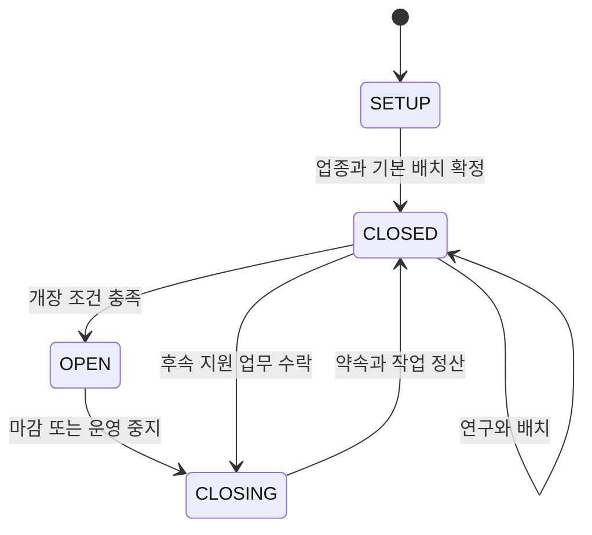

# 공통 게임 구현 명세

버전 2.0 · 설계 기준 2026-11-11 · 상태: 구현 기준안, 실행 검증 전  
[문서 트리](../README.md) / [구현 문서](README.md)

## 1. 목적과 구현 경계

이 문서는 게임 규칙을 실행하는 공통 계약이다. 화면 표현, 통신 수단, 저장 제품, 결제 사업자는 교체할 수 있다. 어느 실행 환경에서도 동일한 명령과 동일한 초기 상태를 사용하면 같은 경제 결과와 선택 결과를 만들어야 한다. 표의 수치는 성능 보장이 아니라 첫 구현의 목표이며, 게임 수치의 원본은 [경제와 아이템](../01-game/06-economy-and-items.md)이다.

공개 MVP는 카페·음식점·소프트웨어·SI를 모두 제공한다. 계정당 실제 사업 1개, 스테이지당 실제 플레이어 최대 6명이다. 업종 중복을 허용한다. 다른 업종을 시험하는 연습 상태에는 영구 경제 효과가 없다. 초기 선택 확정 후 영구 업종 전환은 후속 기능이다.

### 공통 불변식

| ID | 반드시 성립할 조건 |
|---|---|
| INV01 | TC와 DG의 확정 잔액 및 소비 가능액이 음수가 되지 않는다. PB는 프로젝트 범위 밖으로 이전되지 않는다. |
| INV02 | 한 수요는 한 시점에 한 업체만 예약할 수 있다. 같은 주문의 원가와 매출은 각각 한 번만 확정한다. |
| INV03 | 가격·품질·소유권·보상·사건 결과는 권위 실행자가 검증한다. 화면의 완료 연출은 지급 근거가 아니다. |
| INV04 | 초기 지원 80 TC와 무료 필수 설비는 계정의 최초 영구 사업에 한 번만 지급한다. 연습·재접속·선택 수정으로 반복하지 않는다. |
| INV05 | 동작하는 스테이지 소유 세대는 하나다. 이전 세대의 기록 요청은 영구 저장 경계에서 거부한다. |
| INV06 | 선택 확정과 지연 효과 식별자를 영구 보존한다. 접속 종료와 재시작으로 선택지나 사건을 다시 뽑지 않는다. |
| INV07 | DG 아이템은 수요 효용·명성·품질·작업 슬롯·연구 시간·사건 발생 확률을 바꾸지 않는다. |
| INV08 | 정상 마감 후 미접속 시간에는 이익, 고정비, 명성 감소, 연구 노후화가 발생하지 않는다. |

## 2. 구성 요소와 책임

| 구성 요소 | 입력과 책임 | 자신이 소유하지 않는 것 |
|---|---|---|
| 계정·프로필 | 신원 연결, 영구 진행 로드, 초기 지급 기록 | 거래 결과 산출 |
| 스테이지 관리자 | 참가 좌석, 활성 소유 세대, 보고 주기, 수면·복원 | 개별 지갑의 임의 수정 |
| 사업 운영 | 영업 상태, 공표된 약속, 생산 슬롯, 마감 | 고객 효용 가중치 변경 |
| 수요 시장 | 수요 생성, 호환 후보, 외부 선택지, 단독 예약 | NPC 이동 애니메이션 |
| 주문·작업 | 원가 예약, 착수, 공정, 검수, 전달·취소 | 임의 유료 보너스 |
| 품질·연구 | 실제 품질, 적합성, 연구 단계와 적용 버전 | 평가 문장만으로 품질 결정 |
| 명성·관계 | 검증된 결과의 관측값, 완화된 업데이트, 회복 | 다른 플레이어의 허위 평가 반영 |
| 선택·사건 감독 | 조건·시드·노출 한도, 선택 기록, 약속과 지연 효과 | 모델 출력을 직접 실행 |
| 경제 원장 | 정수 재화, 예약액, 거래 중복 방지, 확정 결과 | 렌더링 상태 |
| 소유·배치 | 아이템 인스턴스, 배치 권한, 통로와 사용점 검증 | 유료 외형에 숨은 기능 부여 |
| 예산 연습·프로젝트 | MVP의 PB 예산 연습, 후속 프로젝트 수행 조건 | 개인 지갑에 잔여 PB 지급 |
| 관측·운영 | 지표, 오류 상관 ID, 기능 중지, 복구 사건 | 로그만 보고 사용자 잔액 덮어쓰기 |

게임 상태는 위 구성 요소의 데이터와 규칙으로 표현한다. 화면에서 버튼을 누를 때 모든 요소가 직접 서로를 호출하도록 만들지 않고, 권위 명령 처리기가 필요한 상태를 읽고 검증한 뒤 일관된 변경 묶음을 확정한다.

## 3. 교체 가능한 포트

| 포트 | 최소 계약 |
|---|---|
| IdentityPort | 인증된 내부 `playerId` 제공. 클라이언트가 보낸 사용자 ID로 신원 변경 금지. |
| CommandPort | 명령 접수, 결과 조회, 결과·스냅샷 전달. 재전달 가능성을 전제로 함. |
| ClockPort | stageTick, businessActiveTick, 연결 유예용 실제 경과 시간, 감사 시각을 구분. 기기 시각은 판정에 쓰지 않음. |
| DurableStorePort | 예상 버전·소유 세대 확인, 단일 경제 경계의 원자적 변경, 중복 결과 조회, 내보낼 사건 보존. |
| StageOwnershipPort | 소유 세대 발급·갱신·실효 확인. 정산 저장도 같은 세대를 검증해야 함. |
| PresentationPort | 좌표·상태·문장을 표시하고 입력 의도를 전달. 잔액이나 고객 판정 권한 없음. |
| SpatialPort | 격자·통로·접근점 검사. 시각 오브젝트와 의미상의 서비스 접근성을 연결. |
| PaymentPort | 검증된 지급·취소 증빙을 내부 구매 사건으로 변환. 구매창 종료는 증빙이 아님. |
| TextPolicyPort | 표시 가능한 이름·간판·문장 또는 승인된 기본 문구 반환. 실패 시 원문 공개 금지. |
| EventProposalPort | 허용된 사건 후보·문장 제안. 기한 초과나 무효 결과에는 기본 규칙 사용. |
| TelemetryPort | 게임 결과를 관측. 지표의 전송 성공 여부가 게임 보상을 바꾸지 않음. |

저장 포트는 단일 경제 경계에 대한 원자성을 필수로 제공한다. 여러 계정이나 스테이지를 동시에 바꾸는 기능은 영구 실행 기록과 재처리 가능한 단계로 설계한다. 구현 환경이 다중 경계의 원자적 처리를 제공하더라도 그 기능에만 의존하는 게임 규칙을 만들지 않는다.

## 4. 상태와 시간

### 사업과 접속은 다른 축이다

| 상태 집합 | 값 | 주요 전이 |
|---|---|---|
| BusinessState | `SETUP`, `CLOSED`, `OPEN`, `CLOSING` | 설정 완료 → 닫힘 → 개장 → 마감 중 → 닫힘 |
| ConnectionState | `CONNECTED`, `RECONNECTING`, `ABSENT` | 일시 단절 → 60초 복구 유예 → 복구 또는 부재 |
| OrderState | `RESERVED`, `IN_PROGRESS`, `READY`, `DELIVERED`, `CANCELLED` | 원가 예약 → 착수 → 완료 준비 → 전달 |
| ResearchState | `PLANNED`, `RUNNING`, `READY`, `APPLIED`, `CANCELLED` | 계획 → 연구 → 검증 완료 → 적용 |
| PromiseState | `ANNOUNCED`, `FULFILLED`, `MISSED`, `CANCELLED` | 공표 → 수행 또는 미이행·합의 취소 |
| DecisionState | `PRESENTED`, `CHOSEN`, `PENDING_EFFECT`, `RESOLVED` | 제시 → 선택 확정 → 후속 결과 → 회고 |

`CLOSED`여도 접속한 사용자는 연구·꾸미기를 할 수 있다. 따라서 `businessActiveTick`은 영업 시간과 같지 않다. 기본 작업 슬롯 하나는 생산·연구·사건 대응이 공유한다. 연구는 기존 거래를 마감한 CLOSED에서만 시작·진행한다. 생산은 진행1건과 대기1건이 기본 상한이며, 슬롯이 점유 중이면 다음 작업을 착수하지 않는다. 납품 후 지원은 EVENT_WORK의 AFTERCARE 유형으로 별도 기록하고 원래 매출을 다시 지급하지 않는다.

| 시간 | 사용처 | 진행·정지 규칙 |
|---|---|---|
| stageTick | 스테이지 수요, 공용 사건, 20분 보고 주기 | 활성 스테이지에서 증가. 마지막 사용자의 유예·마감 처리 후 수면. |
| businessActiveTick | 개별 작업, 연구, 선택 약속 | 연결되고 권위 실행이 정상일 때 증가. 복구 유예·서버 장애·부재에는 정지. |
| 유상 운영 누적 | 운영 고정비 | 연결 상태에서 OPEN이거나, CLOSING 중 착수·준비된 생산 또는 EVENT_WORK가 있을 때만 증가. |
| 실제 경과 시간 | 연결 복구60초, 인증·구매 확인 | 정상 서버의 실제 경과 시간으로 판정. 서버 장애 시간으로 귀책을 만들지 않음. |
| 감사 시각 | 구매 증빙, 장애 조사 | 실제 시각 기록. 게임 진행을 이 시각의 차이로 소급 계산하지 않음. |

경제 갱신은 1초 단위, 이동·상호작용 시뮬레이션은 10Hz를 초기 목표로 한다. 고정비는 30초 누적당 1 TC다. 잔여 누적값은 마감·재접속에도 보존한다. 부족한 잔액을 예약 원가에서 가져오지 않으며, 부족 시 처리와 재기 절차는 경제 문서의 단일 규칙을 적용한다.

## 5. 권위 명령 처리 순서

1. 인증된 신원과 연결 세션을 확인한다.
2. 크기·유형·허용 값·유한수·요청률을 검사한다.
3. 같은 `commandId`의 확정 결과를 조회한다. 같은 ID에 다른 내용이면 거부한다.
4. 해당 스테이지의 소유 세대와 사업 소유권을 확인한다.
5. 데이터 버전, 상태, 위치, 재화, 작업 슬롯, 선택 유효성을 검사한다.
6. 고정된 콘텐츠 버전과 시드로 결과 후보를 계산한다.
7. 원장·상태·명령 결과·발행할 사건을 일관되게 영구 확정한다.
8. 확정 성공 후 화면 결과를 전달한다. 응답 유실은 같은 ID로 조회·재시도한다.

단순 이동은 이 경제 경로를 매 프레임 실행하지 않는다. 이동은 일시 상태로 처리하며, 소유권·재화·결정·고객 예약 등 영구 의미가 생기는 순간에만 확정 기록을 만든다.

## 6. 공통 명령 목록

세부 필드와 오류는 [데이터 계약](02-domain-data-contracts.md)을 따른다. 표의 접근자는 인증된 소유자이며, 자동 영업 처리기는 같은 검증을 거치는 내부 주체로 실행한다.

| ID | 명령 | 입력 요약 | 확정 결과 |
|---|---|---|---|
| C01 | JoinStage | 선호 스테이지·초대 증빙 | 좌석 예약, 사업 배치, 공개/개인 스냅샷 |
| C02 | CreateBusiness | 업종·승인된 이름·스타일 | 실제 사업과 최초 지원 단회 생성 |
| C03 | DeclareSchedule | 개장 계획·약속 버전 | 공표할 영업 약속 |
| C04 | SetOpenState | 개장 의도 | 조건 충족 시 OPEN; 마감은 C17로 전달 |
| C05 | SetOffer | 제품·가격·운영 정책 | 신규 수요에 적용할 제안 버전 |
| C06 | AcceptDemand | 수요 ID·제안 버전 | 단독 예약, 주문, 원가와 운영비 예약액 |
| C07 | AdvanceWork | 작업 ID·허용 단계 행동 | 예약 재검증, 착수 원가 또는 공정 진행 |
| C08 | DeliverOrder | 주문 ID | 검수·전달·매출·명성 관측 |
| C09 | StartResearch | 연구 ID | 비용·슬롯·연구 시작 상태 |
| C10 | ApplyResearch | READY 연구 ID | 제품 또는 공정 버전 변경 |
| C11 | MaintainAsset | 설비·관리 행동 | 시간·비용·설비 상태 |
| C12 | PlaceItem | 인스턴스·격자·회전 | 충돌·통로 검사 후 배치 |
| C13 | PurchaseItem | 상품 ID·견적 버전 | TC 또는 DG 차감과 소유권 동시 확정 |
| C14 | ChooseOption | 사건 인스턴스·선택 ID | 비용·선택 이력·지연 효과 |
| C15 | ResolvePromise | 약속 ID·이행 행동 | 실제 증거가 충족한 약속만 완료 |
| C16 | AcceptProject | 예산 연습·계약 ID | MVP의 격리된 PB120 예산 연습 상태 |
| C17 | CloseBusiness | 마무리/취소 의도 | 신규 수요 차단, 기존 작업과 약속 정리 |
| C18 | LeaveStage | 마감 확인 버전 | 정산 확인 후 좌석 해제 |
| C19 | RequestSnapshot | 마지막 상태 버전 | 현재 공개/개인 상태 재전송 |
| C20 | SetVisitPolicy | 공개 범위·허용 설정 | 적용 범위가 분명한 방문 정책 |

기존 C06 주문에 C05의 새 가격을 소급 적용하지 않는다. C08은 애니메이션 완료를 믿지 않고 실제 작업·품질·검수 상태를 확인한다. C14는 선택 창이 열린 뒤 상황이 바뀌면 결과를 다시 예고하고 재확인을 요구한다. 결제 완료는 클라이언트 명령으로 받지 않는다.

## 7. 수요·작업·경제의 연결

수요 고객은 상태로 존재하고 NPC 모습은 그 상태의 표현이다. 손님이 길을 걷거나 문 안으로 들어간 사실만으로 매출이 발생하지 않는다. 수요 예약 → 비용 예약 → 작업 착수 → 검수 → 전달의 의미 단계가 필요하다.

카페와 음식점은 서비스 주문, 소프트웨어는 제품 적합성 확인·릴리스·지원, SI는 요구 범위·단계 검수·최종 인수라는 서로 다른 작업 그래프를 사용한다. 공통 엔진은 그래프를 진행하지만 실제 단계와 선택은 업종 콘텐츠가 정의한다. SI의 중간 검수는 MVP에서 현금 지급을 발생시키지 않는다.

MVP의 C16은 최초 튜토리얼 안의 120 PB 예산 선택 연습만 실행한다. 정식 공동 프로젝트는 후속 범위다. 후속의 예산이 있는 공동 프로젝트는 개인 판매 주문과 별도 정산 정책을 사용한다. 프로젝트 재료비를 PB에서 지급했다면 같은 업무에 TC 원가를 다시 차감하지 않는다. 해당 활동의 일반 매출도 중복 지급하지 않는다.

## 8. AI 사건 처리 계약

기본 감독은 조건, 효용, 노출 한도, 쿨다운과 저장된 시드로 사건을 고른다. 선택적 모델은 정해진 후보 중 제안하거나 문장을 바꿀 수 있다. 결과는 아래 순서로 검증한다.

1. 허용된 사건 ID와 스키마인지 검사한다.
2. 대상 업종·상태·원인·쿨다운·동시 노출 수를 검사한다.
3. 비용과 효과가 등록된 콘텐츠 범위 안에 있는지 검사한다.
4. 모델에 관계없이 같은 규칙으로 사건을 영구 확정한다.
5. 시간 초과·모델 오류·검증 실패에는 기본 감독 결과를 사용한다.

모델은 새 상품 가격, 지갑 변경, 외부 실행 명령, 불이익 크기, 특정 사용자의 승패를 결정할 수 없다. 사건에 대한 사용자의 선택도 검증된 명령 C14로만 반영한다.

## 9. 완료 기준

다음 조건을 모두 만족해야 공통 엔진 구현 완료로 본다.

- 네 업종이 같은 명령 경로로 최초 선택부터 영업·연구·선택·마감·재접속까지 진행된다.
- 저장 실패와 중복 전달에도 원가·매출·아이템·사건 효과가 한 번만 반영된다.
- 수요풀의 생성·예약·성공·이탈·잔여 수가 보존된다.
- 유료 외형을 변경해도 같은 시드의 경쟁 결과가 변하지 않는다.
- 연결 복구, 사용자 종료, 서버 장애의 결과가 각각 명시된 정책과 일치한다.
- [기술 검증 T01~T24](03-realtime-and-persistence.md#8-기술-검증-목록)를 모두 실행하고 증빙을 남긴다.

## 연관 문서

- 다음: [데이터와 메시지 계약](02-domain-data-contracts.md)
- 실행 순서: [실시간 동기화와 영구 저장](03-realtime-and-persistence.md)
- 콘텐츠 입력: [콘텐츠 제작 규격](05-content-authoring.md)
- 플랫폼 적용: [웹 구현](../05-platforms/01-web-threejs.md), [다른 플랫폼 적용](../05-platforms/03-roblox-adapter.md)
