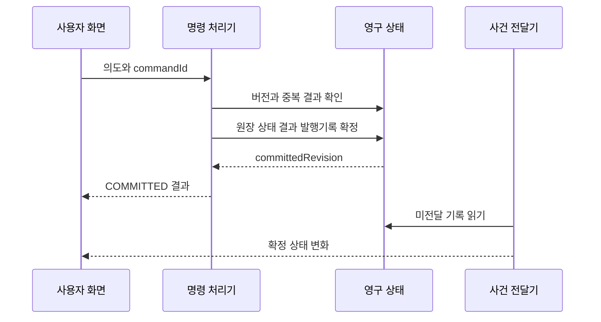

# 실시간 동기화와 영구 저장

버전 2.0 · 설계 기준 2026-11-11 · 상태: 구현·부하 검증 전  
[문서 트리](../README.md) / [구현 문서](README.md)

## 1. 일시 상태와 확정 상태

이동·보행 애니메이션·마우스 미리보기는 일시 상태다. 원가·매출·소유권·고객 예약·확정 선택·명성 관측·영업 약속은 영구 의미가 있는 상태다. 둘을 같은 빈도로 저장하지 않는다.

| 흐름 | 초기 갱신 목표 | 확정 방법 |
|---|---|---|
| 이동과 가까운 상호작용 | 권위 시뮬레이션 10Hz | 속도·장애물·소유 영역 검사, 화면 보간 |
| 공개 상태 전송 | 최대 10Hz, 변한 항목만 | revision 순서 적용, 오래된 상태 폐기 |
| 경제·작업 시계 | 1초 | 권위 tick 계산. 재화 경계와 의미 변화는 영구 기록. |
| 경제 명령 | 사건 발생 시 | 저장 성공 후 COMMITTED 응답 |
| 복구 체크포인트 | 초기 5초 목표 | 확정 사건 위치와 함께 저장; 위치는 보수적으로 복원 가능 |
| 20분 경영 보고 | stageTick 1,200초마다 | 이미 확정된 원장에서 집계, 새 재화 지급 없음 |

10Hz 갱신이 10Hz 영구 재화 쓰기를 뜻하지 않는다. 고정비는 30초 누적 경계, 작업은 착수·검수·전달·취소 경계에서 기록한다. 마지막으로 확인한 체크포인트보다 앞선 경제 결과로 되돌리면 안 된다.

## 2. 명령과 표시의 순서

사용자는 가구를 이동하거나 작업을 누를 때 즉시 미리보기를 볼 수 있다. 잔액은 ‘처리 중’과 ‘확정’을 구분한다. 후속 경제 명령은 앞선 명령이 확정된 revision을 기준으로 실행한다.



응답과 사건 전달은 서로 먼저 도착할 수 있다. 화면은 eventId·revision으로 중복을 제거한다. 모든 메시지가 한 번만 도착한다고 가정하지 않고, 여러 번 도착해도 효과가 한 번 발생하게 한다.

## 3. 경제 정산 단위

단일 사업의 거래는 지갑·재료 예약·운영비 예약·주문·원장·명령 결과·발행할 사건을 일관된 경계에서 확정한다.

```text
commitEconomy(command, expectedRevision, ownerEpoch):
  기존 commandId 결과가 있으면 같은 payloadHash인지 확인하고 반환
  현재 revision, 소유자, ownerEpoch, 상태를 확인
  가용 TC와 재료·운영비 예약, 슬롯과 콘텐츠 조건을 검증
  다음 상태와 ledger entries와 outgoing events를 계산
  한 경제 경계 안에서 함께 저장
  저장 성공이면 COMMITTED를 반환
```

원장 기록만 성공하고 주문 상태가 실패하거나, 아이템만 지급되고 DG 차감이 실패하는 상태를 허용하지 않는다. 저장 오류가 발생했을 때 이미 확정됐는지 불확실하면 같은 operationKey로 조회·재시도한다. 임의의 반대 거래를 즉시 만들어 두 번 복구하지 않는다.

### 수요 예약은 여러 경계를 만질 수 있다

1. 스테이지의 수요에 `reservationId`와 대상 업체를 조건부 확정한다.
2. 업체 경계에서 원가와 운영비를 예약하고 주문 생성 준비를 기록한다.
3. 두 준비가 확인되면 수요와 주문의 확정을 발표한다.
4. 업체의 자금·슬롯 검증 실패 시 수요 예약을 해제한다.
5. 중간 장애 후에는 영구 예약 기록으로 완료 또는 해제를 재수행한다.

준비 중인 수요는 다른 업체가 가져갈 수 없다. 제한된 준비 기한을 넘으면 복구 처리기가 실제 업체 기록을 먼저 확인한 뒤 해제한다. 시간만 보고 이미 준비된 주문의 수요를 재판매하지 않는다. 하나의 저장 경계로 위 단계를 원자적으로 처리할 수 있는 적용 환경은 이를 최적화할 수 있다.

## 4. 스테이지 소유권과 복구

동일 스테이지의 수요와 경쟁 결과를 둘 이상의 실행자가 동시에 확정하지 못하게 한다. 소유권에는 단조 증가하는 `ownerEpoch`를 붙인다. 저장 요청에서 이 값을 확인하지 않는 임대 잠금은 충분하지 않다.

| 상황 | 요구 동작 |
|---|---|
| 정상 실행 | 소유권 갱신, 명령 직렬화, checkpointRevision 유지 |
| 갱신 실패 | 새 수요·경제 확정 중지. 저장 권한을 확인하기 전 성공 응답 금지. |
| 새 실행자 인수 | 새 epoch를 영구 확정하고 체크포인트 이후 사건을 재생 |
| 이전 실행자 복귀 | 이전 epoch의 모든 영구 변경 거부 |
| 복원 중 고객 표시 | 필요하면 단순 위치로 재배치. 예약과 주문 결과는 유지. |
| 콘텐츠 버전 누락 | 해당 스테이지 쓰기 잠금과 복구 안내. 다른 버전으로 임의 재판정 금지. |

복구 시 마지막 확인 상태 이후의 실제 벽시계 시간을 영업 시간으로 채우지 않는다. 확인되지 않은 서버 중단 시간에 비용·불만·실패를 만들지 않는다. 이미 확정된 매출과 선택은 보존한다.

## 5. 연결 해제와 마감

### 정상 종료

C17은 신규 수요를 먼저 막는다. 예약 업무는 마무리 또는 취소 정책에 따라 정리하고, 착수 업무는 정해진 완료·검수 기한 안에서 끝낸다. 결과를 보여준 뒤 C18로 좌석을 해제한다. 정상 마감 후 스테이지가 계속 돌아가더라도 해당 사용자의 사업 시계는 증가하지 않는다.

### 예상치 못한 단절

`RECONNECTING` 진입 때 당시 사업 상태, 활성 작업, 선택, 기한, 고정비 잔여 초를 보존한다. 신규 수요를 받지 않고 작업·연구·비용·개별 기한을 동결한다. 스테이지는 정상 서버의 실제 경과 시간으로 60초의 복구 기회를 유지한다. 프로세스 자체가 바뀌거나 전체 장애가 나면 이전 마감시각을 근거로 귀책 처리하지 않고 서버 복구 절차를 적용한다.

- 60초 안에 재접속: 최신 전체 상태와 미확인 명령 결과를 전달하고 보존된 상태에서 이어 간다.
- 유예 종료: 확정된 약속과 작업에만 정책에 따른 단회 마감 결과를 남긴다. 예약 원가·잔여 운영비 예약을 해제한다. 그 뒤 ABSENT로 전환한다.
- 서버 전체 장애: 연결 유예 종료에 따른 사용자 귀책 결과를 만들지 않는다. 재개·원가 복구·무불이익 취소 중 사전 정의된 정책을 적용한다.

유예 직전에 이미 확정된 불만·실패·선택 결과는 재접속해도 취소하지 않는다. 마감 작업에는 `closureId`를 사용하여 연결 해제 이벤트가 여러 번 와도 한 번만 정산한다.

### 누적 운영비와 예약

현재/예약된 직렬 생산·EVENT_WORK의 최대 남은 유상 운영 시간에 선택 대기·최종 검수 기한을 포함한다. 그 합을 H, 잔여 운영 초를 f라 할 때 필요한 운영비 예약은 `floor((f + H) / 30)`이다. 실제 차감은 유상 운영 30초 경계마다 1 TC다.

수요 수락 시 재료와 운영비를 함께 예약하고 착수 때 다시 검증한다. 시간 연장 선택은 추가 예약이 가능해야 한다. 이미 예약한 업무가 끝나거나 취소되면 필요한 예약을 다시 계산해 초과분을 해제한다. READY는 최종 사용자 입력을 마친 후의 짧은 서버 정산 상태이며 즉시 전달을 시도한다. 사용자가 버튼을 누르지 않아 무한 비용이 쌓이는 상태를 만들지 않는다.

진행 업무가 없는 OPEN에서 다음 1 TC를 감당하지 못하면 자동 마감하고 운영 자금 사유를 표시한다. 누적 f는 유지한다. 미납·음수 지갑·완료된 상품을 돈이 부족해 전달하지 못하는 상태를 만들지 않는다.

## 6. 동기화·권한·부하

초기 전체 상태는 공개 스테이지 뷰와 자신의 비공개 뷰를 나눠 보낸다. 이후 delta에는 baseRevision과 nextRevision을 붙인다. baseRevision이 맞지 않거나 버퍼가 넘치면 낡은 이동을 버리고 전체 스냅샷을 요청한다. 경제 명령 결과는 버리지 않고 별도로 조회할 수 있어야 한다.

클라이언트가 늦다고 과거 수요 결정을 소급 변경하지 않는다. 자기 이동에는 짧은 예측을 사용할 수 있지만, 고객 예약과 구매는 권위 확정을 기다린다. 다른 사용자의 이동을 막아 손님을 빼앗는 몸싸움은 MVP 경쟁 요소가 아니다.

초기 요청 한도는 이동 의도 초당20회, 일반 변경 초당5회, 경제 변경 초당2회로 시작해 실제 입력 경험을 측정한다. 급격한 반복은 제한하되 정상 재전달 commandId는 불필요한 재계산 없이 결과를 조회한다. 상한은 초기 설정값이며 [웹 적용 문서](../05-platforms/01-web-threejs.md)에 전송·기기 예산을 둔다.

## 7. 운영·관측과 중지

모든 확정에는 commandId, sourceId, stageId, ownerEpoch, contentVersion, commitRevision을 연결한다. 사용자에게는 간단한 문의용 결과 ID를 보여준다. 로그에 전체 결제 증빙, 인증 토큰, 모델 입력 원문을 기본 저장하지 않는다.

운영 중지는 신규 구매 진입, 특정 사건의 신규 생성, 신규 스테이지 참가, 특정 상품 판매 단위로 나눈다. 이미 결제된 구매의 지급·환불 처리와 기존 거래 복구는 신규 판매 중지 뒤에도 계속한다. 복구는 근거 ID를 가진 새 정정 거래로 기록한다.

## 8. 기술 검증 목록

아래는 실행해야 할 테스트다. 이 문서 작성 과정에서 실제 게임 테스트가 통과한 것은 아니다. 기능 검증과의 연결은 [전체 완료 기준](04-test-and-acceptance.md)을 따른다.

| ID | 주입·재현 조건 | 통과 기준 |
|---|---|---|
| T01 | 다른 playerId·사업·아이템으로 변경 요청 | 인증된 소유 대상만 변경, 타인 상태 변화0 |
| T02 | 비정상 유형, 무한수, 큰 문자열, 폭주 | 정산 전 거부·제한, 서버 정상 처리 유지 |
| T03 | 동일 ID 동일 내용 20회 및 다른 내용 재전송 | 최초 결과 재사용, 다른 내용은 COMMAND_CONFLICT |
| T04 | 카페 reserve→start→30초→deliver | TC80→80→74→73→89, 예약0→7→1→0→0 |
| T05 | 두 업체가 마지막 수요를 같은 tick에 수락 | 예약 한 건, 패자 비용·보상0 |
| T06 | 구매·연구·수요 수락 동시 요청 | 합산 예약을 고려, 음수·슬롯 초과 없음 |
| T07 | 원장·주문·소유권 확정 중 쓰기 실패 | 모두 적용 또는 모두 미적용, 부분 지급 없음 |
| T08 | commit 성공 직후 응답 전에 실행 종료 | 재시도 결과 동일, 매출·아이템 중복0 |
| T09 | 사건 발행 뒤 완료 표시 전 재시작 | 중복 사건에도 소비자 효과1회 |
| T10 | 새 소유 epoch 발급 후 이전 실행자 쓰기 | 이전 쓰기 모두 거부, 신규 상태 보존 |
| T11 | 59초 복구와 61초 복구를 각각 실행 | 전자는 이어가기, 후자는 단회 마감; 동결 구간 과금0 |
| T12 | 스테이지 실행 전체 중단 후 복원 | 장애 시간의 영업 실패·불만·비용0 |
| T13 | OPEN/CLOSING/CLOSED/복구 전환, f=29에서 반복 | 유상 조건만 과금, f 보존, 운영비 회피·미납 없음 |
| T14 | 같은 초기 상태·콘텐츠·시드로 시장 재생 | 수요 결정 일치, 생성=잔여+예약+완료+이탈 |
| T15 | 무효 AI proposal·과대 비용·시간 초과 | 승인된 기본 사건, 지갑 직접 변경0 |
| T16 | 사건 선택 후 콘텐츠 교체·재접속·재전달 | 기존 선택 버전 유지, 지연 효과1회 |
| T17 | 타인 뷰·방문 권한·숨은 객체 요청 | 개인 재화·연구·사건·결제 증빙 전송0 |
| T18 | 같은 구매의 중복·역순 지급 알림 | 검증된 구매당 DG 지급1회 |
| T19 | 미사용·사용 후·부분 환불·분쟁 역전; 100DG 아이템 후10DG 정정; 원금100 중 환불20+잔여80 분쟁 패소 | 첫 사례 아이템 취소 후90DG 보존, 둘째 원금100 정정; 동일 원금 중복 제외·중첩 불명 추가 회수 보류; 원장 재생·중복 처리 결과 동일, 무료 진행 영향0 |
| T20 | 프로필 로드 실패·손상·미존재 각각 주입 | 실패를 신규 계정으로 덮어쓰지 않음 |
| T21 | 지연·재정렬·전송 적체 후 재접속 | 최신 스냅샷 수렴, 경제 결과 복구, 메모리 무한 증가 없음 |
| T22 | 6명 최대 콘텐츠로 장시간 운영 | 설정된 tick·메모리·전송 예산을 측정해 만족, 수치는 실측 보고 |
| T23 | 사업 생성·훈련·초기 선택 수정 동시 재시도 | 영구 사업1, 80TC 지원1회, 연습 보상 이전0 |
| T24 | 스키마 이전 실패·백업 복원·콘텐츠 롤백 | 지급·선택 이력 보존, 이전 재실행 동일 결과 |

## 연관 문서

- 이전: [데이터와 메시지 계약](02-domain-data-contracts.md)
- 다음: [기능과 기술 완료 기준](04-test-and-acceptance.md)
- 시간 정책: [핵심 순환과 시간](../01-game/01-core-loop-and-time.md)
- 플랫폼 적용: [웹 구현](../05-platforms/01-web-threejs.md), [웹 결제와 운영](../05-platforms/02-web-payments-and-ops.md)
