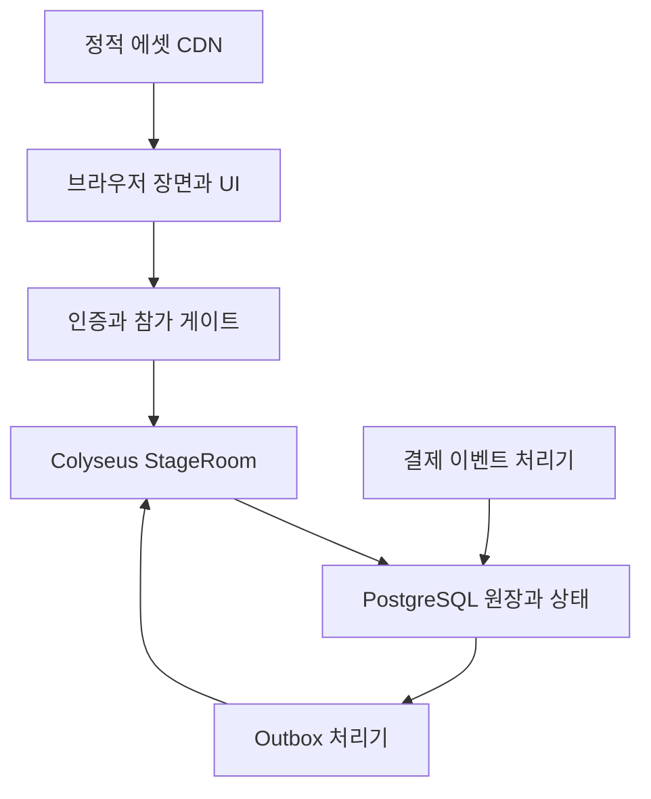

# Three.js 웹 구현 기준

버전 2.0 · 확인일 2026-11-11 · 상태: 웹 우선 구현안, 실제 실행·부하 검증 전  
[문서 트리](../README.md) / [플랫폼 문서](README.md)

## 1. 선택한 구성

이 문서는 [플랫폼 중립 게임 명세](../04-implementation/01-engine-neutral-spec.md)를 웹에서 실행하는 구체적인 적용안이다. Three.js는 장면 표현을 담당하고, 수요·원가·품질·명성·구매의 권위 상태는 서버가 담당한다.

| 계층 | 선택 | 목적과 경계 |
|---|---|---|
| 언어·빌드 | TypeScript, Vite | 클라이언트 빌드와 타입 검사. 정확한 패치 버전은 착수 시 lockfile로 고정. |
| 3D 표현 | Three.js WebGLRenderer | 상권·아바타·NPC·가구·선택 연출. 경제 판정 없음. |
| 화면 UI | DOM/CSS, React | 계약·장부·선택지·설정·접근성. 매 프레임 3D 장면을 UI 상태로 재생성하지 않음. |
| 실시간 서버 | Node.js, Colyseus | StageRoom, 인증, 상태 동기화, 재접속. |
| 영구 저장 | PostgreSQL | 지갑·원장·주문·선택·소유권·구매·outbox. |
| 확장 시 공유 계층 | Redis Presence/Driver | 다중 프로세스의 방 찾기와 임시 알림. 영구 잔액의 근거가 아님. |
| 정적 배포 | CDN과 객체 저장 | 버전이 있는 glTF·텍스처·오디오·클라이언트 묶음. |
| 결제 | PaymentProvider 어댑터 | [별도 결제 명세](02-web-payments-and-ops.md)의 검증된 증빙만 반영. |

현재 확인한 Three.js WebGLRenderer는 WebGL2 기반이다. WebGL1 호환을 전제로 하지 않는다. WebGPU 렌더러는 후속 비교 대상으로 남기고, MVP의 필수 브라우저 조건을 WebGL2로 고정한다. [W01]

Colyseus는 방 상태 동기화와 재접속 기능을 제공한다. 이 기능이 영구 지갑 저장이나 구매 원장을 자동으로 보장하는 것은 아니므로 별도 저장 계층을 둔다. 아래 API는 확인한 공식 문서 기준이며 구현할 때 서버·클라이언트 SDK 호환 버전을 함께 고정한다. [W02][W03][W04]

## 2. 배포 구조

첫 배포는 한 지역의 상시 실행 서버 프로세스와 관리형 데이터베이스로 시작한다. 매 요청마다 사라지는 함수 안에 StageRoom의 권위 상태를 두지 않는다. 수평 확장 때는 방 소유 프로세스로 연결이 이어지도록 라우팅하고, 공유 Presence와 Driver를 추가한다. Colyseus 공식 확장 문서는 각 Room이 한 프로세스에 속하고 다중 프로세스에 Redis 공유 계층을 쓰는 구조를 설명한다. [W08]

## 3. 코드 경계

| 경로 예시 | 담는 것 | 의존 금지 |
|---|---|---|
| `packages/domain` | 명령 reducer, 시장·가격·연구·분기 규칙, 중립 타입 | Three.js, Colyseus, DB 클라이언트, 결제 SDK |
| `packages/content` | 업종·아이템·사건 정의와 검증기 | 클라이언트의 임의 수치 덮어쓰기 |
| `apps/web` | ScenePresenter, InputMapper, UI, 예측·보간 | 확정 잔액 직접 수정 |
| `apps/server` | StageRoom, 인증, 권위 명령 처리, 포트 구현 | UI 컴포넌트 |
| `packages/persistence` | 트랜잭션·중복 키·원장·outbox·마이그레이션 | 미검증 클라이언트 payload 직접 기록 |
| `packages/payments` | 공급자 어댑터, 지급·환불 정규화 | 게임 룰을 우회한 DG 변경 |
| `tests/fixtures` | 네 업종의 결정론 fixture, 장애·재연결 사례 | 운영 계정·실결제 비밀 |

공유 domain 코드를 사용해도 클라이언트 계산 결과는 참고값이다. 가격·완료·시장 결과는 서버에서 다시 계산한다.

## 4. Three.js 장면 구현

MVP 카메라는 기울어진 내려다보기 시점으로 시작한다. 이동·줌·회전 범위를 제한하고, 가게 내부를 선택하면 가림벽을 숨겨 작업점을 볼 수 있게 한다. 고객·사업의 논리 ID와 3D Object의 참조를 분리해서 장면을 재생성해도 경제 상태를 복원할 수 있게 한다.

- 바닥·건물 외형·반복 가구는 모델과 재질을 공유한다. 반복 오브젝트는 적합한 경우 instancing을 사용한다.
- NPC는 같은 리그와 애니메이션을 재사용한다. 멀리 있는 NPC는 업데이트 빈도와 표현 복잡도를 낮춘다.
- 가구 미리보기는 클라이언트에서 빠르게 표시하고, 확정 위치는 서버의 격자·통로 검사 결과를 적용한다.
- 그림자는 주요 장면에 제한하고 저사양 설정에서 낮춘다. 장식 효과를 꺼도 경쟁 정보가 사라지지 않게 한다.
- 품질·명성·혼잡도는 색만으로 표시하지 않고 아이콘·문자·수치를 함께 쓴다.
- glTF와 텍스처는 버전 해시로 배포하고 클라이언트 콘텐츠 버전과 묶는다.

스테이지 전환·가구 외형 교체 때 사용하지 않는 geometry, material, texture를 참조 수에 맞춰 해제한다. Three.js는 이 자원을 자동으로 모두 정리하지 않으므로 `dispose()`를 포함한 수명 관리를 구현한다. 공유 자원을 한 가게가 떠났다는 이유로 삭제하지 않는다. [W06]

### 첫 성능 예산

아래는 제한을 정하기 위한 초기 목표이며 실제 기기에서 측정해 조정한다.

| 항목 | MVP 목표 |
|---|---|
| 실제 플레이어 | 스테이지 최대6명 |
| 동시 표시 NPC | 최대36명, 논리 수요의 양과 독립 |
| 배치 오브젝트 | 가게당60개, 6개 가게 합계360개 |
| 화면 성능 | 지정 데스크톱60fps, 지정 중급 모바일30fps 목표 |
| 낮은 품질 DPR | 1.0~1.25부터 시작 |
| 서버 시뮬레이션 | 10Hz, 각100ms 예산 내 실행 목표 |
| 경제 시계 | 1초, 렌더 프레임과 독립 |
| 상태 전달 | 최대10Hz, 중요 상태와 이동 상태를 분리 |

기준 기기는 개발 시작 시 실제 모델·OS·브라우저를 기록한다. 평균 fps만 보지 않고 프레임 p95, 메모리 증가, 재접속 복구 시간, 입력부터 확정 응답까지의 지연을 함께 보고한다. 지원하지 않는 그래픽 환경에는 원인과 지원 조건을 보여주고 결제 진입을 막는다.

## 5. Colyseus 적용

StageRoom의 `maxClients=6`, `patchRate=100ms`를 시작값으로 사용하고 별도의 100ms simulation step 안에서 domain의 이동·상호작용을 실행한다. 1초 경제 tick은 누적 시간으로 분리한다. 프레임 지연을 무제한 catch-up하며 대량 비용을 한 번에 발생시키지 않는다.

`onAuth`에서는 내부 playerId와 참가 권한을 결정한다. `onMessage`에서는 C01~C20을 타입 검사하고 명령 처리기로 전달한다. public schema에는 타인 지갑·원가·연구 내용·선택 세부·결제 데이터를 넣지 않는다. 개인 상태는 수신 대상이 제한된 경로로 전달한다.

일시 단절은 `allowReconnection(client, 60)`에 대응시키고 게임의 RECONNECTING 상태도 별도로 저장한다. 프레임워크의 좌석 복구가 끝나더라도 지갑과 미확인 명령 결과는 영구 상태 기준으로 확인한다. 새로고침에서는 보존한 재접속 토큰으로 명시적으로 복구하고, 실패 시 정상 재입장 절차로 넘어간다. [W04]

브라우저의 WebSocket에는 자동 backpressure 제어가 없으므로 애플리케이션에서 큐 상한을 둔다. 오래된 위치 갱신은 합치거나 버리고, 중요 명령 결과는 ID로 다시 조회한다. 과도한 버퍼가 생기면 RESYNC_REQUIRED로 전체 상태를 다시 받는다. [W07]

탭이 백그라운드로 이동한 사실만으로 서버 시계를 멈추지 않는다. 사용자는 ‘마감 후 나가기’를 선택할 수 있고, 실제 연결 단절 때만 공통 복구 정책이 적용된다. 페이지 종료 이벤트만을 유일한 저장 수단으로 사용하지 않는다.

## 6. PostgreSQL 저장 적용

최소 테이블은 profiles, businesses, wallets, holds, orders, work_items, demand_reservations, decisions, promises, inventory, placements, ledger_entries, command_receipts, stage_leases, stage_checkpoints, outgoing_events, payment_receipts다. 운영 초기에는 한 데이터베이스에서 정합성을 확보한다.

| 제약 | 목적 |
|---|---|
| `UNIQUE(actor_id, command_id)` | 같은 명령 결과 재사용 |
| `UNIQUE(owner_id, operation_key)` | 원가·매출·효과 중복 적용 방지 |
| `UNIQUE(demand_id)`의 활성 예약 | 마지막 고객 동시 수락 방지 |
| `UNIQUE(provider, provider_payment_id, grant_kind)` | 결제 지급 중복 방지 |
| 지갑 CHECK와 예약 총합 검증 | 잔액·예약액 음수 및 초과 방지 |
| stage lease의 epoch 조건 | 이전 서버의 확정 차단 |

시장 예약과 지갑을 바꾸는 트랜잭션은 stage lease → business → wallet 순으로 잠금 순서를 통일한다. 관련 row lock과 unique constraint를 사용해 조건 확인·차감·원장·outbox를 함께 commit한다. 복잡한 범위 조건에 Serializable을 사용한다면 serialization failure에 대해 전체 트랜잭션을 같은 명령 ID로 재시도한다. PostgreSQL의 격리 수준이 애플리케이션의 모든 충돌 처리를 자동으로 대신한다고 가정하지 않는다. [W05]

명령을 처리한 뒤 outbox를 별도 기록하는 두 단계 쓰기는 피한다. 같은 transaction에 넣고 별도 worker가 전달한다. checkpoint를 복구할 때 checkpoint 이후의 확정 로그를 재생한다. 테스트 환경에서 ‘commit 직후 응답 전 종료’를 반복해 중복 지급이 없는지 확인한다.

## 7. 인증·운영·배포 완료 조건

웹 인증은 서버 세션과 짧은 유효기간의 스테이지 참가 증빙으로 연결한다. 브라우저 저장소의 숫자를 지갑으로 사용하지 않는다. 가능한 동일 사이트 배치에서는 Secure·HttpOnly 세션 쿠키를 쓰고, 변경 요청의 출처와 요청 위조 방어를 적용한다. 결제 비밀·관리자 자격은 클라이언트 묶음에 넣지 않는다.

배포 시 신규 방 생성을 중지하고 기존 방을 drain한다. 강제 서버 종료가 필요한 경우 서버 원인 종료로 기록해 사용자의 약속 파기와 구분한다. 되돌릴 수 없는 저장 모델 변경은 검증된 마이그레이션과 백업 복구 절차를 먼저 준비한다.

공개 MVP 완료에는 네 업종 전체, 6명 경쟁, 저장·복구, 세 품질 설정, 입력 방식, T01~T24, 신규 결제 중지와 기존 결제 복구를 포함한다. 패키지가 설치되거나 장면이 뜨는 것은 이 완료 기준을 충족하지 않는다.

## 8. 공식 근거

확인일: 2026-11-11. 라이브러리 기능에 대한 근거이며 위 성능·예산·구조는 오픈타운의 설계 결정이다.

- [W01 — Three.js WebGLRenderer](https://threejs.org/docs/pages/WebGLRenderer.html): WebGL2 기반 렌더러와 지원 범위.
- [W02 — Colyseus State Synchronization](https://docs.colyseus.io/state): 방 상태 동기화.
- [W03 — Colyseus Rooms](https://docs.colyseus.io/room): maxClients, patchRate, 방 설정.
- [W04 — Colyseus Reconnection](https://docs.colyseus.io/room/reconnection): 재접속 좌석과 전체 상태 복구.
- [W05 — PostgreSQL Transaction Isolation](https://www.postgresql.org/docs/current/transaction-iso.html): 격리 수준·충돌·재시도.
- [W06 — Three.js Cleanup](https://threejs.org/manual/pages/cleanup.html): 그래픽 자원의 명시적 해제.
- [W07 — MDN WebSocket](https://developer.mozilla.org/en-US/docs/Web/API/WebSocket): 통신 API와 backpressure 제약.
- [W08 — Colyseus Scalability](https://docs.colyseus.io/scalability): 방 소유 프로세스와 공유 Presence/Driver.

## 연관 문서

- 규칙 원본: [공통 게임 구현 명세](../04-implementation/01-engine-neutral-spec.md)
- 다음: [웹 결제와 운영](02-web-payments-and-ops.md)
- 대체 적용: [Roblox 어댑터](03-roblox-adapter.md)
