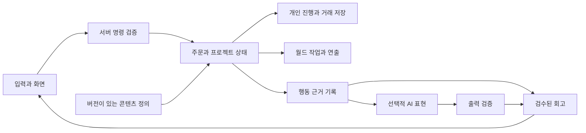

# KidSim / Open Town 방향성 검토 보고서

작성일: 2026-11-11 (Asia/Seoul)

검토 상태: 문서·코드에 근거한 제안. 제품 전환이나 설계 원칙 변경을 승인·적용한 문서가 아님.

> **검토 시점 안내:** 이 보고서는 고정 사건 5개와 `SimEngine`을 사용하던 구현에 대한 기록이다. 코드·기존 문서 링크는 해당 구조의 [기준 커밋 `b0bf7e8`](https://github.com/Jhvictor4/kidsim/tree/b0bf7e80dfcb348553ff575dba74a6954210a288)에 고정했다. 이후 도입된 랜덤 고객 에이전트·멀티플레이 레인 구조는 이번 평가 범위에 포함되지 않는다. 본문의 ‘현재 구현’은 검토 당시를 의미한다. 원본 PDF 2개와 경제 XLSX는 검토 당시의 로컬 첨부 자료이며, 게시 시점 저장소에는 포함되어 있지 않다.

## 1. 종합 판단

**현재 KidSim은 짧은 생활기술 연습과 디브리프를 보여주는 해커톤 시제품으로 합당하다. 다만 첨부 문서가 제안하는 Open Town의 초기 구현이라고 보기에는 핵심 플레이와 지속 성장 구조가 빠져 있다. 권고는 기존 구현을 폐기하는 것이 아니라, 결정적인 규칙과 근거 기반 회고를 유지하면서 ‘합의한 조건을 실제로 실행하고, 그 성과가 내 공간에 남는 작은 게임’으로 확장하는 것이다.**

Open Town의 가치는 큰 맵이나 많은 직업에서 나오지 않는다. 예산·역할·반납 조건을 비교한 선택이 운반, 설치, 운영, 정리로 이어지는 데 있다. 이 연결을 구현하면 현재의 선택지 중심 체험에서 부족했던 행동의 의미와 재방문 이유를 보완할 수 있다. 문서도 작은 골목과 첫 야시장부터 검증하도록 제안한다. [G pp.3–4, 10, 18, 62–64; S pp.6–10]

반면 48개 아이템, 6개 프로젝트, 결제, 협동, 방문을 한 번에 구현하면 학습 경험을 검증하기 전에 제작·운영 비용이 커진다. **다음 목표는 ‘카페 1종 + 첫 야시장 3계약 + 실제 이행 + 저장되는 기념품’의 완성된 한 구간**이어야 한다.

핵심 결정 권고는 다음과 같다.

| 판단 | 권고 |
|---|---|
| 유지 | 서버 권위, 결정적 결과, 팩별 콘텐츠 정의, 코드로 생성하는 월드, 서버 전용 키, 실패 시 진행 가능한 구조 |
| 즉시 수정 | 재고보다 많은 상품을 파는 혼합 주문, 실패 행동을 칭찬하는 평가 폴백, 현금과 이익의 혼동 |
| 우선 추가 | 조건 확인 → 계약 → 실행할 약속 → 실제 완료 → 짧은 회고 → 소유 공간 변화 |
| 원칙 수정 제안 | 자유 발화 의무화 대신 채팅 없이도 정보 확인·역할 선택·약속 이행 가능. LLM 평점으로 경제 결과를 바꾸지 않음 |
| 제품화 조건 | 모바일 사용성, 저장·재접속, 단계별 재시도, 연령별 접근과 AI 입출력 경로 검증 |
| 후순위 | 다인 협동, 방문, 유료 외형, 다수 업종, 장기 AI 대화 기억, 교차 서버 기능 |

현재 상태의 판정은 **‘핵심 아이디어 유지, 제품 루프는 보강, 공개 제품 수준의 준비는 추가 검증 필요’**다. 재미·재방문·교육 효과·수익성이 입증됐다는 판정은 아니다.

## 2. 검토 근거와 범위

### 2.1 자료

- **[G] Open Town 게임 기획과 개발 명세 v1.0** (`open_town_game_design_v1.pdf`, 로컬 첨부): 68페이지. 제품 원칙, 경제, 프로젝트, 기술 책임, 검증·출시 계획.
- **[S] Open Town 첫 체험 스토리보드 v1.0** (`open_town_storyboard_v1.pdf`, 로컬 첨부): 12페이지. 16개 장면과 분기, 화면, 실행·저장 기준.
- **[E] Open Town 아이템·경제 설정 v1.0** (`open_town_items_economy_v1.xlsx`, 로컬 첨부): 최종 파일 확인에서 추가 확인한 7개 시트. 대표 정산·계약·카탈로그의 보조 대조 자료.
- **[R] [README](https://github.com/Jhvictor4/kidsim/blob/b0bf7e80dfcb348553ff575dba74a6954210a288/README.md), [AGENTS](https://github.com/Jhvictor4/kidsim/blob/b0bf7e80dfcb348553ff575dba74a6954210a288/AGENTS.md)**: 검토 당시 제품 의도와 기존 검증 기록.
- **[C] 검토 당시 `src/` 구현**: 엔진, 팩, 에이전트, 통신, 월드, 클라이언트 UI. 상세 위치는 §12.
- **[V] [기존 디브리프 캡처](https://github.com/Jhvictor4/kidsim/blob/b0bf7e80dfcb348553ff575dba74a6954210a288/demo/debrief-after-sortorder-fix.jpg)**: 당시 회고 화면의 정보량과 표현 확인.
- **[W] Roblox 공식 문서**: AI·채팅·목표 연령 관련 변경 가능한 사실만 별도로 재확인. §8의 링크 참조.

G/S 표기는 PDF의 실제 페이지 순서를 따른다. 두 문서 전체 텍스트를 검토했고, 성장 루프 도식, 계약 비교, C계약 중간 인도, HUD 와이어프레임은 렌더링된 페이지로 확인했다. 코드 줄 번호는 검토 시점의 1-based 번호다.

### 2.2 사실과 제안의 구분

문서에 적힌 구현 지시와 수용 기준은 **검토 대상인 설계안**으로 취급했다. 이번 사용자 요청은 방향성 검토 및 보고서 작성이며, 해당 지시를 실행하거나 기존 설계 원칙을 변경하라는 요청으로 해석하지 않았다.

이번에는 Studio 플레이, 실제 모바일, 동시 접속, 게시 권한, 저장 장애, 외부 LLM 호출을 재실행하지 않았다. AGENTS의 완주·폴백 0회는 기존 기록이며 이번 검증 결과가 아니다. 재고·현금 수치는 코드의 상수를 이용해 별도로 산술 재계산했다. 비밀 파일의 내용은 열람하지 않았다.

최종 확인에서 경제 XLSX도 확보되어 대표 수식과 입력값, 카탈로그 ID·출시 단계·기능 원본·면적 일치를 추가 점검했다. XLSX는 수정·재계산·저장하지 않았고, 저장된 계산값과 수식을 읽어 핵심 산술을 독립 대조했다. 전체 Excel 동작이나 모든 해금 조합을 검증한 것은 아니다. 별도 CSV와 서버 카탈로그로의 배포 연결은 확인하지 못했다. [G pp.1, 31; E]

## 3. 현재 제품과 제안 제품은 어디가 다른가

| 관점 | 현재 KidSim | Open Town 문서 | 검토 판단 |
|---|---|---|---|
| 주된 약속 | 생활기술을 연습하고 디브리프로 이름 붙이기 | 가게를 운영·꾸미고 이웃과 프로젝트를 완수하기 | 단순 콘텐츠 추가보다 제품 경험의 전환에 가까움 |
| 기본 루프 | 사건 5개 → 선택 → 수치 변화 → 회고 → 초기화 | 운영 → 수입 → 공간 변화 → 의뢰·합의 → 실행 → 성장 | 현재에는 반복 방문을 지지할 소유·진행 구조가 없음 |
| 플레이어 행동 | 자유 채팅, 코치, 결과 버튼 | 이동·제작·전달·배치·역할·반납 | 새로운 월드 상호작용과 상태 검증이 필요 |
| 선택의 결과 | 미터·재고와 반응 대사 | 비용뿐 아니라 앞으로 할 일과 운영 조건 변화 | 가장 가치 있는 확장 지점 |
| 대화 | LLM 역할극이 차별점 | 자유 채팅 없이도 핵심 진행 가능 | ‘첫 자유 발화 필수’는 문서와 충돌 |
| 대상·언어 | 10–13세, 영어 | 11–14세 가정, 한국어·모바일 우선 | 같은 타깃이라고 뭉뚱그리지 말고 실험 집단 확정 필요 |
| 경제 | 달러 현금·평판·낭비·소모 재고 | TC·프로젝트 PB·XP, 후속 DG | 기존 수치를 새 경제에 그대로 이식하면 안 됨 |
| 결과 표현 | 비교적 긴 전체 화면 디브리프 | 행동 두 문장, 공간 변화, 기념품, 다음 목표 | 기존 회고의 강점은 간결한 기록 카드로 이어갈 수 있음 |
| 산출물 | 90초 데모 | 12–15분 첫 플레이와 지속 서비스 | 영상 길이와 실제 세션 길이를 별도 목표로 관리 |

근거: [R README·AGENTS; G pp.1–4, 7–11, 26–29, 38; S pp.1–2, 10–11].

**권장 제품 설명:** “내 가게와 동네를 바꾸는 프로젝트를 하면서, 조건을 묻고 약속을 정하고 끝까지 실행하는 게임.” KidSim은 이 경험을 지탱하는 시뮬레이션·회고 기반으로, Open Town은 첫 소비자 경험으로 설명할 수 있다. 이는 두 개의 별도 서비스를 동시에 개발하자는 제안이 아니다.

해커톤 피치에서는 ‘Isaac Sim, but for kids’가 목적을 빠르게 전달한다. 실제 어린이용 첫 화면은 ‘오늘 어떤 가게를 만들까?’처럼 바로 할 행동을 보여주는 편이 적절하다. 기술적 비유만으로 아이에게 플레이 동기가 생기는지는 별도 문제다.

## 4. 문서 요구사항 대비 현재 구현

‘미구현’은 기존 90초 데모의 실패를 뜻하지 않는다. 새 목표로 전환할 때 필요한 차이를 나타낸다.

| 문서 항목 | 현재 확인 결과 | 상태 | 다음 완료 기준 |
|---|---|---|---|
| REQ01 주문·제작·전달·정산 | 선택지로 거래 확정. 실제 조리·전달 단계 없음 | 부분 기반 | 서버 주문 ID로 실제 1회 완료·1회 정산 |
| REQ02 소유품 배치·통로 | 고정 카페 생성. 소유·배치 편집 없음 | 미구현 | 소유 화분 배치·회수, 출입구 차단 방지 |
| REQ03 예산과 3계약 | 할인 사건은 있으나 PB·계약 없음 | 개념 일부 | PB120에서 총액100/120/110, 개인 TC와 분리 |
| REQ04 약속 실행 | 버튼 직후 대사·수치 확정 | 핵심 공백 | 계약에서 생긴 운반·인도·반납이 실제 완료 조건이 됨 |
| REQ05 영구 성장 | 새 회차에 초기 상태 생성 | 미구현 | 기념품·간판·목표가 재접속 후 복원 |
| REQ06 소셜 권한 | 플레이어별 엔진이 같은 월드 사용 | 별도 설계 필요 | 동시 접속해도 다른 사람의 NPC·소유품·진행에 간섭 없음 |
| REQ07 결제 신뢰 | 구매 시스템 없음 | 후순위 | 판매 도입 시 영수증 중복·장애 복구 검증 |
| REQ08 개인 아이템 | 메뉴 재고만 존재 | 미구현 | 기념품 소유·출처·배치가 일관되게 저장 |
| REQ09 중단 복구 | 메모리 세션. LLM 폴백은 있으나 영구 복구 없음 | 부분 기반 | 주문·계약·보상 중단 지점별 안전한 재개 |
| REQ10 접근성 | 버튼만으로 진행 가능. 고정 폭 UI 다수 | 부분 기반 | 채팅 OFF·터치·작은 화면·소리 OFF에서 완주 |
| 행동 근거 회고 | 로그와 디브리프 존재, 평가 오류 가능 | 재사용 가치 큼 | 실제 수행 근거만 표시, 잘못된 칭찬 방지 |

요구사항 출처: [G pp.4–5]; 구현 근거: [C1–C7, §12].

## 5. 확장 전에 수정할 현재 문제

### 5.1 재고를 초과하는 ‘정직한 판매’ — P0

`CafeShift.luau:193–198`의 `honest_mix`는 크루아상 1개만 있으면 허용되지만, 크루아상 4개와 쿠키 1개를 차감하고 $14를 받는다. `SimEngine.luau:142–158`은 부족한 재고를 0으로 보정한다.

| 좋은 플레이 경로 | 현금 | 크루아상 | 쿠키 |
|---|---:|---:|---:|
| 시작 | 20 | 5 | 8 |
| 첫 주문 + 쿠키 | 29 | 4 | 7 |
| 정가 + 무료 쿠키 | 33 | 4 | 6 |
| 잘못된 주문 교체 | 33 | 3 | 6 |
| 현재 혼합 주문 | 47 | 0으로 보정 | 5 |
| 테이블 정리 교환 | 47 | 0 | 4 |

큰 주문 직전에는 크루아상이 3개다. 그런데 4개를 판매한 금액을 받으므로 **‘실제 재고를 보고 정직하게 제안했다’는 피드백이 게임 상태와 맞지 않는다.** 기존 $47·평판84·낭비1은 현재 규칙의 계산 결과일 뿐, 올바른 거래의 기준값은 아니다.

수정은 재고 부족을 숨기는 방식이 아니라 거래를 검증하는 방식이어야 한다. 단기적으로 가용 수량에 맞는 거래안을 생성하고, 판매 수량·필요 재고·매출·로그를 같은 서버 계산에서 확정한다. 음수 보정은 거래 검증을 대신할 수 없다.

예를 들어 크루아상 3개 + 쿠키 2개로 다섯 개를 채우면 매출은 $13이며 최종 현금은 $46이다. 이는 **가능한 수정 예시**이지 확정된 새 밸런스가 아니다. 수정안을 채택한 뒤 데모 결과와 AGENTS §5를 함께 갱신해야 한다. `overpromise`도 $9를 더하면서 판매 재고는 차감하지 않아 거래 설명을 다시 정의할 필요가 있다. [C3:193–215]

### 5.2 실패 행동을 ‘잘한 점’으로 분류하는 폴백 — P0

`AgentRuntime.luau:164–187`은 모든 선택의 `logLine`을 `wentWell`에 넣고 `wentWrong`을 빈 배열로 반환한다. 잘못된 주문에 책임을 회피하거나 재고를 과잉 약속한 기록도 같은 경로를 탄다. 정상 평가와 폴백 모두 ‘기술 최대 3개’를 코드로 강제하지 않는다. [C2:149–187]

폴백을 부수적인 예외 처리로 취급하면 안 된다. **검수된 규칙 기반 회고를 기본 결과로 만들고, LLM은 그 사실의 표현을 보조**하도록 바꾸는 것이 적절하다. 각 행동에는 근거 ID, 수행 결과, 주의점, 회복 방법을 연결한다. 기술 개수·허용 태그·근거 ID·출력 길이를 검증하고, 근거 없는 평가 부분은 표시하지 않는다. 실수한 행동도 ‘연습한 기술’에는 포함할 수 있지만 ‘잘했다’와 동일시하지 않는다.

### 5.3 현금·매출·이익과 낭비의 의미 — P1

커피 원가 약 $2는 컨텍스트·코치 설명·로그 등 설명 텍스트에만 등장하고, 쿠키의 원가는 계산되지 않는다. 따라서 무료 쿠키로 ‘대부분의 마진을 보존했다’는 설명은 구현된 경제만으로 확인할 수 없다. 현재 Cash 증가는 이익 증가의 증거가 아니다. [C3:109–140]

기존 CafeShift를 유지한다면 현금 유입·재고 소모·원가 가정을 구분해 설명해야 한다. Open Town 경제로 옮긴다면 문서의 일반 주문 `매출16 - 원가6 = 순증10TC`를 별도 규칙으로 구현한다. 문서는 초기 원재료 사전 구매 재고 경제를 제외하므로, 두 모델을 근거 없이 섞지 않는다. [G pp.8–9, 26–27]

잘못된 주문을 고친 비용, 피할 수 있었던 폐기, 의도적인 나눔도 구별해야 한다. 현재는 교체·환불과 Joon에게 그냥 무료로 주는 선택에 Waste가 붙으며 UI는 증가를 빨간색으로 표시한다. Mr. Park에게 무료 쿠키를 제안하는 선택에는 Waste가 없다. ‘배고픈 아이를 도우면 낭비, 일을 시키면 최선’이라는 보편적 교훈으로 읽히지 않도록 자원 제약·도움의 목적·경계 설정을 함께 다룬다. [C3:150–174, 229–247; C6:513–551]

### 5.4 선택이 실행을 대신함 — P1

현재 첫 대사 직후 재고 조건을 통과한 선택지를 즉시 공개하고, 결과는 선택지 `deltas`로 확정한다. 자유 채팅은 대화와 평가용 로그에 남지만 거래 조건이나 다음 작업을 바꾸지 않는다. 이는 짧은 선택형 데모에는 맞지만 ‘행동으로 배우기’에는 부족하다. [C1:246–309]

우선 해결책은 채팅을 강제하거나 LLM에게 평판 점수를 맡기는 것이 아니다. **조건을 확인한 뒤 선택한 약속이 실제 작업이 되게 하는 것**이다. `earn_it`의 테이블 닦기처럼 현재 대사로만 일어난 일을 실제 과제로 만들거나, 새 P01 계약의 운반·반납을 구현하는 것이 방향성 검증에 더 직접적이다.

AGENTS §7의 ‘첫 발화 뒤 선택지 공개 + LLM 평판 ±1~2’는 기존 §3의 ‘결과는 결정적’과 긴장 관계에 있다. 두 요소를 섞기보다 구조화된 행동은 서버 규칙으로, 언어 표현 피드백은 경제와 분리된 참고 정보로 다루는 방향을 권한다. 기존 원칙을 바꾸는 결정은 이 보고서와 별도로 기록해야 한다.

### 5.5 입력·비동기 실패·동시 접속 — 제품화 전 필수

- **입력 대기열:** 플레이어·타입·문자열 길이는 확인하지만 사건 ID, 요청 ID, 단계 버전, 빈도·큐 상한은 없다. 오래된 입력이 다음 사건에 쓰이거나 호출 비용이 증가할 가능성을 막아야 한다. [C1:168–209]
- **응답 검증:** HTTP·JSON 실패 처리는 있으나 일부 응답 구조는 타입 확인 없이 접근한다. ‘파싱 가능한 잘못된 JSON’도 폴백으로 처리해야 한다. 사용자가 나갔거나 사건이 바뀐 뒤 도착한 답변은 버린다. [C7:106–142]
- **공유 월드:** 각 플레이어의 상태는 나뉘지만 `world`와 `currentNpc`는 공유한다. 두 명이 접속하면 서로의 NPC나 간판을 바꿀 수 있는 구조다. 현재 단일 플레이어 데모의 제약을 협동 지원으로 오해하면 안 된다. [C4:17–28; C5:193 이후]
- **모바일:** 인트로 560, 디브리프 640 픽셀 고정 폭과 선택지 높이38은 작은 화면에서 확인이 필요하다. 실제 실패를 재현한 것은 아니지만 모바일 우선 요구를 충족했다고 볼 근거가 없다. [C6:339, 415, 469; G p.37]

## 6. Open Town 문서 자체의 타당성과 보완점

### 6.1 잘 설계된 부분

계약마다 돈·운반·규모·반납 조건이 다르고 모두 유효한 완료 경로라는 점이 좋다. 특히 C계약의 ‘첫 주문 후 조명 인도 → 기본등으로 둘째 주문’은 선택이 실제 플레이를 바꾸는 명확한 사례다. PB 잔액을 개인 돈으로 바꾸지 않고 기본 보상을 같게 한 것도 무조건 최저가만 고르는 동기를 줄인다. [G pp.10, 27–28; S pp.2, 6, 9]

읽는 속도로 실패시키지 않는 단계 기반 약속, NPC 대체, 재배치·늦은 반납을 통한 회복, 저장 확인과 연출의 구분도 유지할 가치가 있다. 결과를 기념품과 공간 변화에 남기는 방식은 현재의 회고가 다음 플레이로 연결될 경로를 제공한다. [G pp.11–15; S pp.9–12]

### 6.2 정리해야 할 문서 충돌과 불명확성

| 항목 | 근거·문제 | 수정 제안 |
|---|---|---|
| 방문 기능의 단계 | p.3·p.63은 확장/베타, p.40·p.53은 MVP 방문 포함 | 솔로 프로토타입 / 첫 MVP / 소셜 확장 범위표를 하나로 통일 |
| 공개 전 콘텐츠 범위 | p.63은 P02–P06 순차 확장, p.64 일정표는 47개·L6·6프로젝트가 출시 전 필수처럼 읽힘 | 첫 공개 게이트와 확장 일정을 별도 표로 분리 |
| 판매 OFF 상태의 결제 구현 | p.40·p.65는 MVP에서 DG·영수증 기술 구현 요구 | 학습·재미 검증 시제품은 경계만 준비하고 실제 결제 구현은 후속으로 조정하는 안 검토 |
| 데이터 배포 경로 | XLSX는 확인됐지만 p.31의 CSV와 서버 카탈로그 연결은 미확인 | 카탈로그·경제·미션의 원본과 버전·내보내기 책임을 정하고 PDF도 같은 버전 참조 |
| 목표의 약속 범위 | S p.4에서 옥상 정원 제시, G p.29에서는 L9 후속 범위 | 지금 도달할 목표와 장기 콘셉트를 분리. 구현되지 않은 목표를 즉시 얻을 보상처럼 제시하지 않음 |
| 시간 가정 | S는 14분 장면표, G는 12–15분 가정과 자유로운 읽기 | 읽기·이동·입력·도움·재시도를 따로 측정. 장면 타임코드는 타임아웃으로 쓰지 않음 |
| 소유 경험 기준 | P01은 첫3분, MET01은 첫5분 | 3분은 디자인 목표, 5분은 측정 창이라는 차이를 명시 |
| 채팅 원문 접근 설명 | G p.53은 플랫폼 통합 채팅의 전제·적용 시점이 충분히 드러나지 않음 | 현재 활성화 조건과 2027년5월 예정 전환을 구분하여 갱신 (§8) |

이들은 설계 전체를 폐기할 이유가 아니라 제작 단계에서 범위가 불어나는 것을 막기 위해 해결할 항목이다.

### 6.3 추가로 검증할 설계 위험

**동일 보상만으로 세 선택이 동등하게 흥미로워지지는 않는다.** B가 배송·회수까지 포함하고 작은 조명의 불편이 체감되지 않으면 가장 쉬운 선택으로 고정될 수 있다. A의 큰 조명, B의 작은 공간 설계, C의 운영 전환이 각각 다른 선호·제약에 맞는지 관찰해야 한다. 반복 완료 시간의 차이가 시간당 보상 편중으로 이어지는지도 확인한다. 필요한 것은 특정 선택에 벌금을 붙이는 것이 아니라 공간·작업의 차이가 의미 있게 드러나는 것이다.

**회복 가능성과 무의미한 선택도 구별해야 한다.** 영구 손실을 주지 않더라도 잘못된 동선은 다시 배치해야 하고, 누락한 반납은 실제로 마쳐야 한다. 결과를 보여준 뒤 고칠 기회를 주어야 판단과 수정이 학습된다.

**질문을 눌렀다는 사실만으로 이해를 인정할 수 없다.** 공개 기본안만으로도 완료 가능해야 한다는 접근성 원칙은 유지하되, 다음 변형 과제에서 운반 제약이나 반납 조건을 바꿔 실제 비교·조정이 일어나는지 본다. [G pp.14, 38, 63]

### 6.4 경제 설정표 추가 대조

| 확인 범위 | 결과 | 근거 위치 |
|---|---|---|
| 일반 영업12건 | 매출192 - 원가72 = 순증120TC, XP24 | `균형값!C8:C12`, `플레이정산!B6:B13` |
| 첫 체험 대표 경로 | 185TC·82XP로 두 PDF와 일치 | `플레이정산!B18:B24`, 관련 입력 `균형값!C6:C25` |
| A/B/C 계약 | 총액100/120/110, 잔액20/0/10, 첫 보상120TC·60XP 동일 | `플레이정산!B35:I37`, `프로젝트!C18:G20` |
| 카탈로그 수·단계 | 48개 = MVP19 + 출시확장28 + 후속1 | `아이템!A7:A54`, `H7:H54` |
| 식별자·기능 원본·면적 | ID 중복 및 없는 기능 원본 없음. 다른 원본을 참조하는 항목의 면적 차이 없음 | `아이템!A7:A54`, `J7:L54`의 원본 값 독립 비교 |
| 저장된 오류값 | 저장된 셀에서 Excel 오류값 미발견 | 전체 시트의 저장값 스캔. 새 재계산 통과를 의미하지 않음 |

설정표는 경제 원본을 정리하는 좋은 출발점이며, 대표 수치에서 PDF와 충돌을 찾지 못했다. 그러나 `검증` 시트의 ‘정상’은 설정 데이터 대조 결과다. 같은 시트의 서버·영수증·이탈 테스트는 ‘미검증’으로 남아 있다. 이를 실제 게임 완성도나 경제 밸런스 검증으로 해석해서는 안 된다. [E `검증!A6:F33`]

## 7. 권장 추가 방향: 작은 완성 구간

### 7.1 다음 시제품의 한 문장 목표

**“첫 야시장의 조건을 비교하고, 내가 맡은 일을 실제로 끝낸 뒤, 내 가게에 그 결과를 남긴다.”**

다음 범위를 갖춘 한 구간을 권한다. 문서의 19개 MVP 레코드 전체보다 앞선 학습·플레이 검증용 축소안이며, 정식 MVP 범위를 몰래 바꾸는 제안은 아니다.

| 구간 | 플레이어가 하는 일 | 남아야 할 증거 |
|---|---|---|
| 내 공간 | 무료 간판 스타일 선택 | 확정 스타일·다음 접속 복원 |
| 첫 운영 | 커피 주문 접수·제작·전달 1회 | orderId·매출·원가·순증 |
| 첫 배치 | 화분1개 구매 확인·배치·회수 | 소유·구매와 배치 구분·통로 유효 |
| 조건 파악 | 운반·규모·반납 조건 확인 | 확인한 conditionId 또는 공개안 사용 |
| 합의 | A/B/C 계약의 총액·약속 확인 | offerId·정의 버전·약속 목록 |
| 실행 | 계약별 설치와 행사 주문2건 | 실제 task 완료·C 중간 인도 |
| 마무리 | 남은 반납·정리 | 미완료 약속0·정산1회 |
| 결과 | 행동 두 문장·기념품·다음 목표 | 실제 근거·소유·재접속 후 유지 |

맵은 가게·광장·대여점이 보이는 작은 골목이면 충분하다. 실제 제작·이동·반납을 단순한 버튼 연타나 긴 이동 대기로 늘리지 않는다. 공간 배치는 우선 제한된 유효 위치나 간단한 격자로 검증하고, 넓은 자유 건축은 후순위로 둔다.

이 구간의 완성은 첫 세션의 연결을 검증하는 단계다. 자유 운영·꾸미기·의뢰 선택이 지속되는 제품 루프는 다음 세션의 자발적 선택과 복귀로 별도 확인해야 한다. [G p.7]

### 7.2 계약 결과의 기준

| 계약 | 공통비 | 장비비 | 총지출 / PB 잔액 | 고유한 이행 |
|---|---:|---:|---:|---|
| A | 60 | 40 | 100 / 20 | 큰 조명 직접 운반, 행사 후 반납 |
| B | 60 | 60 | 120 / 0 | 배송된 작은 조명에 맞춰 설치·운영 |
| C | 60 | 50 | 110 / 10 | 첫 주문 뒤 포장·인도, 기본등으로 둘째 주문 |

문서의 대표 경로는 `80 + 10 - 25 + 120 = 185TC`, `2 + 60 + 20 = 82XP`로 산술상 일치한다. 행사 주문2건은 일반 영업 정산을 발생시키지 않는다. 화분 구매를 생략하면 210TC가 남으므로 185TC를 모든 정상 플레이의 필수 결과로 검증하면 안 된다. PB 잔액은 개인 지갑으로 이전하지 않는다. [G pp.11, 15, 27–28; S p.2]

### 7.3 회고를 유지하되 게임 안에 연결하기

첫 화면은 행동 두 문장과 다음 시도 하나로 제한하고, 자세한 근거는 선택적으로 펼치게 한다. 기념품에는 실제 계약·수행 기록을 붙인다. 예를 들어 C를 이행한 경우 다음처럼 표현할 수 있다.

> 큰 조명을 짧게 빌리는 조건으로 예산을 맞췄어요. 첫 주문 뒤 조명을 돌려주고 기본등으로 나머지 주문을 마쳤어요.
>
> 다음에는 운반을 도와줄 사람이 있을 때 어떤 조건이 편할지 비교해 봐요.

현실 연결은 ‘학교 행사 물품을 빌릴 때 반납 시점과 담당자를 미리 정하기’처럼 가까운 상황으로 제시한다. ‘협상 능력이 향상됐다’거나 ‘사회성이 좋다’는 인격·효과 판정으로 확대하지 않는다. 실제 도움을 받아 완료했다면 그 사실도 기록하며 도움 사용을 실패로 취급하지 않는다.

### 7.4 LLM의 역할

LLM은 제한된 상황의 반응, 이해를 돕는 선택적 힌트, 검증된 사실의 쉬운 표현에 사용한다. 계약 가격·유효 조건·약속 완료·통화 지급·성장 판정은 서버 규칙이 소유한다.

자유 채팅 OFF, LLM OFF 상태에서도 같은 핵심 진행과 기본 보상을 제공한다. 과제 행동 ID를 통한 조건 확인은 가능하되, 임의 문장을 조합해 플랫폼 채팅 제한을 우회하는 메시지 기능으로 만들지 않는다. AI가 없는 버전과 비교해 이해도나 몰입의 이점이 보이지 않으면, 출시 핵심 경로에서 AI 비중을 낮추는 것도 합리적이다.

## 8. 플랫폼·아동 대상 설계에서 확인할 조건

아래는 2026-11-11 확인한 공식 문서의 범위다. 실제 경험의 등급 판정이나 게시 승인 결과를 대신하지 않는다.

**외부 AI와 지속 대화.** Roblox는 외부 AI의 텍스트 입출력에도 TextChatService 등 안전 조치를 요구하며, 생성형 AI 기능 신고와 AI 대화 표시를 명시한다. 무제한 대화가 주목적이거나 이전 AI 대화 맥락을 다음 세션에 불러오면 Extended AI 기준에 들어가 Restricted, 18세 미만 접근 불가로 설명한다. 따라서 아동 대상 제품에 영속 대화 기억을 그대로 추가해서는 안 된다. [공식 생성형 AI 지침](https://create.roblox.com/docs/generative-AI)

**채팅 원문과 적용 시점.** 현재 플랫폼 통합 채팅은 Studio에서 활성화하며, 활성화 시 사용자 메시지 원문을 코드로 읽거나 기록·반출할 수 없다. 모든 게임에 대한 의무화는 공식 문서상 2027년5월 예정이다. G p.53은 이 조건과 일정을 명시해야 한다. ‘현재 모든 경험에서 이미 원문 접근이 불가하다’고 해석해서는 안 된다. [공식 플랫폼 통합 채팅](https://create.roblox.com/docs/chat/platform-integrated-chat)

**목표 연령 접근.** 공식 Kids and Select 문서는 16세 미만 대상 공개에 계정 검증·2단계 인증·콘텐츠 등급·평가 등을 요구하고, 일반 평가 경로에 최근60일 내 적격 이용자250명의 고유 플레이 기준을 설명한다. 실제 계정별 채팅은 확인 상태와 보호자·지역 조건에도 영향을 받는다. 개발 완료와 목표 연령의 접근 가능일은 별도로 관리해야 한다. [공식 Kids and Select 안내](https://create.roblox.com/docs/production/publishing/kids-and-select)

현재 `TextBox → Say Remote → 외부 LLM → TextLabel` 경로가 이 요건을 충족한다고 볼 근거는 확인하지 못했다. 이것은 기존 비공개 시제품을 곧바로 위반 판정한다는 뜻이 아니라, 아동 대상 사용·공개 전에 연결 방식을 검증해야 한다는 뜻이다. 단순히 표시 위치를 바꾸는 것으로 해결되지 않는다. `TextChannel:DisplaySystemMessage()`도 자동 필터를 수행하지 않는다. [TextChannel API](https://create.roblox.com/docs/reference/engine/classes/TextChannel)

다음 검증에서는 지원되는 외부 모델 연결 경로와 Roblox 제공 `TextGenerator`를 각각 확인할 수 있다. 후자는 대체 후보이며 현재 프로젝트의 권한·가용성·입력 흐름이 확인된 것은 아니다. [TextGenerator API](https://create.roblox.com/docs/reference/engine/classes/TextGenerator)

학습 기록은 과제·선택·실행·도움·회복의 구조화된 사건을 우선 저장한다. 원문 채팅 수집, 보관 기간, 외부 제공업체 전송·보존은 별도 운영 결정으로 다루고 필요한 범위만 사용한다. **완료한 프로젝트를 저장하는 것과 과거 AI 대화를 모델 기억으로 복원하는 것을 구별**해야 한다. 현재 `AgentRuntime.evaluate`에는 발화를 포함할 수 있는 전체 회차 로그를 외부 요청에 넣는 경로가 있다. [C2:203–212; G pp.6, 53, 62]

## 9. 기술 구조 변경 권고

### 9.1 재사용 범위의 정확한 평가

`SimEngine`의 카페 독립성과 `Pack` 계약은 좋은 출발점이다. 그러나 현재 계약은 순서대로 실행되는 사건·선택·대사·수치 변화에 적합하다. `WorldBuilder`는 카페이고 클라이언트에는 `waste` 특별 처리, `AgentRuntime` 폴백에는 소규모 사업 회고가 들어 있다. **프로젝트 전체가 이미 장소·장르와 무관한 엔진인 것은 아니다.** [C1, C2, C5, C6, C8]

새 선형 대화 팩은 모듈 추가로 가능하지만, 운반·배치·저장·협동은 새로운 공통 기능이 필요하다. README의 ‘팩 하나 교체로 끝난다’는 설명은 지원하는 사건 모델의 범위를 밝혀야 한다. 모든 기능을 `SimEngine`에 조건문으로 누적하거나, 문서의 12개 서비스를 처음부터 모두 만드는 양쪽 접근을 피한다.

### 9.2 최소 책임 분리

| 현재 파일·경계 | 권장 변경 |
|---|---|
| `Types.luau` | 선형 사건 계약을 보존하고 MissionDefinition·Offer·Promise·Task·버전·오류 응답 계약 추가 |
| `SimEngine.luau` | 회차 조정 책임 유지. 거래 검증·작업 완료 판정·저장을 별도 책임으로 추출 |
| `CafeShift.luau` | 현재 계산·평가 메타데이터 수정. 새 야시장은 별도 정의로 추가 |
| `AgentRuntime.luau` | 규칙 기반 회고·팩별 전이 예시를 기본값으로 제공. 생성 출력의 근거 검증 |
| `WorldBuilder.luau` | scene 또는 worldFactory로 장면 구분. 프로젝트·플레이어별 객체 소유 명시 |
| `Main.server.luau` | 프로필 준비 상태와 세션 수명 관리. 공유 월드/개별 월드 정책 명시 |
| `Main.client.luau` | 목표·주문·계약·약속·결과 화면을 작은 컴포넌트로 분리. 반응형 폭과 저장 상태 표시 |
| 새 프로필 경계 | 영구 TC·소유품·체크포인트를 한 쓰기 소유자가 관리. 재시도와 중복 반영 방지 |

처음부터 외부 백엔드를 도입할 이유는 확인되지 않았다. 문서의 단일 Place·모듈형 서버 방향을 유지할 수 있다. [G pp.39–44]

### 9.3 바뀌어야 할 핵심 계약

행동 명령에는 최소한 `requestId`, `session/attemptId`, `expectedRevision`, `actionId`와 필요한 대상 ID를 둔다. 서버는 현재 단계·소유·거리/상호작용 맥락·재고/예산·중복 여부를 확인한 뒤 결과를 만든다. 클라이언트의 ‘완료했다’는 주장이나 분석 이벤트 수신만으로 보상하지 않는다.

기존 `choice → 즉시 deltas`와 새 `offer → promises → tasks → settlement`는 다르다. 장비 계약은 비용과 약속을 확정하고, 실제 작업이 끝나야 완료 보상을 준다. C계약은 `첫 주문 → 중간 인도 → 기본등 → 둘째 주문` 순서가 서버 상태에 남아야 한다. [G pp.10, 14, 50–53; S p.9]

영구 저장은 체험의 마지막에 덧붙이는 기능이 아니다. 소유 공간을 약속하는 순간부터 필요하다. 프로필 로드 실패 시 새 기본 지갑으로 덮어쓰지 않고, 보상·소유권·중복 처리 키를 일관되게 확정한다. 실제 지급과 운영 분석을 분리해 분석 수집 실패가 보상을 중단하거나 다시 발생시키지 않게 한다. [G pp.43–50, 62]

## 10. 우선순위와 단계별 완료 기준

기간은 현재 투입 인력·경험·아트 준비를 확인하지 못해 확정하지 않는다. G p.64의 12–18주는 특정 소규모 팀 가정이며 현재 리포의 일정 보장으로 사용할 수 없다.

| 순서 | 작업 | 선행 조건 | 완료 기준 |
|---|---|---|---|
| P0-1 | 혼합 주문·거래 정합성 | 없음 | 모든 허용 경로에서 판매 수량·재고·금액 일치, 부족 재고 판매 없음 |
| P0-2 | 평가 폴백·근거 계약 | 없음 | 실패 행동의 무조건 칭찬 없음, 기술≤3, 없는 행동 지적 없음 |
| P0-3 | 제품 범위·연령·언어·AI 경계 기록 | 문서 비교 | 한 장짜리 기준안, 채팅 없이 완주 가능, AI 경로 검증 항목 명확 |
| P0-4 | 입력·응답 실패 경계 | 기존 흐름 | 오래된 요청·중복·과도 입력 차단, 잘못된 모델 응답에도 진행 복구 |
| P1-1 | 프로필·체크포인트·중복 방지 | P0-3 | 재접속 시 마지막 확정 상태 복원, 로드 실패로 초기화 없음 |
| P1-2 | 실제 주문1개·간판·화분1개 | P1-1 | 일반 주문10TC·화분25TC 각각1회, 이동·회수 무료 |
| P1-3 | P01 3계약·작업·반납 | P1-1·P1-2 | 계약별 의무 상이, C 순서 준수, 미완료 약속이 있으면 정산 불가 |
| P1-4 | 결과 카드·기념품·다음 목표 | P1-3 | 행동 근거와 보상 일치, 다음 접속에 흔적과 목표 유지 |
| P1-5 | 모바일·채팅OFF·오프라인 모델 검증 | 각 기능과 병행 | 텍스트·터치·키보드·안전영역 확인, 대체 경로로 완주 |
| P2-1 | 변형 과제·추가 콘텐츠 | 첫 구간 사용성·선택 이해 확인 | 새 조건에서도 비교·실행 가능, 하나의 버튼 암기 아님 |
| P2-2 | 방문·협동·역할 이탈 복구 | 솔로 저장 안정성 | 다른 소유권 침해 없음, 팀원 이탈 시 NPC로 완료 |
| P2-3 | DG·유료 외형 | 무료 성장·저장·운영 검증 | 영수증 중복/장애 시험 통과 후 별도 판매 활성화 |

P0-3과 플랫폼 검증은 사용자 테스트 전에 착수한다. 서버의 경제·안전·평가 계약이 준비되지 않은 상태에서 아동 실사용을 통해 문제를 찾는 순서는 권하지 않는다.

**확장 관문:** 첫 구간의 재미·이해도·저장 안정성에 근거가 모이기 전에는 P02–P06과 전체 카탈로그 제작을 확대하지 않는다. 다인 기능과 결제는 각각 독립적으로 중지할 수 있도록 두며, 결제 진입을 중지해도 기존 구매 처리·복구 책임은 유지한다. [G pp.63–66]

## 11. 검증 계획과 판단 기준

### 11.1 기술 검증

아래는 향후 구현 시 실행할 검증이며 이번 보고서에서 통과시킨 테스트가 아니다.

| 검증 | 통과 조건 |
|---|---|
| 기존 사건 경로 | 재고0·부족·정상 경로에서 불가능한 판매와 허위 수입 없음 |
| 평가 실패 | 모델OFF·타임아웃·배열/타입 오류·근거 없는 답변에도 사실에 맞는 회고 |
| 입력 경합 | 두 번 클릭·지난 단계 요청·늦은 답변이 현재 상태를 바꾸지 않음 |
| 3계약 실행 | A 반납, B 배송·배치, C 중간 인도가 각 정의대로만 요구됨 |
| 경제 대표 경로 | 화분 경로185TC/82XP, 생략 경로210TC/82XP. 행사 주문 일반 정산 없음 |
| 복구·멱등성 | 계약·주문·보상 전후 중단과 재시도에서 중복 지급·소유품 유실0 |
| 두 사용자 | 서로 다른 NPC·배치·프로필·진행 간섭 없음 |
| 접근성 | 채팅OFF·오디오OFF·모바일 터치·느린 읽기에서도 실제 완료 가능 |

거래·소유권·재접속은 오류의 영향이 커 자동 검증과 장애 주입이 필요하다. 단순 장식이나 화면 배치에는 구현을 복제하는 테스트 대신 시각·실기기 확인을 사용한다.

### 11.2 사용자 검증

초기 사용성 관찰은 예를 들어 목표 연령의 참가자 8–12명 규모의 탐색적 라운드로 시작할 수 있다. 이는 통계적 효과 검증 표본이 아니다. 플랫폼 접근 조건과 보호자 동의 등 실제 조사에 필요한 절차를 먼저 확정한다. 실제 학습효과 연구를 하려면 별도 설계가 필요하다.

| 가설 | 관찰할 행동 | 잘못된 대체 지표 |
|---|---|---|
| 목표가 이해된다 | 다음 행동을 찾고 스스로 시도함 | 안내 화면을 닫은 횟수 |
| 계약 차이를 이해한다 | 고른 조건의 비용과 해야 할 일을 설명하거나 구조화된 보기로 확인 | 특정 계약 선택률만 높음 |
| 선택이 실행에 연결된다 | 약속 목록을 확인하고 실제로 이행·회복함 | 정답 버튼 클릭 |
| 공간이 재방문 이유가 된다 | 자발적 배치·목표 선택, 후속 접속에서 목표 재개 | 세션 체류시간만 증가 |
| 새 조건에 대응한다 | 처음 보는 운반/시간/규모 조건에서 선택을 조정 | 같은 문제의 반복 점수 상승 |
| AI가 도움이 된다 | 동일 과제의 검수 대사 버전과 비교해 이해·막힘 해소 개선 | 대화량·모델 호출 수 |

화면 읽기 시간, 이동 시간, 과제 이해 실패, 저장 대기는 구분한다. D1·D7은 코호트와 분모를 고정하고 원시 인원도 함께 제시한다. 초기 표본으로 업계 평균이나 매출 전망을 만들어내지 않는다. [G pp.60, 63]

제품 다음 단계의 기준은 ‘혼자 핵심 흐름을 마친다’, ‘선택한 약속을 이해한다’, ‘적어도 하나의 성과를 내 공간에 남기고 다음 목표를 안다’다. 몇 %를 통과 기준으로 할지는 첫 라운드 전에 합의하고, 작은 표본에서 나온 비율은 탐색 결과로 해석한다. 데이터 유실·중복 지급·없는 행동을 평가하는 오류는 빈도가 낮아도 확장 전 수정한다.

현실 전이를 주장하려면 게임 밖의 새로운 과제, 사전 수준, 비교 조건, 지연 측정을 포함한 별도 검증이 필요하다. 현재 타당한 주장은 **‘이 기술을 연습하도록 설계했다’**이며 ‘실생활 능력 향상을 증명했다’가 아니다. [G p.38]

### 11.3 데모와 제품 검증의 분리

90초 데모는 실제 첫 세션을90초에 끝내게 만드는 목표가 아니다. 새 구간이 완성되면 도입8초, 조건·계약17초, 실행30초, 행동 근거 회고20초, 기념품·다음 목표15초 정도의 편집안을 사용할 수 있다. 이는 촬영 구성 예시이며 응답 속도나 실제 플레이 시간 보장이 아니다.

데모에서 가장 잘 보여야 할 것은 **같은 목표에 다른 약속이 생기고, 그 약속을 실제로 지켰다는 사실**이다. 기존 데모를 계속 사용한다면 재고 계산을 수정하고 새로운 기준 수치를 확인한 뒤 촬영한다.

## 12. 근거 위치와 후속 문서 수정 목록

### 12.1 코드 근거

| ID | 파일 | 주요 확인 위치 |
|---|---|---|
| C1 | [SimEngine.luau](https://github.com/Jhvictor4/kidsim/blob/b0bf7e80dfcb348553ff575dba74a6954210a288/src/server/SimEngine.luau) | 54–73 초기 상태, 142–164 수치 적용, 168–209 입력 큐, 246–309 대화·선택·로그, 347–352 사건 순회 |
| C2 | [AgentRuntime.luau](https://github.com/Jhvictor4/kidsim/blob/b0bf7e80dfcb348553ff575dba74a6954210a288/src/server/AgentRuntime.luau) | 149–161 평가 정리, 164–187 폴백, 190–237 평가 요청·재시도 |
| C3 | [CafeShift.luau](https://github.com/Jhvictor4/kidsim/blob/b0bf7e80dfcb348553ff575dba74a6954210a288/src/server/Packs/CafeShift.luau) | 18–65 팩·프롬프트, 109–140 할인·원가 설명, 150–174 컴플레인, 193–215 큰 주문, 229–255 나눔·교환 |
| C4 | [Main.server.luau](https://github.com/Jhvictor4/kidsim/blob/b0bf7e80dfcb348553ff575dba74a6954210a288/src/server/Main.server.luau) | 14–28 고정 팩·공유 월드·세션 생성 |
| C5 | [WorldBuilder.luau](https://github.com/Jhvictor4/kidsim/blob/b0bf7e80dfcb348553ff575dba74a6954210a288/src/server/WorldBuilder.luau) | 38–279 카페 생성, 193 이후 단일 NPC 관리 |
| C6 | [Main.client.luau](https://github.com/Jhvictor4/kidsim/blob/b0bf7e80dfcb348553ff575dba74a6954210a288/src/client/Main.client.luau) | 306–358 대화·선택·Busy, 415·469 고정 폭, 513–559 미터·디브리프 |
| C7 | [LlmClient.luau](https://github.com/Jhvictor4/kidsim/blob/b0bf7e80dfcb348553ff575dba74a6954210a288/src/server/LlmClient.luau) | 27–84 서버 설정 경계, 91–143 호출·파싱 |
| C8 | [Types.luau](https://github.com/Jhvictor4/kidsim/blob/b0bf7e80dfcb348553ff575dba74a6954210a288/src/shared/Types.luau) | 29–72 사건·팩·로그 계약 |

줄 번호는 후속 코드 변경에 따라 달라질 수 있다. 표에 기재한 구현 위험은 정적 분석 결과이며 재현이 필요한 동시성·네트워크 항목과 확정적인 데이터 오류를 본문에서 구분했다.

### 12.2 방향 승인 후 갱신할 문서

1. **제품 기준안:** KidSim 기반 위에 Open Town 경험을 만드는지, 해커톤 데모만 개선하는지 결정 기록. 권고는 전자이며 90초 데모는 별도 산출물로 유지.
2. **AGENTS §1·§2·§7:** 대상·언어·핵심 루프, 채팅 의무화·LLM 평판 보정 제안, 회고의 역할을 합의된 방향으로 정리.
3. **AGENTS §3:** 결정적 결과·서버 권위·키 경계 유지. 계약 이행을 지원하는 공통 기능의 확장은 별도 설계 결정으로 기록.
4. **AGENTS §5:** 거래 수정 후 좋은 플레이 결과 재산정. $47을 미리 $46으로 확정하지 않음.
5. **README:** 구현된 선형 팩과 계획 중인 실행형 프로젝트를 구분. 과거 검증과 현재 검증, 플랫폼 접근 조건도 분리.
6. **Open Town v1.1:** 방문·결제·콘텐츠의 단계 구분, 장기 목표 노출, 플랫폼 채팅 적용 시점, 데이터 원본 연결을 보완.
7. **개발 백로그:** §10 작업을 담당자·의존성·완료 기준과 함께 등록. 시간 추정은 실제 팀 역량을 확인한 뒤 수행.

이번 작업에서는 위 문서나 게임 코드를 변경하지 않았다. 이 보고서는 무엇을 유지하고, 무엇부터 수정하며, 어떤 증거를 얻은 뒤 확장할지를 검토하기 위한 산출물이다.
